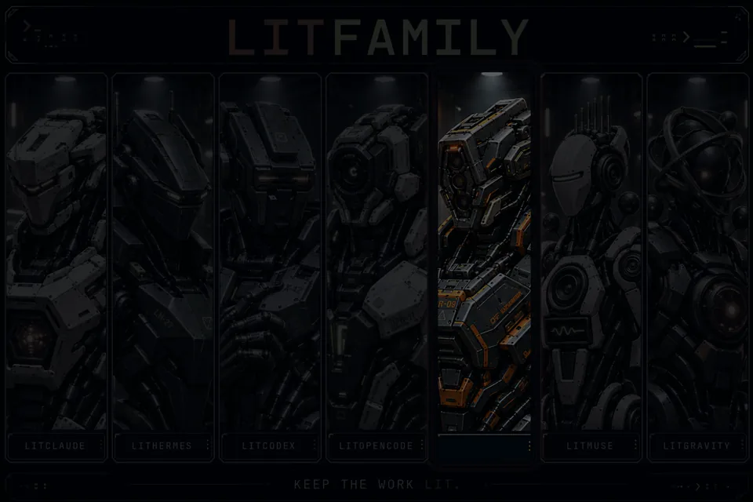
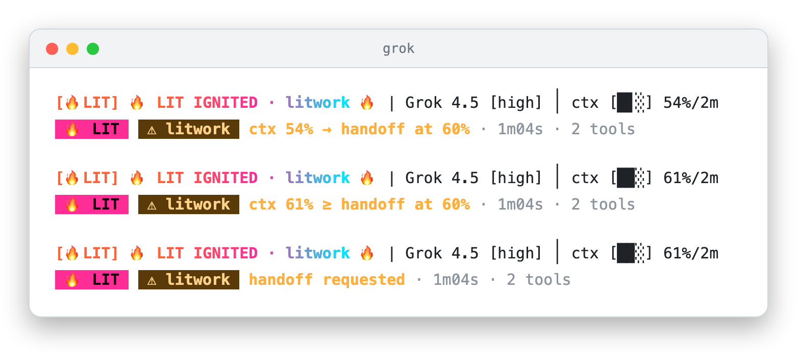
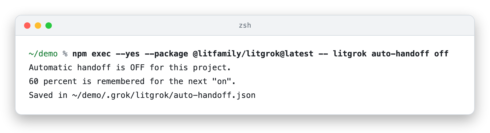
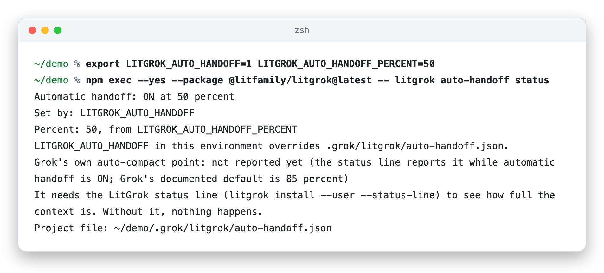
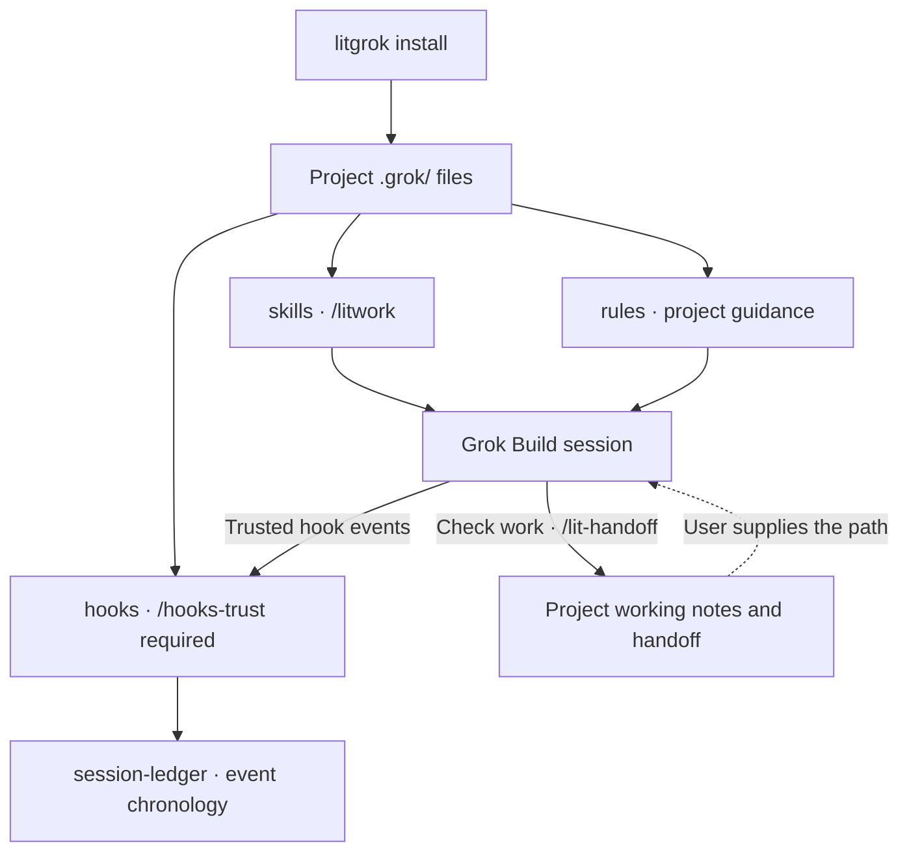
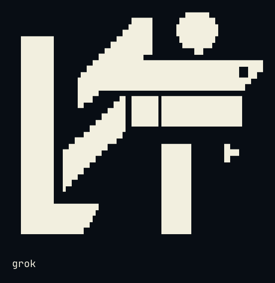

<p align="center"><picture><source media="(prefers-reduced-motion: reduce)" srcset="./docs/assets/cover-motion-still.webp" /><source media="(prefers-reduced-motion: no-preference)" srcset="./docs/assets/cover-motion.webp" /></picture></p>

<h1 align="center">LitGrok</h1>
<p align="center"><strong>Keep the work lit.</strong></p>

<p align="center">LitGrok gives xAI's Grok Build the habit of planning before it edits, checking what it built, and leaving a handoff, so tomorrow's session starts where today's stopped. One npm command adds its skills, project rule and hooks to your project.</p>

<p align="center">
<a href="https://www.npmjs.com/package/@litfamily/litgrok"></a>
<a href="https://www.npmjs.com/package/@litfamily/litgrok"></a>
<a href="./LICENSE"></a>
<a href="https://github.com/wjgoarxiv/litgrok/stargazers"></a>
</p>

<p align="center"><a href="#install-in-30-seconds">Install</a> &nbsp; <a href="./docs/guide.md"> Guide</a> &nbsp; <a href="./docs/skills.md">Skills</a> &nbsp; <a href="./docs/guide.md#watch-it-in-motion"> Film</a> &nbsp; <a href="./docs/guide.md#safety-and-uninstall"> Safety</a> &nbsp; <a href="./docs/reference.md">Reference</a> &nbsp; <a href="./README_ko-KR.md">한국어</a></p>

<!-- demo-gif --><p align="center"></p>

## Why LitGrok

Grok Build is quick to start. You type a line and it gets to work. The trouble comes later: a long session fills its context and gets compacted, the next session starts without what the last one knew, and "done" often just means the model said so. You end up explaining again where you were, and checking by hand what actually works.

LitGrok gives each session a routine to follow. A bigger change gets a written plan before the first edit. The work is checked against that plan, and anything nobody could check is marked as unverified. Before you stop, a handoff file records what was built, what was checked and what is left, so the next session can read it and carry on. Grok Build still runs the session and picks the model; LitGrok adds the way of working.

The film above is one real session. Stripped down to three lines, it goes like this:

```text
you typed   lit add a --shout flag that prints the greeting in capitals, with a test
it did      wrote the test first, changed greet.js, re-ran the tests and the CLI
it ended    node greet.js --shout Ada prints HELLO, ADA!   litwork complete · 35s · 2 tools
```

LitGrok is for anyone whose Grok Build work runs longer than one sitting: a feature spread over a few days, a bug you want a test to prove fixed, a report or a deck that someone else will read. It lives in your project as plain files, and LitGrok itself needs no account or sign-in.

## Install in 30 seconds

You need Node.js and Grok Build. Open an interactive terminal in the project you want to try, then run:

```bash
npm exec --yes --package @litfamily/litgrok@latest -- litgrok install
```

The files land in `<project>/.grok/`. Add `--dry-run` to see every destination first, or `--user` to install under `~/.grok/` instead. To pin this release, use `--package @litfamily/litgrok@1.0.24`. Running `install` again updates LitGrok, and it refuses to overwrite any file you edited. [Other install options, the optional status row and the safety checks](./docs/guide.md#install-options).

The optional status row is the quickest way to see where a session stands. Once a prompt starts a skill, it grows into a small LIT card. Its map, such as `plan ✓ ━━━━ [work 3/7] ━━━━ review · ──── done ·`, shows the stages behind you and the stage you are in with the plan tasks checked so far; the line under it names the next open task, the tool running right now and for how long, and how the last test run went. The title says whether the turn is running, just finished or needs you, and the last line keeps the model, the context gauge, the cost and the branch. The row lives in your user settings, so it comes with a user install (`litgrok install --user --status-line`). Add `--notify` to that command if you also want Grok's terminal notification each time a turn finishes, even while you are watching. Both stay off until you ask for them.

### Let a coding agent install it

If you would rather hand the install to a coding agent, open it in the project folder and paste the prompt below. It asks the agent to show you its plan and wait for your yes, to use only the official npm package, and to check the result before it reports back. An agent's shell has no terminal attached, which is why the install lines carry `--yes` and clear `NO_COLOR` and `CI`; without that the installer only previews.

```text
Install LitGrok, the skill pack for xAI's Grok Build, into this project.
Use only the official npm package @litfamily/litgrok. Do not clone repositories, run other install scripts or use any other package.
Before you change anything, show me your plan and wait for my yes.

1. Check that Node.js and Grok Build are installed and that this folder is the project's Git root. If it is not a Git repository, ask me before running git init.
2. Preview the install and show me where the files would go:
   npm exec --yes --package @litfamily/litgrok@latest -- litgrok install --dry-run
3. Install. Your shell has no terminal, so pass --yes and clear NO_COLOR and CI, or the installer only previews:
   env -u NO_COLOR -u CI npm exec --yes --package @litfamily/litgrok@latest -- litgrok install --yes
4. Ask me whether I also want the LitGrok status row. It is a user install: it copies LitGrok into ~/.grok/ and adds a status line to ~/.grok/config.toml after backing it up. Only if I say yes, run:
   env -u NO_COLOR -u CI npm exec --yes --package @litfamily/litgrok@latest -- litgrok install --user --status-line --yes
5. Verify: the install receipt says "Status: Ready", and the project now has .grok/skills, .grok/rules and .grok/hooks. If the output says "no files written", tell me the reason printed on that line instead of trying other flags.
6. Report what was written and where, anything the installer refused, and anything you could not check. Then remind me to restart Grok Build from the project's Git root and to trust the hooks with /hooks-trust.
```

## Quick start

1. Open (or restart) Grok Build from the project's Git root. In a plain folder, run `git init` yourself first: without a Git root the skills and rules load, but the hooks stay off. Grok runs project hooks only after you trust them, so review and trust them in `/hooks-trust`. [Other ways to trust them, and what to check when hooks don't show up](./docs/guide.md#hooks-do-not-show-up).
2. Check that `/skills` lists the LitGrok skills and `/hooks` lists the hook registrations.
3. Send a small first task that needs no external service:

```text
/litwork Build a to-do list in one index.html with no external dependencies. Implement add, complete, and delete. Leave the checks performed and the next step. Do not open a browser automatically; give me the steps to check it myself.
```

When the hooks are loaded, a new session opens with the LIT mark and the line `LitGrok payload present: skills, project rules, hooks, and the npx installer.` The reply to `/litwork` is asked to open with 🔥 **LIT IGNITED · litwork** 🔥, work through the checklist, and end with what it checked and what comes next. Then open `index.html` yourself and add, complete and delete an item. That click-through is the real test; anything you didn't get to try stays marked unverified. [Pictures of what LitGrok prints](./docs/guide.md#what-you-will-see-on-screen).

You can also begin a message with plain `lit` and describe the task. The project rule asks Grok Build to pick the matching skill, and your session shows which one it picked.

Before you stop for the day, ask for a handoff:

```text
/lit-handoff Record what we built, what we checked, and what remains. Tell me where you saved the handoff.
```

In the next session, give Grok Build the path it returned and ask it to read the handoff and check the current files before continuing. A new Git project keeps it at `.handoff/HANDOFF.md`. [Where handoffs go](./.grok/skills/lit-handoff/SKILL.md).

## What you get

It ships 39 skills, 11 agents, one project rule, and eleven hook registrations. Most days you will use a handful of them.

### A checklist for one task

`/litwork` turns a bounded task into a short checklist the session follows to the end. It records each check it ran and names the next step, so you can see what was done and what was only assumed.

```text
/litwork Fix the date parsing bug in src/dates.js and add a test that fails without the fix.
```

### Plan first, then build

For a larger change, `/lit-plan` writes a plan file with numbered rows and the checks for each one, and edits nothing yet. Once you have read and approved it, `/start-work` runs it row by row and ticks a row only after its checks pass.

```text
/lit-plan Add CSV export to the reports page, with tests.
/start-work <the plan path it printed>
```

### A second look before you merge

`/review-work` reviews a plan before work starts or the finished change after it. It picks the mode from what exists: a branch, a diff or ticked plan rows mean the change, and a plan with no ticked rows means the plan. `/review-work plan` and `/review-work work` force one. A change goes through six read-only lanes, and the findings are ranked by the evidence behind each one. It changes no files.

```text
/review-work the changes on this branch
```

### Research you can trace

`/litresearch` keeps a research question bounded, ties every claim to a source, and says plainly when the evidence is thin.

```text
/litresearch Which SQLite settings matter most for write speed in a small web app? Cite your sources.
```

### Slides, documents and prose

`lit-pptx` builds an editable PowerPoint deck and `lit-docx` a styled Word document, each with its Markdown source. Each picks a design direction for the job and names two alternatives you can switch to. `lit-humanizer` rewrites stiff English or Korean prose and keeps the facts.

```text
/lit-pptx A six-slide update on this quarter's support tickets for Monday's team meeting.
/lit-humanizer docs/intro.md
```

### The routes at a glance

| Type this | What happens |
| --- | --- |
| `/litwork` | Starts the shipped work checklist for a bounded task. |
| `handoff` or `/lit-handoff` | Carries the checked result and the next step into another session. |
| `/lit-brainstorm` | Opens a question into many options and a short list to pick from. |
| `/lit-plan` | Writes a plan with concrete checks. |
| `/start-work <approved-plan>` | Executes a plan you approved. |
| `/review-work` | Reviews a plan before work or a change after it, with its evidence. |
| `/litresearch` | Runs bounded, source-traceable research without overstating the evidence. |

[All 39 skills, with a picture of what each one gives you](./docs/skills.md).

## Automatic handoff

A long session slowly fills Grok's context window. When it is nearly full, Grok compacts the conversation, and the details of what you were in the middle of get squeezed out. Automatic handoff has the model write its handoff while it still remembers everything, so after the compaction it can pick up exactly where it was.

It stays off until you turn it on, and the percent is always your choice. The setting belongs to one project and lives in that project's `.grok/litgrok/auto-handoff.json`. LitGrok learns how full the context is from the optional status row, because Grok shares that figure with the status row and with no hook, so add the row first; it lives in your user settings and only needs doing once. The Stop hook that does the asking is a project hook like the others, so it runs in a trusted Git root (`/hooks-trust`).

```bash
npm exec --yes --package @litfamily/litgrok@latest -- litgrok install --user --status-line
npm exec --yes --package @litfamily/litgrok@latest -- litgrok auto-handoff on 60
```

Run the second line inside the project; from a subfolder it finds the Git root on its own. `auto-handoff status` then reads the setting back, says where each part of it came from, and warns you about anything that would keep it from working.

<p align="center"><picture><source media="(prefers-color-scheme: dark)" srcset="./docs/assets/auto-handoff/auto-handoff-on-dark.webp" /></picture></p>

### What you see in a session

Once the context comes within ten points of your percent, the status row shows a yellow warning with how close it is. When a turn ends at or above your percent, the Stop hook keeps the model going for one more step and asks it, once, to write the handoff with the `lit-handoff` procedure. The card then reads `⚠ handoff requested`. When the packet is saved, the model ends with one plain line: "Handoff saved. Run /compact now."

<p align="center"><picture><source media="(prefers-color-scheme: dark)" srcset="./docs/assets/auto-handoff/auto-handoff-session-dark.webp" /></picture></p>

That is your cue to type `/compact`, since Grok lets no hook start a compaction. After it, the next time a turn ends, LitGrok points the model at the handoff this session saved and asks it to check the current files and continue from the next steps written there. Grok also compacts on its own at 85 percent unless you changed that, so choose a percent below it.

### Turning it off, or deciding per shell

`auto-handoff off` stops it for the project and keeps your percent, so a plain `auto-handoff on` later brings back the same number.

<p align="center"><picture><source media="(prefers-color-scheme: dark)" srcset="./docs/assets/auto-handoff/auto-handoff-off-dark.webp" /></picture></p>

You can also decide from the environment you start Grok Build in, which is handy for a single shell or a script. `LITGROK_AUTO_HANDOFF=1` turns the feature on for every session started from that environment, and `0` keeps it off there. `LITGROK_AUTO_HANDOFF_PERCENT` sets the percent and wins over the saved one. `status` tells you when the environment is overriding the project file.

<p align="center"><picture><source media="(prefers-color-scheme: dark)" srcset="./docs/assets/auto-handoff/auto-handoff-env-dark.webp" /></picture></p>

[Every step in detail, including what happens when a handoff is stale or written by another session](./docs/guide.md#automatic-handoff-in-detail).

## How it works



The installer copies plain files into the project's `.grok/` folder and changes nothing else. Skills are instructions the session reads when you call them, and the project rule tells Grok Build when to reach for them. Once you trust the hooks, they show the LIT mark at session start, keep the optional status row current, check deliverable wording before it is written, and log the order of events in `.grok/litgrok/session-ledger/`. Nothing runs in the background: when the session ends, the work waits in the handoff until you, or the next session, pick it up. [Where LitGrok keeps its state](./docs/guide.md#where-litgrok-keeps-its-state).

## Use LitGrok in Grok Bot and Cursor

Grok Bot and Cursor load plugins in the same Cursor plugin format, and this repository carries one at `.cursor-plugin/plugin.json`. It points both apps at the 39 skills in `.grok/skills`, so `lit-plan`, `litwork`, `review-work` and the rest can be called by name there too. The hooks, the project rule, the status row and the LIT mark stay with Grok Build: Grok Bot shows only the skills and connectors a plugin brings, and the hooks are started by Grok Build itself. Skills that run a bundled script, such as the slide and document skills, need Node.js or Python on the computer that runs them.

Grok Bot's **Connect apps** reads the Cursor Marketplace, so once LitGrok is listed there you can add it from either app. Until then, add it from this repository:

1. In Cursor, open **Customize**, choose **Add Marketplace**, pick **From GitHub Repository** and paste `https://github.com/wjgoarxiv/litgrok`.
2. Cursor then shows a marketplace section with LitGrok in it; press **Add** there. In Grok Bot, open **Connect apps**, find LitGrok under **Your plugins** and add it; connect GitHub if the Bot asks for it. Grok Bot reads marketplaces when it starts, so if LitGrok is not listed yet, restart Grok Bot and look again.

## Requirements, update and uninstall

You need Node.js and Grok Build; the notes on this page were checked on Grok Build 1.0.13. Slides need Node.js 20.9 or newer, and the office skills install their pinned tools into their own cache the first time you use them.

To update, run the same `install` command again. `litgrok doctor` prints the installed version and, when npm has a newer one, the command that installs it; the doctor itself only reads.

To uninstall, use the scope you installed with. The installer removes only files it put there, and if you edited one, it stops before removing anything and names that file.

```bash
npm exec --yes --package @litfamily/litgrok@latest -- litgrok uninstall
npm exec --yes --package @litfamily/litgrok@latest -- litgrok uninstall --user
```

The installer never runs `git init`, trusts hooks, signs in or picks a model for you; those steps, and your API keys, stay with you in Grok Build.

## Learn more

- [Guide](./docs/guide.md): pictures of what LitGrok prints, the promo film, install options and the status row, safety checks, automatic handoff in detail, slides and documents, and fixes for common problems.
- [All skills](./docs/skills.md): the 39 skills, one row each.
- [Operational reference](./docs/reference.md): installation, hooks, terminal output, payload checks and source provenance.
- [Project rule](./.grok/rules/00-litgrok.md), [skill folders](./.grok/skills), [changelog](./CHANGELOG.md), [privacy and local data](./docs/privacy.md) and [migration from the old npm name](./docs/reference.md#npm-package-migration).
- [LitFamily](https://github.com/wjgoarxiv/litfamily): the same way of working for other coding agents.

## LITFAMILY

The seven armored robots on the cover stand for the seven LitFamily products. Each one works on its own in its own host: install just the one you use, and it needs none of the others.

The cover is brand motion made with the LitFamily motion skill: animated artwork, with no Grok session recorded in it. The editable vector version is `docs/assets/cover.svg`, and if your system asks for reduced motion, you see a still frame instead.

<p align="center"></p>

<details>
<summary>Copy ASCII logo</summary>

```text
                             ▄▄▄▄
                   ▗███▌   ▗██████▖
 ▗▄▄▄▄▄          ▗▟████▌   ▝██████▘
 ▐█████        ▗▟██████▌    ▝▀▜█▀▘
 ▐█████      ▗▟███████▄▄▄▄▄▄▄▄▄▄▄▄▄▄▄▄▄▄▄▄
 ▐█████    ▗▟█████████████████████████ ▐█▀
 ▐█████    ████████████████████████████▀
 ▐█████    ██▛▘   ▄ ▄▄▄▄▖▄▄▄▄▄▄▄▄▄▄▄▄▄▖
 ▐█████    ▀    ▄██ ████▌█████████████▌
 ▐█████       ▄████ ████▌█████████████▌
 ▐█████     ▄█████▛
 ▐█████  ▗▟█████▀▘       ▄▄▄▄▄     ▗▖
 ▐█████ ▐█████▀          █████     ▐▛▀
 ▐█████ ▐███▀            █████
 ▐█████ ▐█▀              █████
 ▐█████ ▝                █████
 ▐█████▄▄▄▄▄▄▄▖          █████
 ▐███████████▛           █████
 ▐██████████▀            █████


grok
```

</details>

If LitGrok saves you some re-explaining, a star on GitHub helps other Grok Build users find it.

To contribute, start with a small issue or pull request; the [contributing guide](./CONTRIBUTING.md) lists the checks to run first. See also [security](./SECURITY.md), the [code of conduct](./CODE_OF_CONDUCT.md) and [support](./SUPPORT.md). LitGrok is released under the [MIT license](./LICENSE).
