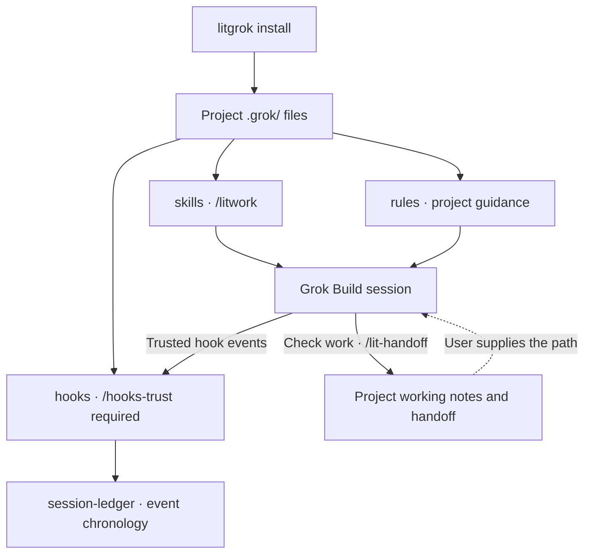

<p align="center"><picture><source media="(prefers-reduced-motion: reduce)" srcset="./docs/assets/cover-motion-still.webp" /><source media="(prefers-reduced-motion: no-preference)" srcset="./docs/assets/cover-motion.webp" /></picture></p>

<h1 align="center">LitGrok</h1>
<p align="center"><strong>Keep the work lit.</strong></p>

<p align="center">Skills, a project rule and hooks for xAI's Grok Build that help every session plan the change, build it, check it, and leave a handoff the next session can pick up.</p>

<p align="center">
<a href="https://www.npmjs.com/package/@litfamily/litgrok"></a>
<a href="https://www.npmjs.com/package/@litfamily/litgrok"></a>
<a href="./LICENSE"></a>
<a href="https://github.com/wjgoarxiv/litgrok/stargazers"></a>
</p>

<p align="center"><a href="#install-in-30-seconds">Install</a> &nbsp; <a href="./docs/guide.md"> Guide</a> &nbsp; <a href="./docs/skills.md">Skills</a> &nbsp; <a href="./docs/guide.md#watch-it-in-motion"> Film</a> &nbsp; <a href="./docs/guide.md#safety-and-uninstall"> Safety</a> &nbsp; <a href="./docs/reference.md">Reference</a> &nbsp; <a href="./README_ko-KR.md">한국어</a></p>

<!-- demo-gif --><p align="center"></p>

<p align="center"><sub>A real Grok Build 1.0.13 session with LitGrok installed, recorded in a terminal and replayed on a drawn terminal window with camera moves. Waiting time is shortened and the project folder is shown as ~/greet; the rest is as Grok Build printed it. What an install prints is in <a href="./docs/guide.md">the guide</a>.</sub></p>

## Why LitGrok

Grok Build is quick to start. You type a line and it gets to work. The trouble comes later: a long session fills its context and gets compacted, the next session starts without what the last one knew, and "done" often means the model said so. You end up explaining again where you were, and checking by hand what actually works.

LitGrok gives each session a routine to follow. A bigger change gets a written plan before the first edit. The work is checked against that plan, and anything nobody could check is marked as unverified. Before you stop, a handoff file records what was built, what was checked and what is left, so the next session can read it and carry on. Grok Build still runs the session and picks the model; LitGrok only adds the way of working.

## Install in 30 seconds

You need Node.js and Grok Build. Open an interactive terminal in the project you want to try, then run:

```bash
npm exec --yes --package @litfamily/litgrok@latest -- litgrok install
```

The files land in `<project>/.grok/`. Add `--dry-run` to see every destination first, or `--user` to install under `~/.grok/` instead. To pin this release, use `--package @litfamily/litgrok@1.0.17`. Running `install` again updates LitGrok, and it refuses to overwrite any file you edited. [Other install options, the optional status row and the safety checks](./docs/guide.md#install-options).

## Quick start

1. Open (or restart) Grok Build from the project's Git root. In a plain folder, run `git init` yourself first: without a Git root the skills and rules load, but the hooks stay off. Grok runs project hooks only after you trust them, so review and trust them in `/hooks-trust`. [Other ways to trust them, and what to check when hooks don't show up](./docs/guide.md#hooks-do-not-show-up).
2. Check that `/skills` lists the LitGrok skills and `/hooks` lists the hook registrations.
3. Send a small first task that needs no external service:

```text
/litwork Build a to-do list in one index.html with no external dependencies. Implement add, complete, and delete. Leave the checks performed and the next step. Do not open a browser automatically; give me the steps to check it myself.
```

When the hooks are loaded, a new session opens with the LIT mark and the line `LitGrok payload present: skills, project rules, hooks, and the npx installer.` The reply to `/litwork` is asked to open with 🔥 **LIT IGNITED · litwork** 🔥, work through the checklist, and end with what it checked and what comes next. Then open `index.html` yourself and add, complete and delete an item. That click-through is the real test; anything you didn't get to try stays marked unverified. [Pictures of what LitGrok prints](./docs/guide.md#what-you-will-see-on-screen).

You can also begin a message with plain `lit` and describe the task. The project rule asks Grok Build to pick the matching skill, and your session shows which one it picked.

Before you stop for the day, ask for a handoff:

```text
/lit-handoff Record what we built, what we checked, and what remains. Tell me where you saved the handoff.
```

In the next session, give Grok Build the path it returned and ask it to read the handoff and check the current files before continuing. A new Git project keeps it at `.handoff/HANDOFF.md`. [Where handoffs go](./.grok/skills/lit-handoff/SKILL.md).

## What you get

It ships 38 skills, 11 agents, one project rule, and eleven hook registrations. Most days you will use a handful of them.

### A checklist for one task

`/litwork` turns a bounded task into a short checklist the session follows to the end. It records each check it ran and names the next step, so you can see what was done and what was only assumed.

```text
/litwork Fix the date parsing bug in src/dates.js and add a test that fails without the fix.
```

### Plan first, then build

For a larger change, `/lit-plan` writes a plan file with numbered rows and the checks for each one, and edits nothing yet. Once you have read and approved it, `/start-work` runs it row by row and ticks a row only after its checks pass.

```text
/lit-plan Add CSV export to the reports page, with tests.
/start-work <the plan path it printed>
```

### A second look before you merge

`/review-work` reviews a change through six read-only lanes and ranks what it finds by the evidence behind each finding. It changes no files.

```text
/review-work the changes on this branch
```

### Research you can trace

`/litresearch` keeps a research question bounded, ties every claim to a source, and says plainly when the evidence is thin.

```text
/litresearch Which SQLite settings matter most for write speed in a small web app? Cite your sources.
```

### Slides, documents and prose

`lit-pptx` builds an editable PowerPoint deck and `lit-docx` a styled Word document, each with its Markdown source. Each picks a design direction for the job and names two alternatives you can switch to. `lit-humanizer` rewrites stiff English or Korean prose and keeps the facts.

```text
/lit-pptx A six-slide update on this quarter's support tickets for Monday's team meeting.
/lit-humanizer docs/intro.md
```

### The routes at a glance

| Type this | What happens |
| --- | --- |
| `/litwork` | Starts the shipped work checklist for a bounded task. |
| `handoff` or `/lit-handoff` | Carries the checked result and the next step into another session. |
| `/lit-plan` | Writes a plan with concrete checks. |
| `/start-work <approved-plan>` | Executes a plan you approved. |
| `/review-work` | Reviews a change and its evidence. |
| `/litresearch` | Runs bounded, source-traceable research without overstating the evidence. |

[All 38 skills, with a picture of what each one gives you](./docs/skills.md).

## Automatic handoff

A long session eventually fills the context, and Grok compacts the conversation and drops detail. LitGrok can ask for a handoff before that happens. Pick the percent yourself; the feature stays off until you do:

```bash
npm exec --yes --package @litfamily/litgrok@latest -- litgrok auto-handoff on 60
```

When a turn ends at or above that percent, the Stop hook asks the model to write the handoff, and the model finishes with "Handoff saved. Run /compact now." so you know when to compact. `LITGROK_AUTO_HANDOFF_PERCENT` overrides the saved percent for one environment. LitGrok reads the context figure from the optional status row, so add the row with `install --user --status-line`, and like every project hook this one needs a trusted Git root (`/hooks-trust`). [The full set of switches, step by step](./docs/guide.md#automatic-handoff-in-detail).

## How it works



The installer copies plain files into the project's `.grok/` folder and changes nothing else. Skills are instructions the session reads when you call them, and the project rule tells Grok Build when to reach for them. Once you trust the hooks, they show the LIT mark at session start, keep the optional status row current, check deliverable wording before it is written, and log the order of events in `.grok/litgrok/session-ledger/`. Nothing runs in the background: when the session ends, the work waits in the handoff until you, or the next session, pick it up. [Where LitGrok keeps its state](./docs/guide.md#where-litgrok-keeps-its-state).

## Requirements, update and uninstall

- **Needs:** Node.js and Grok Build. The notes on this page were checked on Grok Build 1.0.13. Slides need Node.js 20.9 or newer; the office skills install their pinned tools into their own cache the first time you use them.
- **Update:** run the same `install` command again. `litgrok doctor` tells you when a newer version is out; it never installs anything.
- **Uninstall:** use the scope you installed with. The installer removes only files it put there; if you edited one, it stops before removing anything and names that file.

```bash
npm exec --yes --package @litfamily/litgrok@latest -- litgrok uninstall
npm exec --yes --package @litfamily/litgrok@latest -- litgrok uninstall --user
```

The installer never runs `git init`, trusts hooks, signs in or picks a model for you; those steps, and your API keys, stay with you in Grok Build.

## Learn more

- [Guide](./docs/guide.md): pictures of what LitGrok prints, the promo film, install options and the status row, safety checks, automatic handoff in detail, slides and documents, and fixes for common problems.
- [All skills](./docs/skills.md): the 38 skills, one row each.
- [Operational reference](./docs/reference.md): installation, hooks, terminal output, payload checks and source provenance.
- [Project rule](./.grok/rules/00-litgrok.md), [skill folders](./.grok/skills), [changelog](./CHANGELOG.md), [privacy and local data](./docs/privacy.md) and [migration from the old npm name](./docs/reference.md#npm-package-migration).
- [LitFamily](https://github.com/wjgoarxiv/litfamily): the same way of working for other coding agents.

## LITFAMILY

The five armored robots on the cover stand for the five LitFamily products. Each one works on its own in its own host: install just the one you use, and it needs none of the others.

The cover is brand motion made with the LitFamily motion skill: animated artwork, with no Grok session recorded in it. The editable vector version is `docs/assets/cover.svg`, and if your system asks for reduced motion, you see a still frame instead.

<p align="center"></p>

<details>
<summary>Copy ASCII logo</summary>

```text
                             ▄▄▄▄
                   ▗███▌   ▗██████▖
 ▗▄▄▄▄▄          ▗▟████▌   ▝██████▘
 ▐█████        ▗▟██████▌    ▝▀▜█▀▘
 ▐█████      ▗▟███████▄▄▄▄▄▄▄▄▄▄▄▄▄▄▄▄▄▄▄▄
 ▐█████    ▗▟█████████████████████████ ▐█▀
 ▐█████    ████████████████████████████▀
 ▐█████    ██▛▘   ▄ ▄▄▄▄▖▄▄▄▄▄▄▄▄▄▄▄▄▄▖
 ▐█████    ▀    ▄██ ████▌█████████████▌
 ▐█████       ▄████ ████▌█████████████▌
 ▐█████     ▄█████▛
 ▐█████  ▗▟█████▀▘       ▄▄▄▄▄     ▗▖
 ▐█████ ▐█████▀          █████     ▐▛▀
 ▐█████ ▐███▀            █████
 ▐█████ ▐█▀              █████
 ▐█████ ▝                █████
 ▐█████▄▄▄▄▄▄▄▖          █████
 ▐███████████▛           █████
 ▐██████████▀            █████


grok
```

</details>

If LitGrok saves you some re-explaining, a star on GitHub helps other Grok Build users find it.

To contribute, start with a small issue or pull request; the [contributing guide](./CONTRIBUTING.md) lists the checks to run first. See also [security](./SECURITY.md), the [code of conduct](./CODE_OF_CONDUCT.md) and [support](./SUPPORT.md). LitGrok is released under the [MIT license](./LICENSE).
