<p align="center"><picture><source media="(prefers-reduced-motion: reduce)" srcset="./docs/assets/cover-motion-still.webp" /><source media="(prefers-reduced-motion: no-preference)" srcset="./docs/assets/cover-motion.webp" />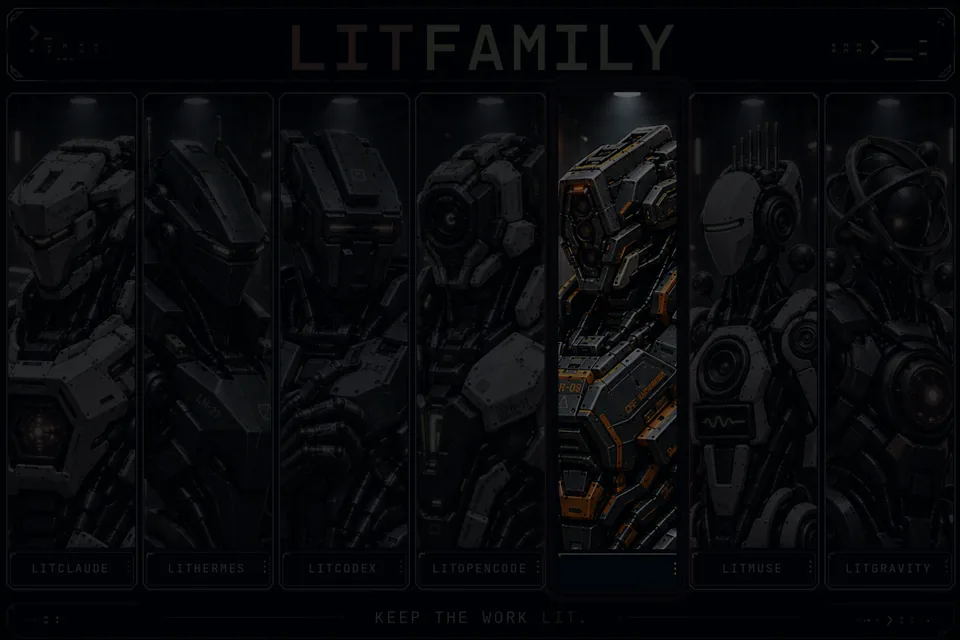</picture></p>

<div align="center"><table>
<tr><th colspan="2">LitGrok Bot · the Grok Bot cover</th></tr>
<tr><td align="center" width="240"><picture><source media="(prefers-reduced-motion: reduce)" srcset="./docs/assets/readme/mascot-still.webp" /><source media="(prefers-reduced-motion: no-preference)" srcset="./docs/assets/readme/mascot.webp" /></picture></td><td>This round fellow is the cover for Grok Bot. It runs the lit loop in quick beats: it blinks while idle, glances up to plan, lights a small flame to work, squints to review and hops when the work is done.<br /><br />LitGrok brings the same skills into Grok Bot through Cursor. <a href="#use-litgrok-in-grok-bot-and-cursor">Use LitGrok in Grok Bot →</a></td></tr>
</table></div>

<h1 align="center">LitGrok</h1>
<p align="center"><strong>Keep the work lit.</strong></p>
<p align="center">Skills, a project rule and hooks that help xAI's Grok Build plan the work, build it, check it, and leave a handoff the next session can pick up.</p>

<p align="center">
<a href="https://www.npmjs.com/package/@litfamily/litgrok"></a>
<a href="https://www.npmjs.com/package/@litfamily/litgrok"></a>
<a href="./LICENSE"></a>
<a href="https://github.com/wjgoarxiv/litgrok/stargazers"></a>
</p>

Start a Grok Build prompt with `lit` and the session follows a routine: it writes the test
before the fix, checks the real result, and says plainly what it could not check. Ask for a
handoff when you stop, and tomorrow's session opens on the note where today's ended. To try it, install into a project and hand Grok one task:

```bash
npm exec --yes --package @litfamily/litgrok@latest -- litgrok install   # then restart Grok Build from the Git root
```

```text
lit fix the date parsing bug in src/dates.js, with a test
```

<p align="center"><a href="#install-in-30-seconds">Install</a> &nbsp; <a href="#quick-start">Quick start</a> &nbsp; <a href="#what-you-can-make">Showcase</a> &nbsp; <a href="./docs/guide.md"> Guide</a> &nbsp; <a href="./docs/skills.md">Skills</a> &nbsp; <a href="./docs/guide.md#watch-it-in-motion"> Film</a> &nbsp; <a href="./docs/guide.md#safety-and-uninstall"> Safety</a> &nbsp; <a href="./docs/reference.md">Reference</a> &nbsp; <a href="./README_ko-KR.md">한국어</a></p>

<!-- demo-gif --><p align="center"></p>

## What you can make

Every picture below is a real output of LitGrok. Where a prompt sits under a picture, that
request produced it in a Grok Build session; where none does, the skill's own engine made it
from an example the skill ships with, and the caption names that example. None of them is a
mock-up, so the same request with LitGrok installed gets you the same kind of result.

### Draw it

Each drawing comes from the skill that knows its rules: ISA-5.1 tags and a title block on a P&ID,
material colours and leader labels on a cutaway, a trust boundary and numbered flows on an
architecture. Every one passed its skill's QA script before it was exported.

<table>
<tr><td width="50%" valign="top">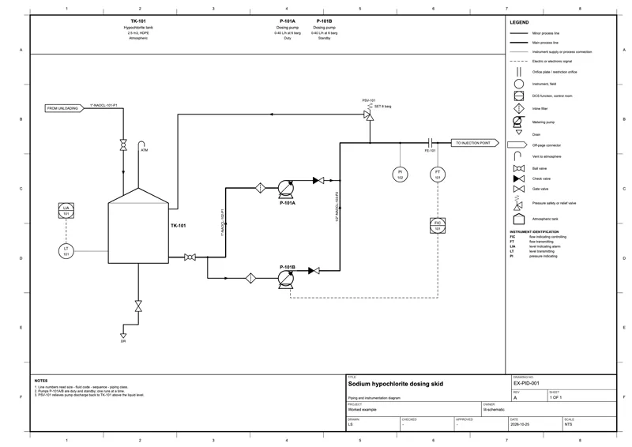<br /><b>lit-schematic · P&amp;ID</b><br /><sub>Built from the skill&#39;s bundled worked example <code>pid-dosing-skid</code> by its own kit; the QA gate passed.</sub></td><td width="50%" valign="top"><br /><b>lit-schematic · isometric cutaway</b><br /><sub>From the bundled example <code>iso-heat-exchanger</code>; QA passed on the SVG and on the 600 dpi PNG and PDF exports.</sub></td></tr>
<tr><td width="50%" valign="top">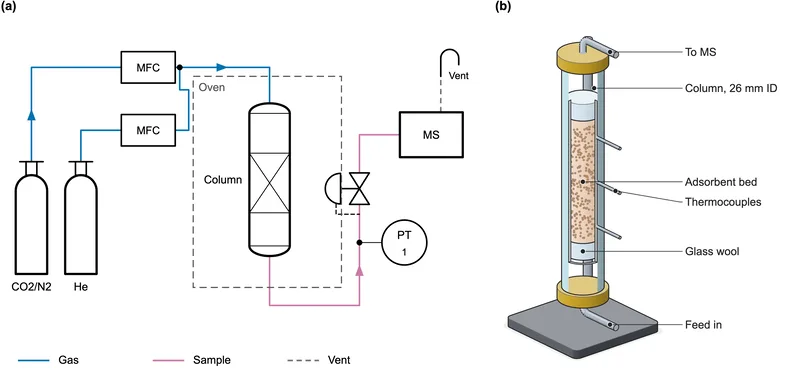<br /><b>lit-schematic · journal apparatus figure</b><br /><sub>From the bundled example <code>journal-adsorption-rig</code>; QA passed.</sub></td><td width="50%" valign="top">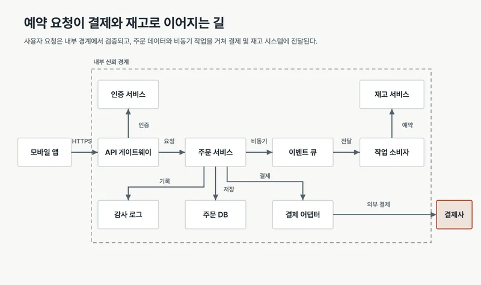<br /><b>lit-diagram-drawer · service architecture</b><br /><sub>From the bundled example <code>01-service-architecture</code>, exported by the skill&#39;s own script; the diagram, type and brief checks passed.</sub></td></tr>
</table>

### Present it

lit-pptx picks one of thirteen tonalities for the audience, then compiles native, editable charts,
KPI rows and tables with Pretendard embedded, and its deck QA checks the result before you get it.

<table>
<tr><td width="50%" valign="top">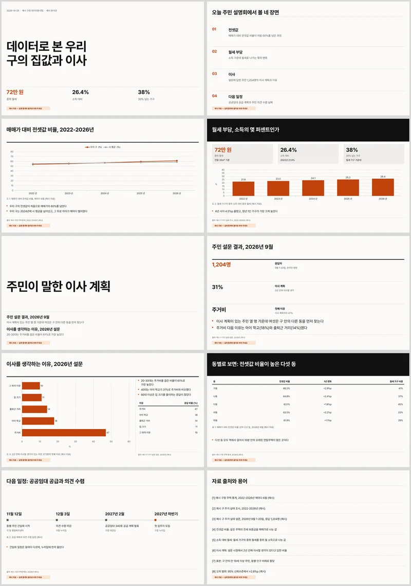<br /><b>lit-pptx · newsroom, Korean public briefing</b><br /><sub>From the bundled example <code>17-public-data-briefing-newsroom-ko.md</code>; the deck QA passed.</sub></td><td width="50%" valign="top">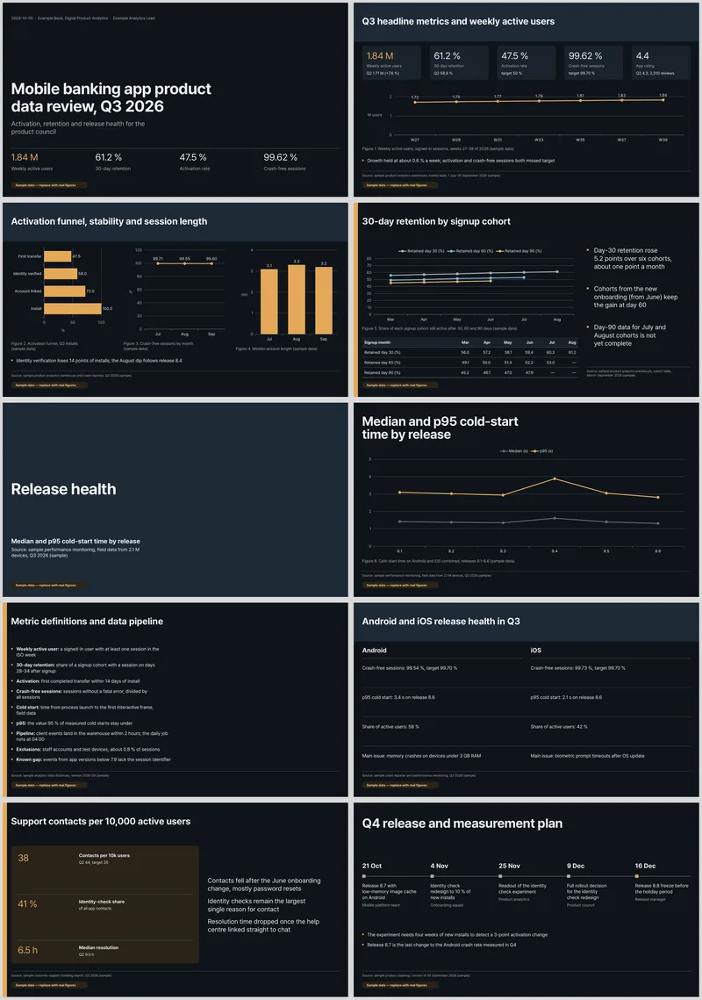<br /><b>lit-pptx · night, data review</b><br /><sub>From the bundled example <code>05-data-review-night-en.md</code>; the deck QA passed.</sub></td></tr>
<tr><td width="50%" valign="top">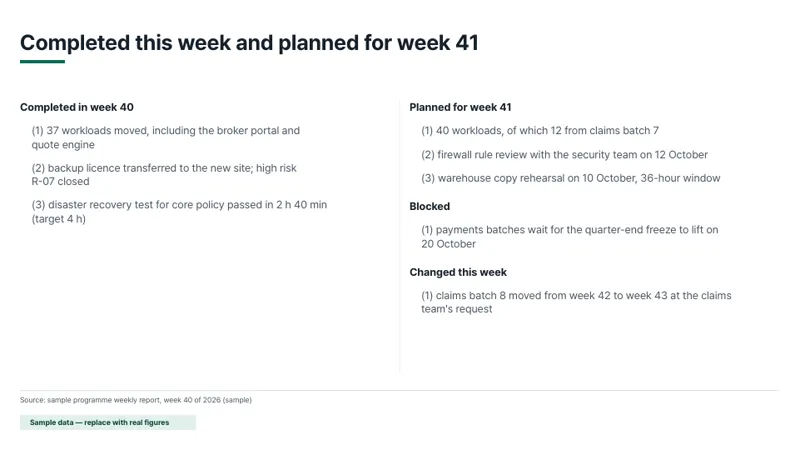<br /><b>lit-pptx · status deck</b><br /><sub>Built from the skill&#39;s bundled sample report by its own converter; the layout gate passed.</sub></td></tr>
</table>

### Write it

lit-docx writes a Word file you can keep editing: a cover or title block, key figures, ruled tables
and numbered sections in one of six restrained tonalities. It renders the pages and runs its layout
gate before it hands the file over.

<table>
<tr><td width="50%" valign="top">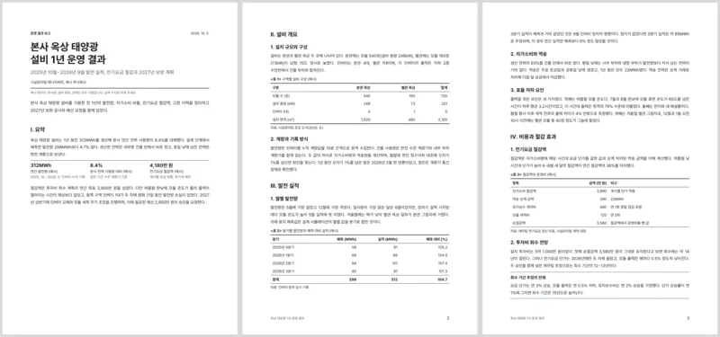<br /><b>lit-docx · Korean report, Report tonality</b><br /><sub>From the bundled example <code>01-report-ko.md</code> by the skill&#39;s own converter; the layout gate passed.</sub></td><td width="50%" valign="top">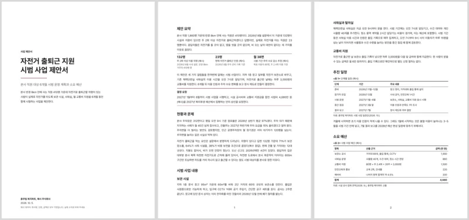<br /><b>lit-docx · Korean proposal, Proposal tonality</b><br /><sub>From the bundled example <code>04-proposal-ko.md</code>; the layout gate passed.</sub></td></tr>
</table>

### Build it and keep track of it

frontend-ui-ux builds a page from a brief and then checks it at several widths. When the work has
spread over several sessions, `lit adhd` reads them all and prints one brief with a next step.

<table>
<tr><td width="50%" valign="top">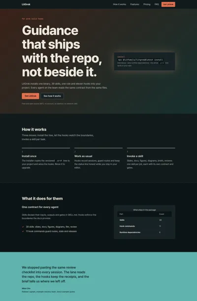<br /><b>frontend-ui-ux · landing page</b><br /><sub>Built from a plain brief; the probe renders it at seven views and checks overflow, contrast and motion.</sub></td><td width="50%" valign="top">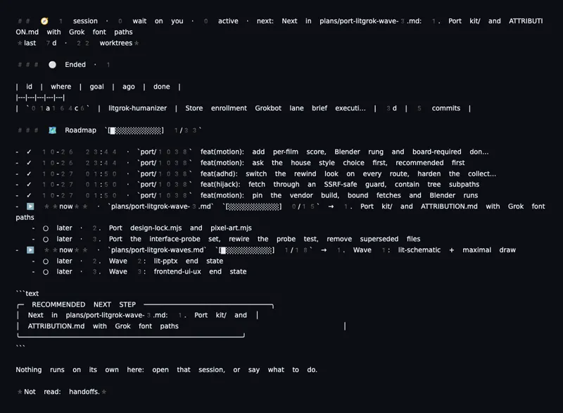<br /><b>lit-adhd · the brief</b><br /><code>lit adhd</code></td></tr>
</table>

## Why LitGrok

Grok Build is quick to start. You type a line and it gets to work. The trouble comes later: a
long session fills its context and gets compacted, the next session starts without what the
last one knew, and "done" often just means the model said so. You end up explaining again where
you were, and checking by hand what actually works.

LitGrok gives each session a routine to follow. A bigger change gets a written plan before the
first edit. The work is checked against that plan, and anything nobody could check is marked as
unverified. Before you stop, a handoff file records what was built, what was checked and what is
left, so the next session can read it and carry on. Grok Build still runs the session and picks
the model; LitGrok adds the way of working, as plain files in your project's `.grok/` folder.

In one line, for a friend: *start a Grok Build prompt with `lit` and it writes the test first,
checks the result, and leaves tomorrow's session a note.*

### Who it's for

LitGrok suits people whose Grok Build work runs longer than one sitting: a feature spread over a
few days, a bug you want a test to prove fixed, a refactor you want reviewed before it merges. It
also builds editable slide decks and Word reports, draws diagrams and equipment schematics, and
cleans up stiff English or Korean prose, so it earns its place outside code too. LitGrok itself
needs no account or sign-in.

### What a session looks like

The film above is one real session. You type the first line, the hooks answer with the second,
and the status row walks the third as the work happens. Stripped down to three lines, it goes
like this:

```text
you typed   lit add a --shout flag that prints the greeting in capitals, with a test
it did      wrote the test first, changed greet.js, re-ran the tests and the CLI
it ended    node greet.js --shout Ada prints HELLO, ADA!   litwork complete · 35s · 2 tools
```

## Install in 30 seconds

You need Node.js and Grok Build. Open an interactive terminal in the project you want to try,
then run:

```bash
npm exec --yes --package @litfamily/litgrok@latest -- litgrok install
```

The installer copies LitGrok's skills, agents, project rule and hooks into `<project>/.grok/`
and changes nothing else. It ends with an install receipt that should read `Status: Ready` and
reminds you of the two steps only you can take: open Grok Build from the project's Git root, and
trust the hooks. Running the same command later updates LitGrok. Before it replaces or removes a
file, it checks that the file is one it put there, and if you edited one, it stops and names it.

Three switches change how the install runs, each for a particular moment:

- `--dry-run` prints every destination and writes nothing, for when you want to look first.
- `--user` installs under `~/.grok/` instead, so its skills and rule are there in every project
  you open. Add
  `--status-line` to that command to get the LIT status row as well, which Grok reads only
  from user settings.
- `--package @litfamily/litgrok@1.0.34` in place of `@latest` pins this release, for when a team
  wants everyone on the same files.

[Every install option, local packages and the safety checks](./docs/guide.md#install-options).

The same package can sit in the project, in your user account, or be opened from Grok Bot
through Cursor:

| Place | How you add it | Where it lives |
| --- | --- | --- |
| Grok Build, this project | `npm exec --yes --package @litfamily/litgrok@latest -- litgrok install` | `<project>/.grok/` |
| Grok Build, your user account | `litgrok install --user`, with `--status-line` for the status row | `~/.grok/` |
| Grok Bot, through Cursor | Add Marketplace, From GitHub Repository, then Connect apps | `.cursor-plugin/plugin.json` in this repository |

### Let a coding agent install it

If you would rather hand the install to a coding agent, open it in the project folder and paste
the prompt below. It asks the agent to show you its plan and wait for your yes, to use only the
official npm package, and to check the result before it reports back. An agent's shell has no
terminal attached, which is why the install lines carry `--yes` and clear `NO_COLOR` and `CI`;
without that the installer only previews.

```text
Install LitGrok, the skill pack for xAI's Grok Build, into this project.
Use only the official npm package @litfamily/litgrok. Do not clone repositories, run other install scripts or use any other package.
Before you change anything, show me your plan and wait for my yes.

1. Check that Node.js and Grok Build are installed and that this folder is the project's Git root. If it is not a Git repository, ask me before running git init.
2. Preview the install and show me where the files would go:
   npm exec --yes --package @litfamily/litgrok@latest -- litgrok install --dry-run
3. Install. Your shell has no terminal, so pass --yes and clear NO_COLOR and CI, or the installer only previews:
   env -u NO_COLOR -u CI npm exec --yes --package @litfamily/litgrok@latest -- litgrok install --yes
4. Ask me whether I also want the LitGrok status row. It is a user install: it copies LitGrok into ~/.grok/ and adds a status line to ~/.grok/config.toml after backing it up. Only if I say yes, run:
   env -u NO_COLOR -u CI npm exec --yes --package @litfamily/litgrok@latest -- litgrok install --user --status-line --yes
5. Verify: the install receipt says "Status: Ready", and the project now has .grok/skills, .grok/rules and .grok/hooks. If the output says "no files written", tell me the reason printed on that line instead of trying other flags.
6. Report what was written and where, anything the installer refused, and anything you could not check. Then remind me to restart Grok Build from the project's Git root and to trust the hooks with /hooks-trust.
```

## Quick start

1. Open (or restart) Grok Build from the project's Git root. In a plain folder, run `git init`
   yourself first: without a Git root the skills and rules load, but the hooks stay off. Grok
   runs project hooks only after you trust them, so review and trust them in `/hooks-trust`.
   [Other ways to trust them, and what to check when hooks don't show up](./docs/guide.md#hooks-do-not-show-up).
2. Check that `/skills` lists the LitGrok skills and `/hooks` lists the hook registrations.
3. Send a small first task that needs no external service:

```text
/litwork Build a to-do list in one index.html with no external dependencies. Implement add, complete, and delete. Leave the checks performed and the next step. Do not open a browser automatically; give me the steps to check it myself.
```

When the hooks are loaded, a new session opens with the LIT mark and the line `LitGrok payload
present: skills, project rules, hooks, and the npx installer.` The reply to `/litwork` is asked
to open with 🔥 **LIT IGNITED · litwork** 🔥, work through the checklist, and end with what it
checked and what comes next. Then open `index.html` yourself and add, complete and delete an
item. That click-through is the real test; anything you didn't get to try stays marked
unverified. [Pictures of what LitGrok prints](./docs/guide.md#what-you-will-see-on-screen).

You can also begin a message with plain `lit` and describe the task. The project rule asks Grok
Build to pick the matching skill, and your session shows which one it picked.

Before you stop for the day, ask for a handoff:

```text
/lit-handoff Record what we built, what we checked, and what remains. Tell me where you saved the handoff.
```

In the next session, give Grok Build the path it returned and ask it to read the handoff and
check the current files before continuing. A new Git project keeps it at `.handoff/HANDOFF.md`.
[Where handoffs go](./.grok/skills/lit-handoff/SKILL.md).

## The LIT status row

While you work, Grok can keep one LitGrok line at the bottom of the screen, so you can follow
the session without scrolling back through it. It is optional and lives in your user settings,
so you switch it on with a user install (`litgrok install --user --status-line`).

Until a prompt names a LitGrok skill, the row stays a single quiet line with the model and its
effort, how much of the context is used, the session's cost and the Git branch. Once a prompt
starts a skill, here `/litwork`, it grows into a small LIT card. Read it from top to bottom:

- The title names the skill, the tool calls and subagents so far, and whether the turn is
  running (with its time), just finished, or needs you.
- The map shows the stages of the work, such as `plan ✓ ━━━━ [work 3/7] ━━━━ review · ──── done ·`:
  stages behind you carry a tick, and the one you are in is lit with the plan tasks checked so far.
- The line under the map names the next open task, the tool running right now and for how long,
  and how the last test run went.
- The last line keeps the model, the context gauge, the cost and the branch.

When the turn ends, the card folds back into the single line and keeps where the work got to. It
turns yellow when something needs you: a planning turn that has not saved its plan, a handoff
request, or a context close to your handoff percent. Add `--notify` to the same install command
if you also want Grok's terminal notification each time a turn finishes, even while you are
watching. Both stay off until you ask for them.
[Pictures of the row idle and at work, and the switches for colour and glyphs](./docs/guide.md#what-you-will-see-on-screen).

## Automatic handoff

A long session slowly fills Grok's context window. When it is nearly full, Grok compacts the conversation, and the details of what you were in the middle of get squeezed out. Automatic handoff has the model write its handoff while it still remembers everything, so after the compaction it can pick up exactly where it was.

It stays off until you turn it on, and the percent is always your choice. The setting belongs to one project and lives in that project's `.grok/litgrok/auto-handoff.json`. LitGrok learns how full the context is from the optional status row, because Grok shares that figure with the status row and with no hook, so add the row first; it lives in your user settings and only needs doing once. The Stop hook that does the asking is a project hook like the others, so it runs in a trusted Git root (`/hooks-trust`).

```bash
npm exec --yes --package @litfamily/litgrok@latest -- litgrok install --user --status-line
npm exec --yes --package @litfamily/litgrok@latest -- litgrok auto-handoff on 60
```

Run the second line inside the project; from a subfolder it finds the Git root on its own. `auto-handoff status` then reads the setting back, says where each part of it came from, and warns you about anything that would keep it from working.

<p align="center"><picture><source media="(prefers-color-scheme: dark)" srcset="./docs/assets/auto-handoff/auto-handoff-on-dark.webp" /></picture></p>

### What you see in a session

Once the context comes within ten points of your percent, the status row shows a yellow warning with how close it is. When a turn ends at or above your percent, the Stop hook keeps the model going for one more step and asks it, once, to write the handoff with the `lit-handoff` procedure. The card then reads `⚠ handoff requested`. When the packet is saved, the model ends with one plain line: "Handoff saved. Run /compact now."

<p align="center"><picture><source media="(prefers-color-scheme: dark)" srcset="./docs/assets/auto-handoff/auto-handoff-session-dark.webp" />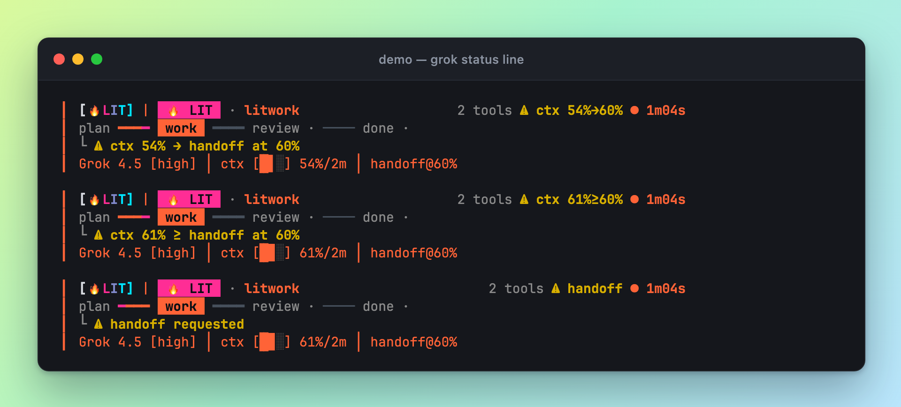</picture></p>

That is your cue to type `/compact`, since Grok lets no hook start a compaction. After it, the next time a turn ends, LitGrok points the model at the handoff this session saved and asks it to check the current files and continue from the next steps written there. Grok also compacts on its own at 85 percent unless you changed that, so choose a percent below it.

### Turning it off, or deciding per shell

`auto-handoff off` stops it for the project and keeps your percent, so a plain `auto-handoff on` later brings back the same number.

<p align="center"><picture><source media="(prefers-color-scheme: dark)" srcset="./docs/assets/auto-handoff/auto-handoff-off-dark.webp" />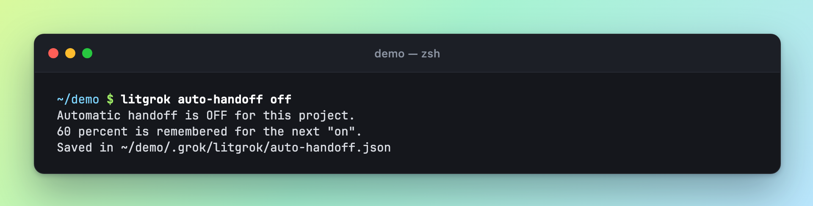</picture></p>

You can also decide from the environment you start Grok Build in, which is handy for a single shell or a script. `LITGROK_AUTO_HANDOFF=1` turns the feature on for every session started from that environment, and `0` keeps it off there. `LITGROK_AUTO_HANDOFF_PERCENT` sets the percent and wins over the saved one. `status` tells you when the environment is overriding the project file.

<p align="center"><picture><source media="(prefers-color-scheme: dark)" srcset="./docs/assets/auto-handoff/auto-handoff-env-dark.webp" />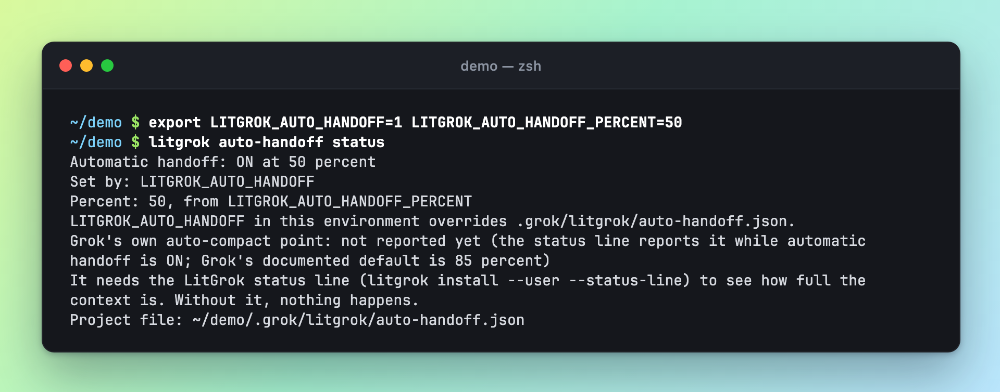</picture></p>

[Every step in detail, including what happens when a handoff is stale or written by another session](./docs/guide.md#automatic-handoff-in-detail).

## What you get

It ships 42 skills, 11 agents, one project rule, and twelve hook registrations. Most days you
will use a handful of them. The skills are instructions the session reads when you call one by
name or start a prompt with `lit`; the agents in `.grok/agents` take a bounded job such as a
plan, a review or a prose pass; the project rule `.grok/rules/00-litgrok.md` tells Grok Build
which skill fits a request; and the hooks show the LIT mark, keep the status row current, check
deliverable wording before it is written, and log the order of events.

### A checklist for one task

`/litwork` turns a bounded task into a short checklist the session follows to the end. It
records each check it ran and names the next step, so you can see what was done and what was
only assumed.

```text
/litwork Fix the date parsing bug in src/dates.js and add a test that fails without the fix.
```

### Plan first, then build

For a larger change, `/lit-plan` writes a plan file with numbered rows and the checks for each
one, and edits nothing yet. Once you have read and approved it, `/start-work` runs it row by row
and ticks a row only after its checks pass.

```text
/lit-plan Add CSV export to the reports page, with tests.
/start-work <the plan path it printed>
```

### A second look before you merge

`/review-work` reviews a plan before work starts or the finished change after it. It picks the
mode from what exists: a branch, a diff or ticked plan rows mean the change, and a plan with no
ticked rows means the plan. `/review-work plan` and `/review-work work` force one. A change goes
through six read-only lanes, and the findings are ranked by the evidence behind each one. It
changes no files; fixing is a separate step.

```text
/review-work the changes on this branch
```

### Research you can trace

`/litresearch` keeps a research question bounded, ties every claim to a source, and says plainly
when the evidence is thin.

```text
/litresearch Which SQLite settings matter most for write speed in a small web app? Cite your sources.
```

### Slides, documents and prose

Ask for a deck or a report and `lit-pptx` builds an editable PowerPoint file or `lit-docx` a
styled Word document, each with its Markdown source beside it. Neither starts from one fixed
look: decks choose among thirteen tonalities and documents among six restrained ones, and the
reply names the choice, the reason and two alternatives you can switch to with one word. Both
render their pages and run a layout gate before they hand the file over. `lit-humanizer`
rewrites stiff English or Korean prose and keeps the facts.

```text
/lit-pptx A six-slide update on this quarter's support tickets for Monday's team meeting.
lit write a two-page proposal for the new onboarding flow, as a Word file
/lit-humanizer docs/intro.md
```

### Diagrams, P&IDs and cutaways

`lit-diagram-drawer` draws concept and technical diagrams: architectures, flows, sequences,
timelines. For real equipment, `lit-schematic` draws a P&ID with ISA-5.1 tags and control loops,
an equipment layout, an isometric cutaway or a journal figure of an experimental setup, as
editable SVG with PDF and a 600 dpi PNG, and checks it with its own QA script before it reports.

```text
lit draw a P&ID of a hypochlorite dosing skid with duty and standby pumps
lit 논문용 흡착 실험 장치 모식도 그려줘
```

### Bring in a technique you read about

You read a post, an article or a repository that does something your own skill does not, and
you want the know-how without copying the text. `lit hijack` takes the sources and the target,
records where each source came from, checks what its licence allows, writes a spec in its own
words, has the change built through `lit-plan` and `start-work`, and proves it on the real
surface against a baseline that cannot see the new work. The report says what was taken, what
was left and why.

```text
lit hijack https://example.com/post and docs/paper.pdf into .grok/skills/lit-pptx
```

### Where was I?

After a day of several sessions and interruptions, `lit adhd` (or `lit rewind`) reads every
recent agent session of this repository and prints one board: the one thing to do now and what to
type, how much is done, in progress, waiting on you and left, each plan as a milestone with a
progress bar, what you finished lately, what is still to do, and a short list of things not to
forget, such as a session waiting on your answer, uncommitted changes or a plan that stalled. It
changes nothing. If that step is what you want, type `go` and the session takes it. `lit adhd
detail` adds one card per session under the board.

```text
lit adhd
go
```

### Films and README covers

`lit-typographic-motion` writes a treatment first, then renders a short film with LitGrok's own
type engine or stage capture and checks it with a QA gate; it also makes silent README cover loops
that repeat without a visible seam. Its engine installs once, when you ask for it, with `litgrok motion-runtime install`
run from the version you installed; the install receipt prints that exact line for you.

### The routes at a glance

| Type this | What happens |
| --- | --- |
| `/litwork` | Starts the shipped work checklist for a bounded task. |
| `handoff` or `/lit-handoff` | Carries the checked result and the next step into another session. |
| `/lit-brainstorm` | Opens a question into many options and a short list to pick from. |
| `/lit-plan` | Writes a plan with concrete checks. |
| `/start-work <approved-plan>` | Executes a plan you approved. |
| `/review-work` | Reviews a plan before work or a change after it, with its evidence. |
| `/litresearch` | Runs bounded, source-traceable research without overstating the evidence. |
| `lit adhd` | Briefs every recent session on one read-only screen, with one next step. |

[All 42 skills, with a picture of what each one gives you](./docs/skills.md).

## How it works

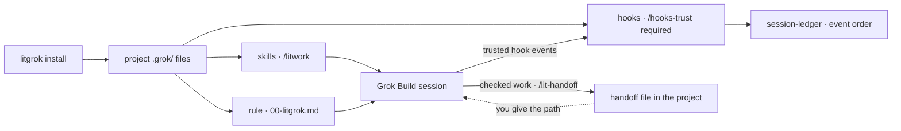

The installer copies plain files into the project's `.grok/` folder and changes nothing else.
When you call a skill, the session reads its instructions; when you start a prompt with `lit`,
the project rule tells Grok Build which skill fits. Once you trust the hooks, they show the LIT
mark at session start, keep the optional status row current, check deliverable wording before it
is written, and log the order of events in `.grok/litgrok/session-ledger/`. Nothing runs in the
background: when the session ends, the work waits in the handoff until you, or the next session,
pick it up. [Where LitGrok keeps its state](./docs/guide.md#where-litgrok-keeps-its-state) and
[what goes over the network](./docs/privacy.md).

## Use LitGrok in Grok Bot and Cursor

You can use the same planning and review habits inside Grok Bot, without a separate Grok Build
install. The plugin gives the bot the skill text, and you call a skill by its folder name.

This repository carries that plugin at `.cursor-plugin/plugin.json`. Grok Bot and Cursor both
read this Cursor-format manifest, and it points them at the 42 skills in `.grok/skills`. Ask with
the name and the job, for example "lit-plan this change" or "litwork the to-do list". The bot
reads that skill and does the work with the tools it already has. These are the names:

`autoconference`, `autoresearch`, `browser-drive`, `comment-checker`, `debugging`, `deep-interview`, `frontend-ui-ux`, `lit-brainstorm`, `lit-burnoff`, `lit-burnoff-file`, `lit-code`, `lit-commit`, `lit-comprehend`, `lit-crucible`, `lit-diagram-drawer`, `lit-docx`, `lit-adhd`, `lit-handoff`, `lit-hijack`, `lit-humanizer`, `lit-init`, `lit-plan`, `lit-pptx`, `lit-recap`, `lit-schematic`, `lit-scientific-visualization`, `lit-team`, `lit-typographic-motion`, `litgoal`, `litgrok`, `litresearch`, `litwork`, `lsp`, `lsp-setup`, `readme-studio`, `refactor`, `review-work`, `rules`, `start-work`, `structural-search`, `visual-qa`, `wikify`.

Skills that run a bundled script, such as the slide and document skills, need Node.js or Python
on the computer that runs them.

The hooks, the project rule, the status row and the LIT mark stay with Grok Build. Grok Bot
shows only the skills and connectors a plugin brings, and hooks are started by Grok Build itself:

| Piece | Grok Build | Grok Bot |
| --- | --- | --- |
| Skills | The install copies the 42 folders into `.grok/skills`, and you call one by name. | The plugin points at those folders, and you call one by its folder name in the message. |
| Agents | Eleven definitions in `.grok/agents` take a bounded job, such as a plan or a review. | No agent definitions load; the bot does the work with the tools it already has. |
| Hooks | The twelve registrations run after you trust the project with `/hooks-trust`. | None run: the plugin declares skills only, and hook commands are started by Grok Build. |
| Project rule | `.grok/rules/00-litgrok.md` is the guidance the session reads. | The working habits are written into the skill files, so the bot reads them there. |
| Status row and LIT mark | `--status-line` on a user install draws the row, and a trusted session opens with the LIT mark. | Neither appears; Connect apps lists the plugin's skills. |

Grok Bot's **Connect apps** reads the Cursor Marketplace. Add LitGrok from this repository:

1. In Cursor, open **Customize**, choose **Add Marketplace**, pick **From GitHub Repository** and paste `https://github.com/wjgoarxiv/litgrok`.
2. Cursor then shows a marketplace section with LitGrok in it; press **Add** there. In Grok Bot, open **Connect apps**, find LitGrok under **Your plugins** and add it; connect GitHub if the Bot asks for it. Grok Bot reads marketplaces when it starts, so if LitGrok is not listed yet, restart Grok Bot and look again.

On 22 October 2026, Grok Bot loaded LitGrok 1.0.25. It came from this public repository through
that Cursor marketplace and listed 39 skills. The xAI catalog pull request, xai-org #1619, is
still open, so this is the repository's own marketplace entry.

## The ground rules in your user rule

A user install also leaves a short ground-rules section at the end of `~/.grok/rules/00-litgrok.md`,
so every Grok Build session on your machine knows the basics before any skill loads: a prompt
starting with `lit` is LitGrok's activation word, plans live in `plans/` and the handoff in
`.handoff/HANDOFF.md`, and a push, a publish, a tag or a version bump waits for your explicit yes.

The section is LitGrok's own, and you decide whether it stays. `litgrok doctor` and
`litgrok ground status` print a `GROUND:` line with its presence and version:

```bash
npm exec --yes --package @litfamily/litgrok@latest -- litgrok ground status
npm exec --yes --package @litfamily/litgrok@latest -- litgrok ground off   # take it out and keep it out
npm exec --yes --package @litfamily/litgrok@latest -- litgrok ground on    # put it back
```

`install --no-ground` skips it for that one run. For a single repository, an approved lit-init
can add the same agreement as its own project file, `.grok/rules/10-litgrok-ground.md`, by
running `litgrok ground project`.

## Requirements, update and uninstall

You need Node.js and Grok Build; the notes on this page were checked on Grok Build 1.0.13.
Slides need Node.js 20.9 or newer, and the office skills install their pinned tools into their
own cache the first time you use them.

Three commands look after an install:

```bash
npm exec --yes --package @litfamily/litgrok@latest -- litgrok doctor      # installed version, GROUND: line, newer release if any
npm exec --yes --package @litfamily/litgrok@latest -- litgrok install     # update: the same install, run again
npm exec --yes --package @litfamily/litgrok@latest -- litgrok uninstall   # add --user for a user install
```

`doctor` only reads: when npm has a newer version, it prints the command that installs it and
leaves the choice to you. `uninstall` takes the scope you installed with and removes only files
the installer put there; if you edited one, it stops before removing anything and names that file.
A user uninstall also takes out the status-line keys LitGrok wrote, if you left them unchanged.

The installer never runs `git init`, trusts hooks, signs in or picks a model for you; those
steps, and your API keys, stay with you in Grok Build.

## Learn more

- [Guide](./docs/guide.md): pictures of what LitGrok prints, the promo film, install options and
  the status row, safety checks, automatic handoff in detail, slides and documents, and fixes for
  common problems.
- [All skills](./docs/skills.md): the 42 skills, one row each, with a picture of each.
- [Operational reference](./docs/reference.md): installation, hooks, terminal output, payload
  checks and source provenance.
- [Project rule](./.grok/rules/00-litgrok.md), [skill folders](./.grok/skills),
  [changelog](./CHANGELOG.md), [privacy and local data](./docs/privacy.md) and
  [migration from the old npm name](./docs/reference.md#npm-package-migration).
- [LitFamily](https://github.com/wjgoarxiv/litfamily): the same way of working for other coding agents.

## LITFAMILY

The seven armored robots on the cover stand for the seven LitFamily products. Each one works on its own in its own host: install just the one you use, and it needs none of the others.

The cover is brand motion made with the LitFamily motion skill: animated artwork, with no Grok session recorded in it. The editable vector version is `docs/assets/cover.svg`, and if your system asks for reduced motion, you see a still frame instead. The film near the top of this page is the one that shows a real Grok Build session.

<p align="center">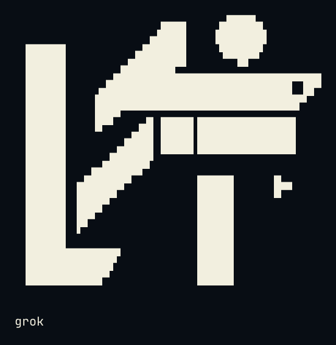</p>

<details>
<summary>Copy ASCII logo</summary>

```text
                             ▄▄▄▄
                   ▗███▌   ▗██████▖
 ▗▄▄▄▄▄          ▗▟████▌   ▝██████▘
 ▐█████        ▗▟██████▌    ▝▀▜█▀▘
 ▐█████      ▗▟███████▄▄▄▄▄▄▄▄▄▄▄▄▄▄▄▄▄▄▄▄
 ▐█████    ▗▟█████████████████████████ ▐█▀
 ▐█████    ████████████████████████████▀
 ▐█████    ██▛▘   ▄ ▄▄▄▄▖▄▄▄▄▄▄▄▄▄▄▄▄▄▖
 ▐█████    ▀    ▄██ ████▌█████████████▌
 ▐█████       ▄████ ████▌█████████████▌
 ▐█████     ▄█████▛
 ▐█████  ▗▟█████▀▘       ▄▄▄▄▄     ▗▖
 ▐█████ ▐█████▀          █████     ▐▛▀
 ▐█████ ▐███▀            █████
 ▐█████ ▐█▀              █████
 ▐█████ ▝                █████
 ▐█████▄▄▄▄▄▄▄▖          █████
 ▐███████████▛           █████
 ▐██████████▀            █████


grok
```

</details>

If LitGrok saves you some re-explaining, a star on GitHub helps other Grok Build users find it.

To contribute, start with a small issue or pull request; the [contributing guide](./CONTRIBUTING.md) lists the checks to run first. See also [security](./SECURITY.md), the [code of conduct](./CODE_OF_CONDUCT.md) and [support](./SUPPORT.md). LitGrok is released under the [MIT license](./LICENSE); the name and logos follow the [trademark policy](./TRADEMARK.md).
