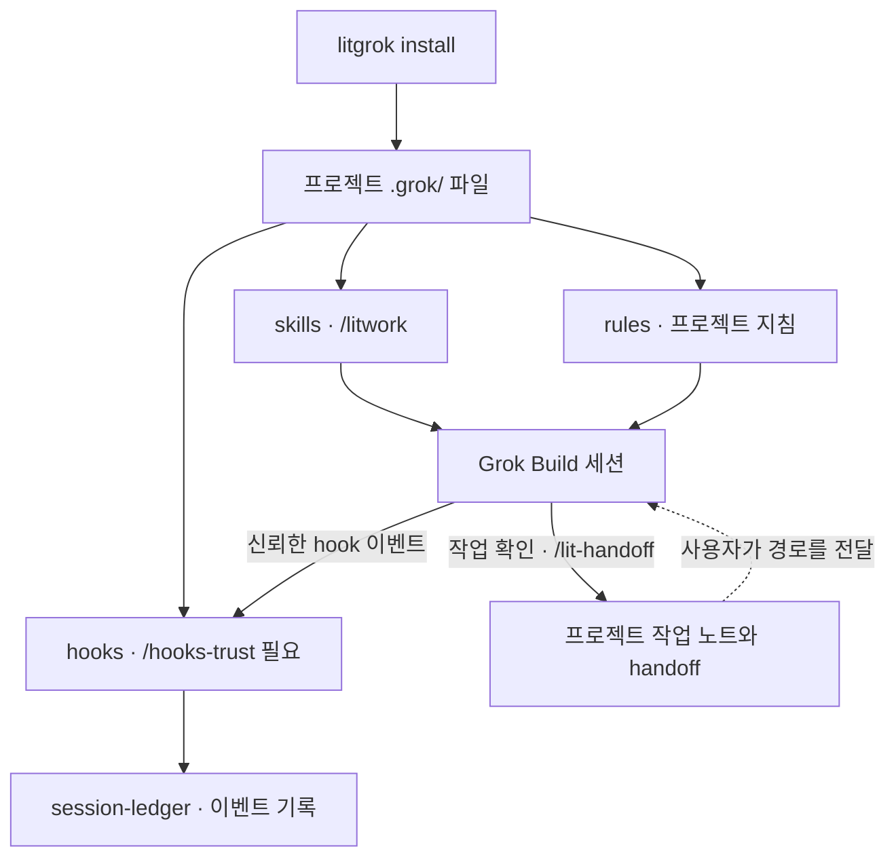

<p align="center"><picture><source media="(prefers-reduced-motion: reduce)" srcset="./docs/assets/cover-motion-still.webp" /><source media="(prefers-reduced-motion: no-preference)" srcset="./docs/assets/cover-motion.webp" /></picture></p>

<h1 align="center">LitGrok</h1>
<p align="center"><strong>Keep the work lit.</strong></p>

<p align="center">xAI Grok Build에 스킬, 프로젝트 규칙, 훅을 더해 세션마다 계획하고, 만들고, 확인하고, 다음 세션이 이어받을 인수인계 문서를 남기게 합니다.</p>

<p align="center">
<a href="https://www.npmjs.com/package/@litfamily/litgrok"></a>
<a href="https://www.npmjs.com/package/@litfamily/litgrok"></a>
<a href="./LICENSE"></a>
<a href="https://github.com/wjgoarxiv/litgrok/stargazers"></a>
</p>

<p align="center"><a href="#30초-설치">설치</a> &nbsp; <a href="./docs/guide_ko-KR.md"> 안내서</a> &nbsp; <a href="./docs/skills_ko-KR.md">스킬</a> &nbsp; <a href="./docs/guide_ko-KR.md#움직임으로-보기"> 영상</a> &nbsp; <a href="./docs/guide_ko-KR.md#안전하게-설치하고-지우기"> 안전</a> &nbsp; <a href="./docs/reference_ko-KR.md">상세 안내</a> &nbsp; <a href="./README.md">English</a></p>

<!-- demo-gif --><p align="center"></p>

## 왜 LitGrok인가요

Grok Build는 시작이 빠릅니다. 한 줄만 입력하면 바로 일을 시작하죠. 문제는 그다음입니다. 세션이 길어지면 컨텍스트가 차서 대화가 압축되고, 새 세션은 앞 세션이 알던 내용을 모른 채 시작합니다. "다 됐다"는 말도 모델이 그렇게 말했다는 뜻일 때가 많습니다. 결국 어디까지 했는지 다시 설명하고, 무엇이 실제로 되는지 손으로 확인하게 됩니다.

LitGrok은 세션마다 따라갈 순서를 줍니다. 큰 변경은 첫 수정 전에 계획부터 글로 남깁니다. 작업은 그 계획에 비추어 확인하고, 아무도 확인하지 못한 부분은 미확인으로 표시합니다. 멈추기 전에는 무엇을 만들었고, 무엇을 확인했고, 무엇이 남았는지 인수인계 문서에 적어 두어서 다음 세션이 그 문서를 읽고 이어 갈 수 있습니다. 세션을 돌리고 모델을 고르는 일은 여전히 Grok Build가 하고, LitGrok은 일하는 방식만 더합니다.

## 30초 설치

Node.js와 Grok Build가 있으면 됩니다. 써 보고 싶은 프로젝트에서 대화형 터미널을 열고 다음을 실행하세요.

```bash
npm exec --yes --package @litfamily/litgrok@latest -- litgrok install
```

파일은 `<project>/.grok/`에 들어갑니다. 어디에 무엇이 들어갈지 먼저 보려면 `--dry-run`을, 사용자 홈(`~/.grok/`)에 설치하려면 `--user`를 붙이세요. 이 릴리스로 고정하려면 `--package @litfamily/litgrok@1.0.19`을 쓰면 됩니다. `install`을 다시 실행하면 업데이트되고, 직접 고친 파일은 덮어쓰지 않습니다. [다른 설치 방법, 상태 행, 안전 장치](./docs/guide_ko-KR.md#설치-옵션)

선택 기능인 상태 행을 켜 두면 세션이 어디까지 왔는지 한눈에 보입니다. 프롬프트가 작업 흐름 스킬을 시작하면 `plan ✓ ━━━━ [WORK 3/7] ──── review · ──── done ·   ⠹ Bash · 0:31   tests ✓ 214` 같은 줄이 붙습니다. 지나온 단계, 지금 단계와 계획에서 체크한 작업 수, 지금 돌고 있는 도구와 걸린 시간, 마지막 테스트 결과를 차례로 보여 줍니다. 상태 행은 사용자 설정에 들어가므로 사용자 범위로 설치할 때 켭니다(`litgrok install --user --status-line`). 턴이 끝날 때마다 Grok의 터미널 알림도 받고 싶다면 같은 명령에 `--notify`를 붙이세요. 화면을 보고 있을 때도 알림이 옵니다. 두 기능 모두 직접 켜기 전에는 꺼져 있습니다.

### 코딩 에이전트에게 설치 맡기기

설치를 코딩 에이전트에게 맡기고 싶다면 프로젝트 폴더에서 에이전트를 열고 아래 프롬프트를 붙여 넣으세요. 에이전트가 계획을 먼저 보여 주고 승인을 기다리게 하며, 공식 npm 패키지만 쓰게 하고, 결과를 확인한 뒤에 보고하게 합니다. 에이전트의 셸에는 터미널이 연결되어 있지 않습니다. 그래서 설치 줄에 `--yes`를 붙이고 `NO_COLOR`와 `CI`를 지웁니다. 그렇게 하지 않으면 설치 프로그램은 미리보기만 하고 끝납니다.

```text
xAI Grok Build용 스킬 묶음인 LitGrok을 이 프로젝트에 설치해 줘.
공식 npm 패키지 @litfamily/litgrok만 써. 저장소를 클론하거나, 다른 설치 스크립트를 실행하거나, 다른 패키지를 쓰지 마.
무엇이든 바꾸기 전에 계획을 먼저 보여 주고 내가 승인할 때까지 기다려.

1. Node.js와 Grok Build가 설치되어 있는지, 이 폴더가 프로젝트의 Git 루트인지 확인해. Git 저장소가 아니면 git init을 실행하기 전에 나에게 물어봐.
2. 설치를 미리 보고, 파일이 어디에 들어갈지 보여 줘.
   npm exec --yes --package @litfamily/litgrok@latest -- litgrok install --dry-run
3. 설치해. 네 셸에는 터미널이 없으니 --yes를 붙이고 NO_COLOR와 CI를 지워. 그렇지 않으면 미리보기만 하고 끝나.
   env -u NO_COLOR -u CI npm exec --yes --package @litfamily/litgrok@latest -- litgrok install --yes
4. LitGrok 상태 행도 원하는지 나에게 물어봐. 상태 행은 사용자 설치라서 LitGrok을 ~/.grok/에도 복사하고, ~/.grok/config.toml을 백업한 뒤 상태 행 설정을 추가해. 내가 원한다고 할 때만 실행해.
   env -u NO_COLOR -u CI npm exec --yes --package @litfamily/litgrok@latest -- litgrok install --user --status-line --yes
5. 확인해. 설치 결과에 "Status: Ready"가 있고, 프로젝트에 .grok/skills, .grok/rules, .grok/hooks가 생겼는지 봐. 출력에 "no files written"이 있으면 다른 옵션을 시도하지 말고 그 줄에 적힌 이유를 알려 줘.
6. 무엇을 어디에 썼는지, 설치 프로그램이 거부한 것, 확인하지 못한 것을 보고해. 마지막으로 프로젝트의 Git 루트에서 Grok Build를 다시 시작하고 /hooks-trust로 훅을 신뢰하라고 알려 줘.
```

## 빠른 시작

1. 프로젝트의 Git 루트에서 Grok Build를 열거나 다시 시작합니다. 일반 폴더라면 먼저 직접 `git init`을 실행하세요. Git 루트가 없으면 스킬과 규칙은 불러와도 훅은 꺼진 채로 남습니다. Grok은 신뢰한 Git 프로젝트 루트에서만 프로젝트 훅을 실행하니, `/hooks-trust`에서 훅을 살펴보고 신뢰해 주세요. [다른 신뢰 방법과 훅이 보이지 않을 때 확인할 것](./docs/guide_ko-KR.md#훅이-보이지-않을-때)
2. `/skills`에 LitGrok 스킬이, `/hooks`에 훅 등록이 보이는지 확인합니다.
3. 외부 서비스가 필요 없는 작은 작업부터 보내 보세요.

```text
/litwork 외부 의존성 없이 index.html 하나로 할 일 목록을 만들어줘. 추가·완료·삭제 동작을 구현하고, 확인한 내용과 다음 할 일을 남겨줘. 브라우저를 자동으로 열지 말고 내가 확인할 순서를 알려줘.
```

훅이 로드되면 새 세션이 LIT 마크와 `LitGrok payload present: skills, project rules, hooks, and the npx installer.` 줄로 시작합니다. `/litwork`는 모델에게 답을 🔥 **LIT IGNITED · litwork** 🔥로 시작해 체크리스트를 따라가고, 확인한 내용과 다음 할 일로 끝내라고 요청합니다. 그다음 `index.html`을 직접 열어 항목을 추가하고, 완료로 표시하고, 지워 보세요. 이렇게 직접 눌러 보는 것이 진짜 확인이고, 해 보지 못한 부분은 미확인으로 남습니다. [LitGrok이 출력하는 화면 모음](./docs/guide_ko-KR.md#화면에-나오는-모습)

메시지를 그냥 `lit`으로 시작하고 할 일을 적어도 됩니다. 그러면 프로젝트 규칙이 Grok Build에 알맞은 스킬을 고르라고 안내하고, 어떤 스킬을 골랐는지는 세션에서 보입니다.

하루 작업을 멈추기 전에는 인수인계를 요청하세요.

```text
/lit-handoff 지금까지 만든 것, 확인한 것, 남은 일을 기록하고 저장 경로를 알려줘.
```

다음 세션에서는 돌려받은 경로를 Grok Build에 알려 주고, 그 문서를 읽은 뒤 현재 파일 상태부터 확인하라고 요청하세요. 새 Git 프로젝트라면 `.handoff/HANDOFF.md`에 저장됩니다. [인수인계 문서가 저장되는 곳](./.grok/skills/lit-handoff/SKILL.md)

## 무엇을 할 수 있나요

스킬 38개, 에이전트 11개, 프로젝트 규칙 하나, 훅 등록 열한 개가 들어 있습니다. 평소에는 그중 몇 가지만 써도 충분합니다.

### 작업 하나를 위한 체크리스트

`/litwork`는 범위가 정해진 작업을 짧은 체크리스트로 바꾸고, 세션이 끝까지 그 순서를 따르게 합니다. 실행한 확인과 다음 할 일을 남기니, 실제로 한 일과 짐작으로 넘어간 일을 구별할 수 있습니다.

```text
/litwork src/dates.js의 날짜 파싱 버그를 고치고, 수정 전에는 실패하는 테스트를 하나 추가해줘.
```

### 계획하고 나서 만들기

큰 변경이라면 `/lit-plan`이 번호 붙은 행과 행마다의 확인 기준을 담은 계획 파일을 쓰고, 아직 아무것도 고치지 않습니다. 계획을 읽고 승인하면 `/start-work`가 한 행씩 실행하고, 확인을 통과한 행에만 체크합니다.

```text
/lit-plan 보고서 페이지에 CSV 내보내기를 테스트와 함께 추가해줘.
/start-work <출력된 계획 경로>
```

### 합치기 전에 한 번 더 보기

`/review-work`는 읽기 전용 검토 레인 여섯 개로 변경을 살펴보고, 찾은 문제를 근거에 따라 순서대로 정리합니다. 파일은 고치지 않습니다.

```text
/review-work 이 브랜치의 변경 사항
```

### 출처를 따라갈 수 있는 조사

`/litresearch`는 조사 범위를 정해 두고, 모든 주장을 출처와 연결하며, 근거가 약하면 약하다고 말합니다.

```text
/litresearch 작은 웹 앱에서 쓰기 속도에 가장 영향을 주는 SQLite 설정은 무엇인지 출처와 함께 알려줘.
```

### 슬라이드, 문서, 글

`lit-pptx`는 편집할 수 있는 PowerPoint 덱을, `lit-docx`는 서식을 갖춘 Word 문서를 Markdown 원본과 함께 만듭니다. 둘 다 일에 맞는 디자인 방향을 스스로 고르고, 바꿔 볼 만한 다른 방향 두 가지도 알려 줍니다. `lit-humanizer`는 딱딱한 한국어나 영어 문장을 사실은 그대로 두고 자연스럽게 고쳐 씁니다.

```text
/lit-pptx 월요일 팀 회의용으로 이번 분기 고객 문의 현황을 6장짜리 발표자료로 만들어줘.
/lit-humanizer docs/intro.md
```

### 명령 한눈에 보기

| 이렇게 입력하면 | 일어나는 일 |
| --- | --- |
| `/litwork` | 범위가 정해진 작업에 쓸 체크리스트를 시작합니다. |
| `handoff` 또는 `/lit-handoff` | 확인한 결과와 다음 할 일을 다음 세션으로 건넵니다. |
| `/lit-plan` | 확인 기준이 붙은 계획을 씁니다. |
| `/start-work <승인된 계획>` | 승인한 계획을 실행합니다. |
| `/review-work` | 변경 사항과 그 근거를 검토합니다. |
| `/litresearch` | 출처를 따라갈 수 있는 범위 안에서 조사하고, 근거보다 크게 말하지 않습니다. |

[스킬 38개 전체와 스킬마다 얻는 결과 그림](./docs/skills_ko-KR.md)

## 자동 핸드오프

세션이 길어지면 Grok의 컨텍스트 창이 조금씩 찹니다. 거의 다 차면 Grok이 대화를 압축하고, 하던 일의 세부 내용이 그 과정에서 빠져나갑니다. 자동 핸드오프는 모델이 아직 모든 것을 기억할 때 인수인계 문서를 쓰게 해서, 압축이 끝난 뒤에도 하던 자리에서 바로 이어 가게 합니다.

이 기능은 직접 켜기 전까지 꺼져 있고, 퍼센트도 언제나 직접 정합니다. 설정은 프로젝트마다 따로이며 그 프로젝트의 `.grok/litgrok/auto-handoff.json`에 저장됩니다. 컨텍스트가 얼마나 찼는지는 선택 기능인 상태 행에서 읽습니다. Grok이 그 수치를 상태 행에만 알려 주고 훅에는 알려 주지 않기 때문입니다. 그러니 상태 행부터 켜 두세요. 사용자 설정에 들어가므로 한 번만 하면 됩니다. 요청을 보내는 Stop 훅도 다른 프로젝트 훅과 같아서, 신뢰한 Git 루트(`/hooks-trust`)에서 동작합니다.

```bash
npm exec --yes --package @litfamily/litgrok@latest -- litgrok install --user --status-line
npm exec --yes --package @litfamily/litgrok@latest -- litgrok auto-handoff on 60
```

둘째 줄은 프로젝트 안에서 실행하세요. 하위 폴더에서 실행해도 Git 루트를 알아서 찾습니다. 그다음 `auto-handoff status`를 실행하면 설정을 다시 읽어 보여 주고, 각 값이 어디서 왔는지와 동작을 막을 만한 문제가 있는지 알려 줍니다.

<p align="center"><picture><source media="(prefers-color-scheme: dark)" srcset="./docs/assets/auto-handoff/auto-handoff-on-dark.webp" /></picture></p>

### 세션에서 보이는 것

컨텍스트가 정한 퍼센트의 10포인트 안으로 들어오면 상태 행 아래 리본이 주황색으로 바뀌고 얼마나 가까운지 보여 줍니다. 턴이 끝났을 때 컨텍스트가 정한 퍼센트 이상이면 Stop 훅이 모델을 한 단계 더 일하게 하고, `lit-handoff` 절차대로 인수인계 문서를 쓰라고 한 번 요청합니다. 그러면 리본에 `handoff requested`가 뜹니다. 문서가 저장되면 모델은 "Handoff saved. Run /compact now." 한 줄로 마무리합니다.

<p align="center"><picture><source media="(prefers-color-scheme: dark)" srcset="./docs/assets/auto-handoff/auto-handoff-session-dark.webp" /></picture></p>

이때 `/compact`를 직접 입력하세요. Grok은 훅이 압축을 시작하게 해 주지 않습니다. 압축이 끝나고 다음 턴이 끝날 때, LitGrok은 이 세션이 저장한 인수인계 문서를 모델에게 알려 주고 현재 파일을 확인한 뒤 문서에 적힌 다음 단계부터 이어 가라고 요청합니다. Grok도 설정을 바꾸지 않았다면 85퍼센트에서 스스로 압축하니, 그보다 낮은 퍼센트를 고르세요.

### 끄기, 셸마다 정하기

`auto-handoff off`는 프로젝트에서 기능을 끄고 퍼센트는 기억해 둡니다. 나중에 숫자 없이 `auto-handoff on`만 실행해도 같은 숫자로 다시 켜집니다.

<p align="center"><picture><source media="(prefers-color-scheme: dark)" srcset="./docs/assets/auto-handoff/auto-handoff-off-dark.webp" /></picture></p>

Grok Build를 시작하는 환경에서 정할 수도 있습니다. 셸 하나나 스크립트에서만 다르게 쓰고 싶을 때 편합니다. `LITGROK_AUTO_HANDOFF=1`은 그 환경에서 시작하는 모든 세션에서 기능을 켜고, `0`이면 그 환경에서는 꺼 둡니다. `LITGROK_AUTO_HANDOFF_PERCENT`는 퍼센트를 정하며 저장된 값보다 우선합니다. 환경 변수가 프로젝트 파일을 덮어쓰고 있으면 `status`가 알려 줍니다.

<p align="center"><picture><source media="(prefers-color-scheme: dark)" srcset="./docs/assets/auto-handoff/auto-handoff-env-dark.webp" /></picture></p>

[단계별 동작 전체, 오래됐거나 다른 세션이 쓴 인수인계 문서를 어떻게 다루는지까지](./docs/guide_ko-KR.md#자동-핸드오프-자세히)

## 어떻게 동작하나요



설치 프로그램은 프로젝트의 `.grok/` 폴더에 일반 파일을 복사할 뿐, 다른 곳은 건드리지 않습니다. 스킬은 부를 때 세션이 읽는 지침이고, 프로젝트 규칙은 언제 어떤 스킬을 쓰면 좋을지 Grok Build에 알려 줍니다. 훅을 신뢰하면 세션을 시작할 때 LIT 마크를 띄우고, 선택 기능인 상태 행을 최신으로 유지하고, 결과물에 들어갈 문장을 쓰기 전에 검사하고, 이벤트 순서를 `.grok/litgrok/session-ledger/`에 기록합니다. 백그라운드에서 따로 도는 작업은 없습니다. 세션이 끝나면 작업은 인수인계 문서 안에서 기다리다가, 사용자나 다음 세션이 이어받습니다. [LitGrok이 상태를 두는 곳](./docs/guide_ko-KR.md#litgrok이-상태를-두는-곳)

## 필요한 것, 업데이트, 제거

- **필요한 것:** Node.js와 Grok Build. 이 페이지의 내용은 Grok Build 1.0.13에서 확인했습니다. 슬라이드 작업에는 Node.js 20.9 이상이 필요하고, 문서 스킬은 처음 쓸 때 버전이 고정된 도구를 전용 캐시에 설치합니다.
- **업데이트:** 같은 `install` 명령을 다시 실행합니다. 새 버전이 나왔는지는 `litgrok doctor`가 알려 주며, 직접 설치하지는 않습니다.
- **제거:** 설치한 범위 그대로 실행합니다. 설치 프로그램은 자기가 넣은 파일만 지우고, 그중 직접 고친 파일이 있으면 아무것도 지우기 전에 멈추고 그 파일을 알려 줍니다.

```bash
npm exec --yes --package @litfamily/litgrok@latest -- litgrok uninstall
npm exec --yes --package @litfamily/litgrok@latest -- litgrok uninstall --user
```

설치 프로그램은 `git init`, 훅 신뢰, 로그인, 모델 선택을 대신하지 않습니다. 이런 일과 API 키는 Grok Build에서 사용자가 직접 다룹니다.

## 더 알아보기

- [안내서](./docs/guide_ko-KR.md): LitGrok이 출력하는 화면, 홍보 영상, 설치 옵션과 상태 행, 안전 장치, 자동 핸드오프 세부 동작, 슬라이드와 문서, 자주 겪는 문제 해결.
- [전체 스킬](./docs/skills_ko-KR.md): 스킬 38개를 한 줄씩 정리했습니다.
- [상세 안내](./docs/reference_ko-KR.md): 설치, 훅, 터미널 출력, 패키지 검증, 출처.
- [프로젝트 규칙](./.grok/rules/00-litgrok.md), [스킬 폴더](./.grok/skills), [변경 이력](./CHANGELOG.md), [개인정보와 로컬 데이터](./docs/privacy.md), [기존 npm 이름에서 옮겨 오기](./docs/reference_ko-KR.md#npm-package-migration).
- [LitFamily](https://github.com/wjgoarxiv/litfamily): 다른 코딩 에이전트에서도 같은 방식으로 일할 수 있습니다.

## LITFAMILY

커버의 장갑 로봇 다섯은 LitFamily의 다섯 제품입니다. 각 제품은 자기 호스트에서 따로 동작하니, 쓰는 것 하나만 설치하면 되고 다른 제품은 필요 없습니다.

커버의 모션은 LitFamily 모션 스킬로 만든 브랜드 연출입니다. 그려서 움직인 그림이라 실제 Grok 세션을 녹화한 장면은 들어 있지 않습니다. 편집할 수 있는 벡터 원본은 `docs/assets/cover.svg`에 있고, 시스템에서 동작 줄이기를 켜 두었다면 정지 프레임이 대신 보입니다.

<p align="center"></p>

<details>
<summary>ASCII 로고 복사</summary>

```text
                             ▄▄▄▄
                   ▗███▌   ▗██████▖
 ▗▄▄▄▄▄          ▗▟████▌   ▝██████▘
 ▐█████        ▗▟██████▌    ▝▀▜█▀▘
 ▐█████      ▗▟███████▄▄▄▄▄▄▄▄▄▄▄▄▄▄▄▄▄▄▄▄
 ▐█████    ▗▟█████████████████████████ ▐█▀
 ▐█████    ████████████████████████████▀
 ▐█████    ██▛▘   ▄ ▄▄▄▄▖▄▄▄▄▄▄▄▄▄▄▄▄▄▖
 ▐█████    ▀    ▄██ ████▌█████████████▌
 ▐█████       ▄████ ████▌█████████████▌
 ▐█████     ▄█████▛
 ▐█████  ▗▟█████▀▘       ▄▄▄▄▄     ▗▖
 ▐█████ ▐█████▀          █████     ▐▛▀
 ▐█████ ▐███▀            █████
 ▐█████ ▐█▀              █████
 ▐█████ ▝                █████
 ▐█████▄▄▄▄▄▄▄▖          █████
 ▐███████████▛           █████
 ▐██████████▀            █████


grok
```

</details>

LitGrok 덕분에 같은 설명을 덜 반복하게 됐다면, GitHub 스타 하나가 다른 Grok Build 사용자에게 이 프로젝트를 알리는 데 도움이 됩니다.

기여하고 싶다면 작은 이슈나 풀 리퀘스트부터 시작하세요. 먼저 돌려 볼 검사는 [기여 안내](./CONTRIBUTING.md)에 있습니다. [보안](./SECURITY.md), [행동 규범](./CODE_OF_CONDUCT.md), [지원](./SUPPORT.md)도 함께 보세요. LitGrok은 [MIT 라이선스](./LICENSE)로 배포됩니다.
