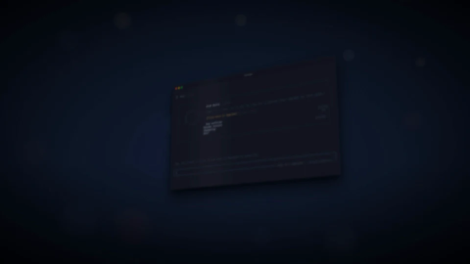
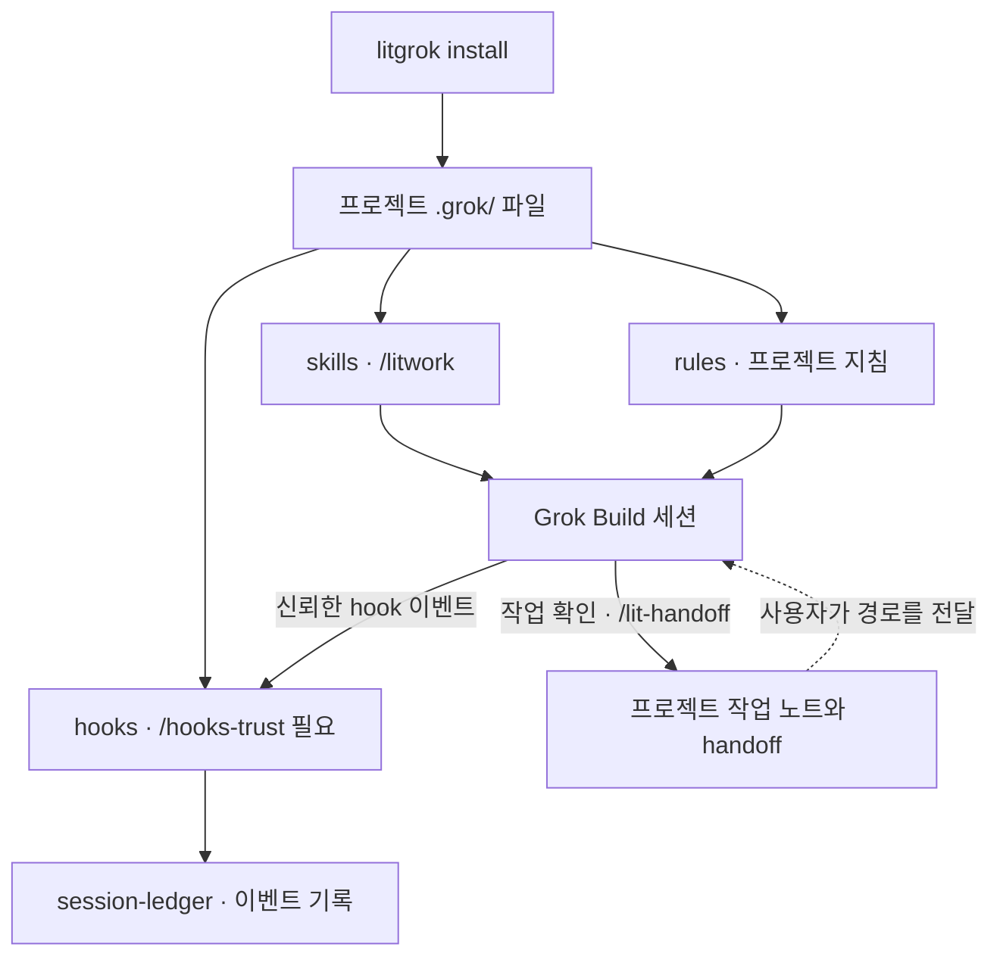

<p align="center"><picture><source media="(prefers-reduced-motion: reduce)" srcset="./docs/assets/cover-motion-still.webp" /><source media="(prefers-reduced-motion: no-preference)" srcset="./docs/assets/cover-motion.webp" /></picture></p>

<h1 align="center">LitGrok</h1>
<p align="center"><strong>Keep the work lit.</strong></p>

<p align="center">xAI Grok Build에 스킬, 프로젝트 규칙, 훅을 더해 세션마다 계획하고, 만들고, 확인하고, 다음 세션이 이어받을 인수인계 문서를 남기게 합니다.</p>

<p align="center">
<a href="https://www.npmjs.com/package/@litfamily/litgrok"></a>
<a href="https://www.npmjs.com/package/@litfamily/litgrok"></a>
<a href="./LICENSE"></a>
<a href="https://github.com/wjgoarxiv/litgrok/stargazers"></a>
</p>

<p align="center"><a href="#30초-설치">설치</a> &nbsp; <a href="./docs/guide_ko-KR.md"> 안내서</a> &nbsp; <a href="./docs/skills_ko-KR.md">스킬</a> &nbsp; <a href="./docs/guide_ko-KR.md#움직임으로-보기"> 영상</a> &nbsp; <a href="./docs/guide_ko-KR.md#안전하게-설치하고-지우기"> 안전</a> &nbsp; <a href="./docs/reference_ko-KR.md">상세 안내</a> &nbsp; <a href="./README.md">English</a></p>

<!-- demo-gif --><p align="center"></p>

<p align="center"><sub>LitGrok을 설치한 실제 Grok Build 1.0.13 세션을 터미널에서 녹화한 뒤, 그린 터미널 창 위에서 카메라를 움직이며 다시 재생했습니다. 기다리는 시간을 줄이고 프로젝트 폴더를 ~/greet로 표시했으며, 나머지 글자는 Grok Build가 출력한 그대로입니다. 설치 화면은 <a href="./docs/guide_ko-KR.md">안내서</a>에 있습니다.</sub></p>

## 왜 LitGrok인가요

Grok Build는 시작이 빠릅니다. 한 줄만 입력하면 바로 일을 시작하죠. 문제는 그다음입니다. 세션이 길어지면 컨텍스트가 차서 대화가 압축되고, 새 세션은 앞 세션이 알던 내용을 모른 채 시작합니다. "다 됐다"는 말도 모델이 그렇게 말했다는 뜻일 때가 많습니다. 결국 어디까지 했는지 다시 설명하고, 무엇이 실제로 되는지 손으로 확인하게 됩니다.

LitGrok은 세션마다 따라갈 순서를 줍니다. 큰 변경은 첫 수정 전에 계획부터 글로 남깁니다. 작업은 그 계획에 비추어 확인하고, 아무도 확인하지 못한 부분은 미확인으로 표시합니다. 멈추기 전에는 무엇을 만들었고, 무엇을 확인했고, 무엇이 남았는지 인수인계 문서에 적어 두어서 다음 세션이 그 문서를 읽고 이어 갈 수 있습니다. 세션을 돌리고 모델을 고르는 일은 여전히 Grok Build가 하고, LitGrok은 일하는 방식만 더합니다.

## 30초 설치

Node.js와 Grok Build가 있으면 됩니다. 써 보고 싶은 프로젝트에서 대화형 터미널을 열고 다음을 실행하세요.

```bash
npm exec --yes --package @litfamily/litgrok@latest -- litgrok install
```

파일은 `<project>/.grok/`에 들어갑니다. 어디에 무엇이 들어갈지 먼저 보려면 `--dry-run`을, 사용자 홈(`~/.grok/`)에 설치하려면 `--user`를 붙이세요. 이 릴리스로 고정하려면 `--package @litfamily/litgrok@1.0.16`을 쓰면 됩니다. `install`을 다시 실행하면 업데이트되고, 직접 고친 파일은 덮어쓰지 않습니다. [다른 설치 방법, 상태 행, 안전 장치](./docs/guide_ko-KR.md#설치-옵션)

## 빠른 시작

1. 프로젝트의 Git 루트에서 Grok Build를 열거나 다시 시작합니다. 일반 폴더라면 먼저 직접 `git init`을 실행하세요. Git 루트가 없으면 스킬과 규칙은 불러와도 훅은 꺼진 채로 남습니다. Grok은 신뢰한 Git 프로젝트 루트에서만 프로젝트 훅을 실행하니, `/hooks-trust`에서 훅을 살펴보고 신뢰해 주세요. [다른 신뢰 방법과 훅이 보이지 않을 때 확인할 것](./docs/guide_ko-KR.md#훅이-보이지-않을-때)
2. `/skills`에 LitGrok 스킬이, `/hooks`에 훅 등록이 보이는지 확인합니다.
3. 외부 서비스가 필요 없는 작은 작업부터 보내 보세요.

```text
/litwork 외부 의존성 없이 index.html 하나로 할 일 목록을 만들어줘. 추가·완료·삭제 동작을 구현하고, 확인한 내용과 다음 할 일을 남겨줘. 브라우저를 자동으로 열지 말고 내가 확인할 순서를 알려줘.
```

훅이 로드되면 새 세션이 LIT 마크와 `LitGrok payload present: skills, project rules, hooks, and the npx installer.` 줄로 시작합니다. `/litwork`는 모델에게 답을 🔥 **LIT IGNITED · litwork** 🔥로 시작해 체크리스트를 따라가고, 확인한 내용과 다음 할 일로 끝내라고 요청합니다. 그다음 `index.html`을 직접 열어 항목을 추가하고, 완료로 표시하고, 지워 보세요. 이렇게 직접 눌러 보는 것이 진짜 확인이고, 해 보지 못한 부분은 미확인으로 남습니다. [LitGrok이 출력하는 화면 모음](./docs/guide_ko-KR.md#화면에-나오는-모습)

메시지를 그냥 `lit`으로 시작하고 할 일을 적어도 됩니다. 그러면 프로젝트 규칙이 Grok Build에 알맞은 스킬을 고르라고 안내하고, 어떤 스킬을 골랐는지는 세션에서 보입니다.

하루 작업을 멈추기 전에는 인수인계를 요청하세요.

```text
/lit-handoff 지금까지 만든 것, 확인한 것, 남은 일을 기록하고 저장 경로를 알려줘.
```

다음 세션에서는 돌려받은 경로를 Grok Build에 알려 주고, 그 문서를 읽은 뒤 현재 파일 상태부터 확인하라고 요청하세요. 새 Git 프로젝트라면 `.handoff/HANDOFF.md`에 저장됩니다. [인수인계 문서가 저장되는 곳](./.grok/skills/lit-handoff/SKILL.md)

## 무엇을 할 수 있나요

스킬 38개, 에이전트 11개, 프로젝트 규칙 하나, 훅 등록 열한 개가 들어 있습니다. 평소에는 그중 몇 가지만 써도 충분합니다.

### 작업 하나를 위한 체크리스트

`/litwork`는 범위가 정해진 작업을 짧은 체크리스트로 바꾸고, 세션이 끝까지 그 순서를 따르게 합니다. 실행한 확인과 다음 할 일을 남기니, 실제로 한 일과 짐작으로 넘어간 일을 구별할 수 있습니다.

```text
/litwork src/dates.js의 날짜 파싱 버그를 고치고, 수정 전에는 실패하는 테스트를 하나 추가해줘.
```

### 계획하고 나서 만들기

큰 변경이라면 `/lit-plan`이 번호 붙은 행과 행마다의 확인 기준을 담은 계획 파일을 쓰고, 아직 아무것도 고치지 않습니다. 계획을 읽고 승인하면 `/start-work`가 한 행씩 실행하고, 확인을 통과한 행에만 체크합니다.

```text
/lit-plan 보고서 페이지에 CSV 내보내기를 테스트와 함께 추가해줘.
/start-work <출력된 계획 경로>
```

### 합치기 전에 한 번 더 보기

`/review-work`는 읽기 전용 검토 레인 여섯 개로 변경을 살펴보고, 찾은 문제를 근거에 따라 순서대로 정리합니다. 파일은 고치지 않습니다.

```text
/review-work 이 브랜치의 변경 사항
```

### 출처를 따라갈 수 있는 조사

`/litresearch`는 조사 범위를 정해 두고, 모든 주장을 출처와 연결하며, 근거가 약하면 약하다고 말합니다.

```text
/litresearch 작은 웹 앱에서 쓰기 속도에 가장 영향을 주는 SQLite 설정은 무엇인지 출처와 함께 알려줘.
```

### 슬라이드, 문서, 글

`lit-pptx`는 편집할 수 있는 PowerPoint 덱을, `lit-docx`는 서식을 갖춘 Word 문서를 Markdown 원본과 함께 만듭니다. 둘 다 일에 맞는 디자인 방향을 스스로 고르고, 바꿔 볼 만한 다른 방향 두 가지도 알려 줍니다. `lit-humanizer`는 딱딱한 한국어나 영어 문장을 사실은 그대로 두고 자연스럽게 고쳐 씁니다.

```text
/lit-pptx 월요일 팀 회의용으로 이번 분기 고객 문의 현황을 6장짜리 발표자료로 만들어줘.
/lit-humanizer docs/intro.md
```

### 명령 한눈에 보기

| 이렇게 입력하면 | 일어나는 일 |
| --- | --- |
| `/litwork` | 범위가 정해진 작업에 쓸 체크리스트를 시작합니다. |
| `handoff` 또는 `/lit-handoff` | 확인한 결과와 다음 할 일을 다음 세션으로 건넵니다. |
| `/lit-plan` | 확인 기준이 붙은 계획을 씁니다. |
| `/start-work <승인된 계획>` | 승인한 계획을 실행합니다. |
| `/review-work` | 변경 사항과 그 근거를 검토합니다. |
| `/litresearch` | 출처를 따라갈 수 있는 범위 안에서 조사하고, 근거보다 크게 말하지 않습니다. |

[스킬 38개 전체와 스킬마다 얻는 결과 그림](./docs/skills_ko-KR.md)

## 자동 핸드오프

세션이 길어지면 컨텍스트가 차고, Grok이 대화를 압축하면서 세부 내용이 사라집니다. LitGrok은 그 전에 인수인계 문서를 받아 둘 수 있습니다. 퍼센트는 직접 정하고, 정하기 전까지 이 기능은 꺼져 있습니다.

```bash
npm exec --yes --package @litfamily/litgrok@latest -- litgrok auto-handoff on 60
```

턴이 끝났을 때 컨텍스트가 그 퍼센트 이상이면 Stop 훅이 모델에게 인수인계 문서를 쓰라고 요청하고, 모델은 "Handoff saved. Run /compact now." 한 줄로 마무리해 압축할 때를 알려 줍니다. `LITGROK_AUTO_HANDOFF_PERCENT`를 설정하면 그 환경에서는 저장된 퍼센트 대신 그 값을 씁니다. 컨텍스트 수치는 선택 기능인 상태 행에서 읽으니 `install --user --status-line`으로 상태 행을 켜 두어야 하고, 다른 프로젝트 훅처럼 신뢰한 Git 루트(`/hooks-trust`)에서만 동작합니다. [모든 설정과 단계별 동작](./docs/guide_ko-KR.md#자동-핸드오프-자세히)

## 어떻게 동작하나요



설치 프로그램은 프로젝트의 `.grok/` 폴더에 일반 파일을 복사할 뿐, 다른 곳은 건드리지 않습니다. 스킬은 부를 때 세션이 읽는 지침이고, 프로젝트 규칙은 언제 어떤 스킬을 쓰면 좋을지 Grok Build에 알려 줍니다. 훅을 신뢰하면 세션을 시작할 때 LIT 마크를 띄우고, 선택 기능인 상태 행을 최신으로 유지하고, 결과물에 들어갈 문장을 쓰기 전에 검사하고, 이벤트 순서를 `.grok/litgrok/session-ledger/`에 기록합니다. 백그라운드에서 따로 도는 작업은 없습니다. 세션이 끝나면 작업은 인수인계 문서 안에서 기다리다가, 사용자나 다음 세션이 이어받습니다. [LitGrok이 상태를 두는 곳](./docs/guide_ko-KR.md#litgrok이-상태를-두는-곳)

## 필요한 것, 업데이트, 제거

- **필요한 것:** Node.js와 Grok Build. 이 페이지의 내용은 Grok Build 1.0.13에서 확인했습니다. 슬라이드 작업에는 Node.js 20.9 이상이 필요하고, 문서 스킬은 처음 쓸 때 버전이 고정된 도구를 전용 캐시에 설치합니다.
- **업데이트:** 같은 `install` 명령을 다시 실행합니다. 새 버전이 나왔는지는 `litgrok doctor`가 알려 주며, 직접 설치하지는 않습니다.
- **제거:** 설치한 범위 그대로 실행합니다. 설치 프로그램은 자기가 넣은 파일만 지우고, 그중 직접 고친 파일이 있으면 아무것도 지우기 전에 멈추고 그 파일을 알려 줍니다.

```bash
npm exec --yes --package @litfamily/litgrok@latest -- litgrok uninstall
npm exec --yes --package @litfamily/litgrok@latest -- litgrok uninstall --user
```

설치 프로그램은 `git init`, 훅 신뢰, 로그인, 모델 선택을 대신하지 않습니다. 이런 일과 API 키는 Grok Build에서 사용자가 직접 다룹니다.

## 더 알아보기

- [안내서](./docs/guide_ko-KR.md): LitGrok이 출력하는 화면, 홍보 영상, 설치 옵션과 상태 행, 안전 장치, 자동 핸드오프 세부 동작, 슬라이드와 문서, 자주 겪는 문제 해결.
- [전체 스킬](./docs/skills_ko-KR.md): 스킬 38개를 한 줄씩 정리했습니다.
- [상세 안내](./docs/reference_ko-KR.md): 설치, 훅, 터미널 출력, 패키지 검증, 출처.
- [프로젝트 규칙](./.grok/rules/00-litgrok.md), [스킬 폴더](./.grok/skills), [변경 이력](./CHANGELOG.md), [개인정보와 로컬 데이터](./docs/privacy.md), [기존 npm 이름에서 옮겨 오기](./docs/reference_ko-KR.md#npm-package-migration).
- [LitFamily](https://github.com/wjgoarxiv/litfamily): 다른 코딩 에이전트에서도 같은 방식으로 일할 수 있습니다.

## LITFAMILY

커버의 장갑 로봇 다섯은 LitFamily의 다섯 제품입니다. 각 제품은 자기 호스트에서 따로 동작하니, 쓰는 것 하나만 설치하면 되고 다른 제품은 필요 없습니다.

커버의 모션은 LitFamily 모션 스킬로 만든 브랜드 연출입니다. 그려서 움직인 그림이라 실제 Grok 세션을 녹화한 장면은 들어 있지 않습니다. 편집할 수 있는 벡터 원본은 `docs/assets/cover.svg`에 있고, 시스템에서 동작 줄이기를 켜 두었다면 정지 프레임이 대신 보입니다.

<p align="center"></p>

<details>
<summary>ASCII 로고 복사</summary>

```text
                             ▄▄▄▄
                   ▗███▌   ▗██████▖
 ▗▄▄▄▄▄          ▗▟████▌   ▝██████▘
 ▐█████        ▗▟██████▌    ▝▀▜█▀▘
 ▐█████      ▗▟███████▄▄▄▄▄▄▄▄▄▄▄▄▄▄▄▄▄▄▄▄
 ▐█████    ▗▟█████████████████████████ ▐█▀
 ▐█████    ████████████████████████████▀
 ▐█████    ██▛▘   ▄ ▄▄▄▄▖▄▄▄▄▄▄▄▄▄▄▄▄▄▖
 ▐█████    ▀    ▄██ ████▌█████████████▌
 ▐█████       ▄████ ████▌█████████████▌
 ▐█████     ▄█████▛
 ▐█████  ▗▟█████▀▘       ▄▄▄▄▄     ▗▖
 ▐█████ ▐█████▀          █████     ▐▛▀
 ▐█████ ▐███▀            █████
 ▐█████ ▐█▀              █████
 ▐█████ ▝                █████
 ▐█████▄▄▄▄▄▄▄▖          █████
 ▐███████████▛           █████
 ▐██████████▀            █████


grok
```

</details>

LitGrok 덕분에 같은 설명을 덜 반복하게 됐다면, GitHub 스타 하나가 다른 Grok Build 사용자에게 이 프로젝트를 알리는 데 도움이 됩니다.

기여하고 싶다면 작은 이슈나 풀 리퀘스트부터 시작하세요. 먼저 돌려 볼 검사는 [기여 안내](./CONTRIBUTING.md)에 있습니다. [보안](./SECURITY.md), [행동 규범](./CODE_OF_CONDUCT.md), [지원](./SUPPORT.md)도 함께 보세요. LitGrok은 [MIT 라이선스](./LICENSE)로 배포됩니다.
