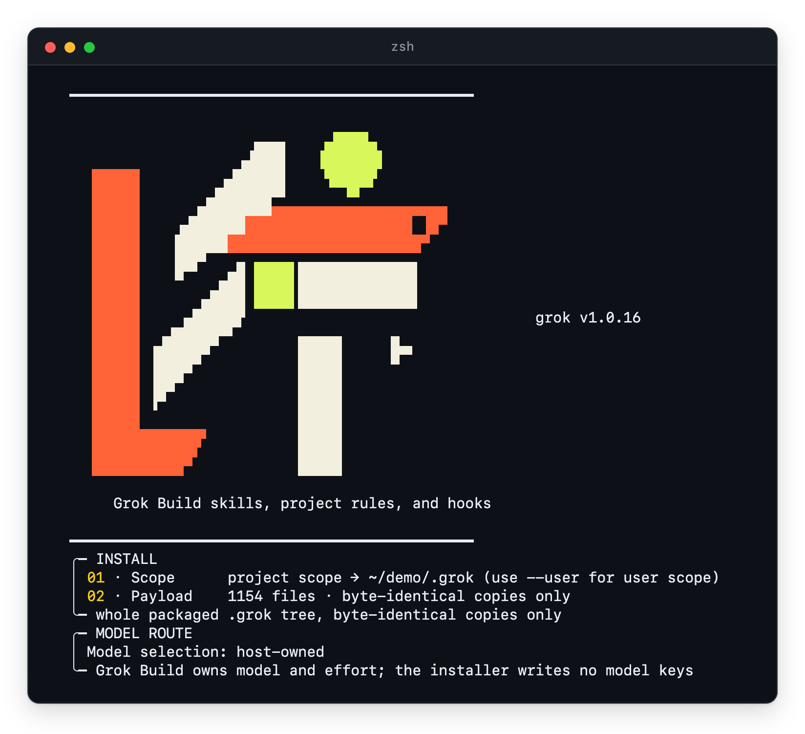

# LitGrok 안내서

[README](../README_ko-KR.md) · [English](./guide.md) · [전체 스킬](./skills_ko-KR.md) · [상세 안내](./reference_ko-KR.md)

[README](../README_ko-KR.md)에서 다 하지 못한 이야기를 모은 페이지입니다. LitGrok이 화면에 무엇을 출력하는지, 다른 설치 방법은 무엇인지, 기능마다 어떻게 움직이는지 정리했습니다. 아직 설치하지 않았다면 README부터 보세요.

## 다음 세션으로 불씨 건네기

> **불씨를 건네받았다. 이제, 당신의 작업에 옮길 차례다.**
>
> 고치고 싶은 버그 하나. 만들고 싶은 화면 하나. 끝내고 싶은 프로젝트 하나.
>
> 시작은 짧은 한 줄이면 됩니다. 세션이 바뀌면 어디까지 했는지 다시 짚기가 어렵습니다. LIT은 목표와 계획, 확인한 결과, 다음에 할 일을 프로젝트에 남기는 작업을 안내합니다.
>
> **대화가 끝난 자리에서, 다음 작업이 시작되도록.**

```text
계획하기 → 만들기 → 확인하기 → 다음 작업에 건네기
```

세션을 `/lit-handoff`로 마무리하면([빠른 시작](../README_ko-KR.md#빠른-시작) 참고) 인수인계 문서를 어디에 저장했는지 알려 줍니다. 다음 세션에서는 그 경로를 Grok Build에 알려 주고, 문서를 읽은 뒤 현재 파일 상태부터 확인하라고 요청하세요. 인수인계 문서는 새 Git 프로젝트라면 `.handoff/HANDOFF.md`, Git이 없는 폴더라면 `HANDOFF.md`에 저장됩니다. 루트에 인수인계 문서가 이미 있으면 그 파일을 씁니다. [경로 선택과 인수인계 안내](../.grok/skills/lit-handoff/SKILL.md)

작업 중에 뭔가 깨지면 오류 메시지를 그대로 세션에 붙여 넣으세요.

이 과정은 모두 지금 세션 안에서 스킬의 안내를 따라 진행되고, LitGrok이 백그라운드에서 따로 돌리는 작업은 없습니다. 세션이 끝나면 작업도 그 자리에서 멈추고, 다음 세션이 인수인계 문서를 받아 다시 이어 갑니다.

## 화면에 나오는 모습

아래 그림은 LitGrok이 터미널에 출력하는 내용입니다. 설치하기 전에 미리 볼 수 있도록 실었습니다. 그림마다 LitGrok의 설치 프로그램, SessionStart 훅, 프롬프트 훅, 상태 행 명령이 실제로 출력한 내용을 캡처했고, 빈 데모 프로젝트와 임시 홈 폴더에서 실행했습니다. 홈 폴더 경로만 `~`로 줄였습니다. 창 테두리는 글자 둘레에 그려 넣은 것이라 실제 터미널에서는 글꼴과 색이 다르게 보일 수 있습니다. 대부분의 그림은 페이지 테마를 따라 어두운 페이지에서는 어두운 창으로, 밝은 페이지에서는 밝은 창으로 보입니다. 굵은 글씨는 보통 굵기로 그렸고, 불꽃 이모지는 작은 벡터 아이콘으로 대신 그렸습니다. 그림 속 버전 번호, 파일 개수, 걸린 시간은 캡처한 실행의 값입니다.

설치 프로그램은 LIT 마크와 패키지 버전을 먼저 보여 준 뒤, 파일이 들어갈 위치와 개수를 알려 줍니다. Scope는 파일이 들어갈 폴더입니다. 여기서는 데모 프로젝트의 `.grok` 폴더이고, `--user`를 붙이면 홈 폴더가 됩니다. Payload는 파일 개수이고, 모두 원본과 바이트가 같은 복사본입니다. MODEL ROUTE 카드는 모델을 계속 Grok Build가 고른다고 알려 줍니다. 그래서 설치 프로그램은 모델을 묻지 않고 모델 키도 쓰지 않습니다. 마크의 크림색 칸이 흰 창에서는 흐려지므로, 이 그림은 페이지 테마와 상관없이 어두운 창으로 보여 줍니다.

<p align="center"></p>

*설치 프로그램에서 캡처*

`--dry-run`을 붙이면 같은 계획 뒤에 DRY RUN — no files written 줄이 나오고, 이어서 복사할 파일이 한 줄에 하나씩 나옵니다. 그림은 그중 처음 세 줄까지만 보여 주며, 전체 줄 수는 직접 실행했을 때 Payload 줄에 나옵니다. [안전하게 설치하고 지우기](#안전하게-설치하고-지우기)에 적힌 다른 미리보기 경우도 같은 형태로 출력하며, no files written 줄에 그 이유가 적힙니다.

<p align="center"><picture><source media="(prefers-color-scheme: dark)" srcset="./assets/screens/install-dry-run-dark.webp" /></picture></p>

*`--dry-run` 설치에서 캡처*

실제 설치는 네 단계를 차례로 거치고 단계마다 걸린 시간을 적습니다. PAYLOAD는 파일 수를 세고, SAFETY는 설치 경로가 비어 있는지 확인하고, OWNERSHIP은 파일마다 디스크에 이미 있는 것과 견주고(새 프로젝트에는 아무것도 없어서 충돌이 없습니다), WRITE는 파일을 복사합니다. 이어지는 영수증은 Ready로 시작하고 사용자가 챙길 일을 알려 줍니다. 프로젝트 훅은 신뢰한 Git 루트에서만 돌기 때문에 `/hooks-trust`를 안내하고, 설치 프로그램이 `git init`을 실행하거나 신뢰 설정을 바꾸지 않는다고 적습니다. 마지막 두 줄은 영상 도구를 미리 받는 명령과 Grok Build를 다시 시작하라는 안내입니다. 가장 긴 줄은 터미널이 줄을 바꾸는 방식대로 100칸에서 접혀 있습니다.

<p align="center"><picture><source media="(prefers-color-scheme: dark)" srcset="./assets/screens/install-done-dark.webp" /></picture></p>

*설치 프로그램에서 캡처*

신뢰한 프로젝트에서 세션이 시작되면 SessionStart 훅이 LIT 마크와 페이로드가 있다는 한 줄을 출력합니다. 이 마크가 보이면 그 세션에서 훅이 로드된 것이고, 끝내 나타나지 않으면 [훅이 보이지 않을 때](#훅이-보이지-않을-때)부터 확인하세요. 이 훅은 일반 문자만 출력하므로 마크에 색이 없습니다. 색이 있는 마크는 위의 설치 프로그램 배너입니다.

<p align="center"><picture><source media="(prefers-color-scheme: dark)" srcset="./assets/screens/session-start-dark.webp" /></picture></p>

*SessionStart 훅에서 캡처*

선택 기능인 [상태 행](#상태-행-켜기-선택)은 Grok이 화면에 계속 띄워 두는 한 줄입니다. 프롬프트가 LitGrok 스킬을 부르기 전에는 다른 LitFamily 상태 행과 같은 모양입니다. `[🔥LIT vX.Y.Z]` 마크 뒤에 추론 강도가 붙은 모델, 컨텍스트 게이지, 세션 비용, Git 브랜치가 모두 LitGrok의 불꽃 주황으로 이어집니다. 프롬프트가 스킬을 시작하면(여기서는 `/litwork`) 상태 행이 LIT 카드로 커집니다. 제목에는 마크, 분홍 `🔥 LIT` 칩, 스킬 이름이 오고, 오른쪽 끝에는 지금까지의 도구 호출 수, 아직 도는 하위 에이전트 수, 턴이 돈 시간이 붙습니다. 그 아래 단계 지도는 plan을 지나 work가 진행 중이고 계획의 작업 일곱 개 중 세 개가 체크됐음을 보여 줍니다. 다음 줄에는 다음에 할 작업, 마지막 테스트 결과, 12초째 돌고 있는 셸 명령이 나오고, 마지막 줄에는 수치가 남습니다. 창에는 두 상태가 모두 들어 있습니다. 프롬프트 훅에 평범한 질문을 먼저 보내고, 이어서 작업 일곱 개짜리 계획을 저장하고 끝난 `/lit-plan` 턴, 마지막으로 `/litwork` 프롬프트를 보냈습니다. LitGrok의 도구 훅과 하위 에이전트 훅이 도구 호출 세 번(그중 하나는 테스트 세 개가 통과한 실제 `node --test` 실행)과 하위 에이전트 둘(그중 하나는 끝남)을 기록했고, 셸 명령이 시작되고 12초 뒤에 상태 행 명령이 답한 결과입니다. 모델 이름, 추론 강도, 42%, 2m 창 크기, 비용, 브랜치, 1m42s 턴 시간은 입력으로 넣은 예시 값입니다. 실제 값은 Grok이 넘겨주기 때문입니다. Bash 앞의 스피너는 화면을 다시 그릴 때마다 돌아갑니다. 훅을 설치된 사본으로 실행해서 마크에 버전이 보입니다.

<p align="center"><picture><source media="(prefers-color-scheme: dark)" srcset="./assets/screens/status-row-dark.webp" /></picture></p>

*프롬프트 훅, 도구 훅, 하위 에이전트 훅과 상태 행 명령에서 캡처*

## 움직임으로 보기

이 영상은 22초 동안 불씨 하나를 따라갑니다. LIT 마크의 연두색 점이 한 줄을 입력하면 마크에 불을 붙이고, 계획·구현·검증·인계를 차례로 지나 상태 행을 밝힌 뒤, 인수인계 카드에 실려 새 터미널로 넘어가서 다시 마크에 불을 붙입니다.

<p align="center"><a href="./assets/promo/promo-ko.mp4"><picture><source media="(prefers-reduced-motion: reduce)" srcset="./assets/promo/promo-ko-still.webp" /><source media="(prefers-reduced-motion: no-preference)" srcset="./assets/promo/promo-ko-preview.webp" /></picture></a></p>

영상은 LitGrok의 모션 스킬로 만들고 글꼴은 Pretendard를 썼습니다. 터미널과 상태 행에 나오는 글자는 LitGrok이 실제로 출력하는 문자열입니다. 예시 프롬프트, 카드의 항목, 새 터미널의 문장은 보여 주기 위해 그린 것이고, 불꽃은 그려 넣은 도형입니다. 녹화한 Grok 세션은 들어 있지 않습니다. 시스템에서 동작 줄이기를 켜 두었다면 정지 프레임이 보입니다. 자동으로 만든 배경 음악까지 들으려면 [MP4로 보기](./assets/promo/promo-ko.mp4)를 누르세요.

## 설치 옵션

대부분은 [README](../README_ko-KR.md#30초-설치)의 기본 설치로 충분합니다. 이 절에서는 다른 설치 방법, 선택 기능인 상태 행, 그리고 설치 프로그램이 파일을 쓰거나 지우기 전에 무엇을 확인하는지 다룹니다.

### 로컬 패키지로 써 보기

npm 레지스트리 대신 패키지 파일로 설치하려면 실제 절대 경로를 변수에 넣고 두 줄을 따로 실행하세요.

```bash
LITGROK_PACK='/absolute/path/to/the-provided-package.tgz'
npm exec --yes --package "$LITGROK_PACK" -- litgrok install
```

### 상태 행 켜기 (선택)

원하면 Grok 화면에 LitGrok 상태 행을 띄워 둘 수 있습니다. 마지막 프롬프트로 어떤 LitGrok 스킬이 시작됐는지, 어떤 모델인지, 컨텍스트를 얼마나 썼는지가 한 줄에 보입니다. 사용자 설정에 들어가는 값이라, 사용자 범위로 설치할 때 켜야 합니다.

```bash
npm exec --yes --package @litfamily/litgrok@latest -- litgrok install --user --status-line
```

이 명령은 `~/.grok/config.toml`에 `[ui.status_line]` 항목을 넣고, 상태 행은 2초마다 새로 고쳐집니다. 파일을 바꾸기 전에는 먼저 백업하고, 직접 설정한 상태 행이 이미 있으면 파일을 그대로 둡니다. 나중에 `--user`로 제거하면 LitGrok이 넣은 값만 지우고, 사용자가 직접 고친 값은 그대로 둡니다.

Grok은 이 설정을 사용자나 관리자 설정에서만 읽고, 프로젝트나 플러그인 설정은 보지 않습니다. 그래서 프로젝트 설치로는 켤 수 없습니다([상태 행 문서](https://docs.x.ai/build/features/status-line), [설정 참조](https://docs.x.ai/build/settings/reference)).

끝났을 때 알림을 받고 싶다면 같은 명령에 `--notify`를 붙이세요. `[ui.notifications]` 표를 추가해, 턴이 끝나거나 승인이 필요하거나 실패했을 때 Grok이 직접 터미널 알림을 띄우게 합니다. 터미널을 보고 있을 때도 알림이 옵니다. Grok 기본값은 다른 창을 보고 있을 때만 알립니다. 알림 설정이 이미 있으면 LitGrok은 손대지 않고, `--user`로 제거하면 LitGrok이 넣은 표가 그대로일 때만 지웁니다.

<details>
<summary>상태 행에 보이는 내용</summary>

LitGrok 스킬이 동작하지 않을 때 상태 행은 `[🔥LIT vX.Y.Z] | Grok 4.5 [high] │ ctx [█▎░] 42%/2m │ $0.42 │ git main` 같은 한 줄입니다. 모델 뒤 괄호는 추론 강도이고 Grok이 알려 줄 때만 나옵니다. 컨텍스트 게이지는 70%까지 주황이고 70%에서 노랑, 90%에서 빨강으로 바뀝니다. 빗금 뒤 숫자는 컨텍스트 창의 크기입니다. 그 뒤로 지금까지 쓴 비용과 Git 브랜치가 붙습니다. Grok이 보내지 않은 값은 `?`로 표시하거나 빼 둡니다.

어떤 이름이 뜰지는 가장 최근 프롬프트가 정합니다. 프롬프트에서 `lit-scientific-visualization`, `lit-handoff`, `autoconference`, `autoresearch`, `lit-plan`, `litwork` 가운데 가장 먼저 나오는 이름이 표시되고, `lit`만 쓰면 `litwork`로 보입니다. 인라인 코드나 코드 블록 안에 든 이름은 세지 않으니, 코드 조각을 붙여 넣어도 표시는 바뀌지 않습니다.

프롬프트가 스킬을 시작하면 상태 행이 LIT 카드로 커집니다. 제목은 `[🔥LIT vX.Y.Z] |  🔥 LIT  · litwork`입니다. 패밀리 마크, 분홍 `🔥 LIT` 칩, 스킬 이름이 차례로 옵니다. 제목 오른쪽 끝은 턴이 무엇을 하는지 알려 줍니다. 도는 중이면 걸린 시간이 붙은 `● 1m42s`, 끝나면 20초 동안 초록 `✓ complete`, 그 밖에는 `idle`입니다. 그 칩 옆에는 지금까지의 도구 호출 수와 아직 도는 하위 에이전트 수가 붙습니다. 카드의 마지막 줄에는 모델, 컨텍스트 게이지, 비용, 브랜치가 그대로 남습니다. LitFamily 상태 행은 제품마다 한 가지 색을 쓰기 때문에 나머지는 모두 LitGrok의 불꽃 주황(`#FF6337`)이고, 왼쪽 가장자리의 가는 주황 막대가 카드를 묶어 줍니다. Grok Build 1.0.13의 상태 행에서 truecolor, 굵은 글씨, emoji가 모두 제대로 보였습니다.

손을 봐야 할 일이 생기면 카드에 노란 경고가 붙습니다. 계획 게이트가 계획을 아직 저장하지 않은 계획 턴을 붙잡았을 때, 자동 핸드오프가 핸드오프를 요청했을 때, 컨텍스트가 핸드오프 퍼센트에 가까워졌을 때입니다. 제목은 짧게, 제목 아래 줄은 `⚠ plan gate: save plans/<slug>.md`처럼 길게 알려 줍니다. 타이머는 Grok이 준 값을 쓰고, 수는 LitGrok의 세션 기록에서 셉니다. LitGrok이 읽을 수 없는 값은 짐작하지 않고 뺍니다. 화면이 좁으면 버전, 수, 칩부터 빠지고 스킬 이름, 지금 단계, 컨텍스트 게이지는 끝까지 남습니다.

그리는 방식을 바꾸는 스위치도 몇 가지 있습니다. 색을 전혀 쓰지 않으려면 Grok 실행 환경에 `NO_COLOR`(빈 값도 됩니다)나 `LITGROK_HUD_COLOR=0`을 설정하세요. 칩은 `(🔥 LIT)` 같은 괄호가 됩니다. 터미널이 색을 적게 보여 준다면 `LITGROK_HUD_COLOR=256`이나 `LITGROK_HUD_COLOR=16`이 가장 가까운 색을 고릅니다. `LITGROK_HUD_GLYPHS=nerd`는 둥근 칩과 작은 아이콘을 그리는데 터미널에 Nerd Font가 있어야 하고, `LITGROK_HUD_GLYPHS=ascii`는 emoji나 상자 문자, 점자가 없는 글꼴을 위해 ASCII만 씁니다. `LITGROK_HUD_LINES=1`은 상태 행을 한 줄로 유지하고, 이때 활성 스킬은 `🔥 LIT IGNITED · litwork 🔥`로 보입니다.

프롬프트가 작업 흐름 스킬을 부르면 카드에 세션이 LIT 작업 흐름의 어디쯤인지 보여 주는 지도가 붙습니다. `plan ✓ ━━━━ [work 3/7] ━━━━ review · ──── done ·` 같은 모습이고, 그 아래 줄은 `└ task 3/7 ▮▮▮▯▯▯▯ · next ▸ 4. README demo GIF · tests ✓ 214`에 오른쪽 끝 `⠹ Bash 0:31`입니다. `deep-interview`는 인터뷰 단계, `lit-plan`은 계획, `start-work`나 `litwork`, `lit`만 쓴 프롬프트는 작업, `review-work`(또는 `lit review`)는 검토 단계를 시작합니다. `lit brainstorm`, `lit ideation`, `lit idea`는 `lit-brainstorm`을 열며, 상태 줄에 이름이 나오고 단계는 그대로 둡니다. 인터뷰는 세션이 실제로 거쳤을 때만 보입니다. 지나온 단계는 회색에 체크 표시가 붙고, 지금 단계는 주황으로 찬 칸으로 보이며, 작업 단계에서는 `plans/`의 가장 최근 계획에서 체크한 작업 수를 세고, 아직 열린 첫 작업의 이름을 보여 줍니다. 검토 턴이 끝났을 때 그 계획의 작업이 모두 체크되어 있으면 done이 켜집니다. 턴이 도는 동안에는 지금 단계로 들어가는 레일 위를 분홍 칸 하나가 다시 그릴 때마다 한 칸씩 움직이고, 그 아래 줄에 지금 실행 중인 도구와 걸린 시간이 나옵니다. 테스트 표시는 테스트 실행기를 부른 마지막 명령의 결과입니다. 통과했으면 통과한 수를, 실패했으면 실패한 수를 보여 줍니다. LitGrok은 단계 이름과 작업 수, 열린 작업의 이름, 이 결과만 남기고 프롬프트나 명령, 출력은 남기지 않습니다. 화면이 좁으면 레일부터 짧아지고, 이어서 단계 이름이 빠지며, 지금 단계는 끝까지 남습니다.

상태 행은 별도의 상태 명령으로 돌기 때문에 훅 등록은 그대로 열한 개입니다.

</details>

### 안전하게 설치하고 지우기

실제로 쓰기 전에 어느 경로에 파일이 들어가는지 보려면 `--dry-run`을 붙이세요.

```bash
npm exec --yes --package @litfamily/litgrok@latest -- litgrok install --dry-run
```

설치 프로그램은 파일을 업데이트하거나 지우기 전에 자기가 설치한 파일인지부터 확인합니다. 직접 고친 파일, 다른 도구가 둔 파일, 심볼릭 링크처럼 안전하지 않은 경로가 하나라도 있으면 아무 파일도 쓰기 전에 작업 전체를 멈추고, 어떤 파일 때문인지 알려 줍니다.

어떤 때는 미리보기만 하고 끝납니다. 무엇을 할지 보여 준 뒤 `no files written`을 출력하고 멈추는데, `--yes`를 붙여도 다음 경우에는 그렇습니다.

- `--dry-run`: 먼저 계획만 보겠다고 한 경우입니다.
- `--no-color`를 붙였거나 환경에 `NO_COLOR`가 있는 경우입니다. 값이 비어 있어도 마찬가지이니, 실제로 설치하려면 이 변수를 지우세요.
- 환경에 `CI`가 있는 경우입니다. CI 작업에서는 늘 미리보기로 끝납니다.

`--yes` 없이 스크립트나 파이프처럼 터미널이 연결되지 않은 곳에서 실행해도 미리보기입니다. 스크립트에서 실제로 설치하려면 `--yes`를 붙이세요. 위 경우에 해당하지 않으면 터미널 없이도 설치가 진행됩니다.

제거는 설치한 방식 그대로 합니다. 프로젝트에 설치했다면 그대로, 사용자 범위에 설치했다면 `--user`를 붙여 실행하세요.

```bash
npm exec --yes --package @litfamily/litgrok@latest -- litgrok uninstall
npm exec --yes --package @litfamily/litgrok@latest -- litgrok uninstall --user
```

로컬 패키지로 설치했다면 같은 프로젝트에서 같은 패키지로 지웁니다.

```bash
npm exec --yes --package "$LITGROK_PACK" -- litgrok uninstall
```

사용자 범위에서 제거할 때는 먼저 `~/.grok/config.toml`을 백업한 뒤, LitGrok이 넣고 손대지 않은 상태 행 값만 지웁니다. 다른 설정은 건드리지 않습니다. 업데이트는 `install`을 다시 실행하면 됩니다.

몇 가지는 사용자 몫으로 남겨 둡니다. 훅 신뢰, Git 루트 만들기, 로그인, 모델 선택은 모두 Grok Build에서 하는 일이라 설치 프로그램은 손대지 않고, API 키도 건드리지 않습니다. 훅 가운데 얼버무림 검사는 결과물에 모호하게 둘러대는 표현이 들어가기 전에 막아 줍니다. 다만 호스트 쪽에서 오류가 나면 막지 않고 그대로 통과시킵니다. 패키지 테스트는 배포하는 파일을 검사합니다. 지금 세션이 실제로 무엇을 불러왔는지는 저장소 루트에서 Grok Build를 열고 `/hooks`와 `grok inspect --json`으로 확인하세요. [호스트 경계와 검증](./reference_ko-KR.md#검증)

## 자주 쓰는 명령

평소에는 아래 여섯 개면 충분합니다. 각 명령은 스킬의 지침을 Grok Build에 건네고, 모델이 실제로 어떻게 움직이는지는 세션에서 보입니다.

| 이렇게 입력하면 | 일어나는 일 |
| --- | --- |
| `/litwork` | 범위가 정해진 작업에 쓸 체크리스트를 시작합니다. |
| `handoff` 또는 `/lit-handoff` | 확인한 결과와 다음 할 일을 다음 세션으로 건넵니다. |
| `/lit-brainstorm` | 열린 질문을 여러 선택지와 고를 수 있는 짧은 목록으로 펼칩니다. |
| `/lit-plan` | 확인 기준이 붙은 계획을 씁니다. |
| `/start-work <승인된 계획>` | 승인한 계획을 실행합니다. |
| `/review-work` | 작업 전에는 계획을, 작업 후에는 변경 사항을 근거와 함께 검토합니다. |
| `/litresearch` | 출처를 따라갈 수 있는 범위 안에서 조사하고, 근거보다 크게 말하지 않습니다. |

### 프로젝트 훅

훅 등록 열한 개는 [`hooks/hooks.json`](../hooks/hooks.json)에 있습니다. 세션이 시작되면 LitGrok 표시를 띄우고 선택 기능인 상태 행을 최신으로 유지하며, 결과물에 들어갈 문장은 쓰기 전에 미리 검사합니다. 이벤트가 일어난 순서도 함께 기록합니다. 다른 프로젝트 훅처럼 신뢰한 Git 루트에서만 동작합니다([빠른 시작](../README_ko-KR.md#빠른-시작) 참고).

### 활성화된 응답의 첫 줄

`/litwork`를 비롯한 몇몇 LitGrok 스킬은 활성화된 응답은 다른 말보다 이 한 줄로 먼저 시작하라고 모델에 요청합니다. `/litwork`라면 이런 줄입니다.

🔥 **LIT IGNITED · litwork** 🔥

이 줄이 보이면 작업이 시작된 것입니다. 모델에게 건네는 요청이니, 결과를 믿기 전에 직접 확인해 보세요.

## 자동 핸드오프 자세히

짧은 설명은 [README](../README_ko-KR.md#자동-핸드오프)에 있습니다. 여기서는 모든 설정과 단계별로 일어나는 일을 정리합니다.

세션이 길어지면 컨텍스트 창이 차고, Grok이 대화를 압축하면서 세부 내용이 사라집니다. LitGrok은 그 전에 핸드오프를 미리 받아 둘 수 있습니다. 컨텍스트가 정해 둔 퍼센트에 닿으면 모델이 아직 모든 내용을 기억하는 동안 핸드오프를 쓰게 합니다. 이 기능은 켜기 전까지 꺼져 있고, 퍼센트는 언제나 사용자가 정합니다. LitGrok에는 기본값이 없습니다.

프로젝트 루트에서 원하는 숫자로 켜세요.

```bash
npm exec --yes --package @litfamily/litgrok@latest -- litgrok auto-handoff on 60
```

- `auto-handoff on <percent>`는 1부터 99 사이의 정수 퍼센트로 켭니다. 숫자 없이 `auto-handoff on`만 쓰면 마지막으로 쓴 퍼센트를 다시 쓰고, 한 번도 정한 적이 없으면 숫자를 물어봅니다.
- `auto-handoff off`는 끄고, 다음에 쓸 수 있게 퍼센트를 기억해 둡니다.
- `auto-handoff status`는 켜져 있는지, 각 설정이 어디서 왔는지, 경고가 있는지 보여 줍니다.
- `LITGROK_AUTO_HANDOFF=1`은 그 환경에서 시작하는 모든 세션에서 기능을 켜고, `0`이면 꺼 둡니다. `LITGROK_AUTO_HANDOFF_PERCENT=60`은 퍼센트를 정하며 저장된 값보다 우선합니다. 1~99 밖의 값이면 기능은 꺼진 채로 있고, `status`가 이유를 알려 줍니다.

선택한 값은 프로젝트의 `.grok/litgrok/auto-handoff.json`에 저장됩니다. 켜고 나면 이렇게 흘러가며, Grok Build에서는 LitGrok이 맡는 단계와 그렇지 않은 단계가 나뉩니다.

| 단계 | Grok Build에서는 |
| --- | --- |
| 컨텍스트가 얼마나 찼는지 읽기 | 자동입니다. 다만 [상태 행 켜기](#상태-행-켜기-선택)의 상태 행을 통해서만 읽습니다. Grok이 훅에 퍼센트를 따로 알려 주지 않아서, 상태 행이 없으면 아무 일도 일어나지 않습니다. |
| 핸드오프 요청하기 | 자동입니다. 턴이 끝났을 때 컨텍스트가 정한 퍼센트 이상이면 Stop 훅이 모델을 계속 일하게 하고, `lit-handoff` 절차대로 핸드오프를 쓰라고 전합니다. 한 번 넘을 때마다 한 번만 요청하며, 요청을 따를지는 모델에게 달려 있습니다. |
| 압축하기 | 직접 실행합니다. Grok은 훅이 압축을 시작하게 해 주지 않으므로 모델이 "Handoff saved. Run /compact now." 한 줄로 마무리합니다. Grok도 설정을 바꾸지 않았다면 85퍼센트에서 스스로 압축하니, 그보다 낮은 퍼센트를 고르세요. 그렇지 않으면 `status`가 경고합니다. |
| 핸드오프 다시 불러오기 | 알림 수준입니다. 압축이 끝난 뒤 다음 턴이 끝날 때, 모델에게 이 세션이 저장한 핸드오프를 읽으라고 알립니다. Grok은 프롬프트 훅이 출력한 내용을 버리기 때문에 이 알림을 더 일찍 보낼 수 없습니다. 요청보다 오래됐거나 다른 세션이 쓴 핸드오프는 건너뜁니다. |

압축한 뒤 컨텍스트가 다시 정한 퍼센트를 넘으면 같은 과정이 처음부터 반복됩니다. 다른 프로젝트 훅처럼 신뢰한 Git 루트(`/hooks-trust`, [빠른 시작](../README_ko-KR.md#빠른-시작) 참고)에서만 동작합니다. 컨텍스트 수치는 [상세 안내](./reference_ko-KR.md#지속-상태-행-선택)에서 설명하는 상태 행용 임시 폴더에 두고, 각 단계는 세션 기록에 남깁니다.

## LitGrok이 상태를 두는 곳

훅을 신뢰하면 `.grok/litgrok/session-ledger/`에 이벤트가 일어난 순서가 쌓입니다. 새 세션에서 이어 가려면 인수인계 경로를 직접 건네면 됩니다.

이 기록에는 세션 ID, 폴더, 도구 이름이 들어가므로, 기록과 자동 핸드오프 설정을 담는 `.grok/litgrok/` 폴더에는 LitGrok이 처음 쓸 때 `*` 한 줄짜리 `.gitignore`가 함께 생깁니다. 설치한 `.grok` 스킬·규칙·훅을 커밋해도 이 실행 상태는 따라가지 않습니다.

[체크리스트와 훅의 범위](../.grok/skills/litwork/SKILL.md) · [인수인계 경로](../.grok/skills/lit-handoff/SKILL.md) · [설치 상세](./reference_ko-KR.md#설치)

## 화면, 슬라이드, 문서, 글

`/frontend-ui-ux <화면과 목표>`는 고쳐도 되는 화면을 만들고 렌더링을 확인합니다. 요구사항이 분명하면 바로 동작하는 코드로 가고, 중요한 방향이 모호할 때만 질문합니다. 검토나 계획만 요청하면 파일을 고치지 않습니다.

개념도나 기술 다이어그램에는 `lit-diagram-drawer` 스킬을 씁니다. 슬래시 경로(`/lit-diagram-drawer`)는 아직 실제 Grok Build 세션에서 확인하지 못했으니 `/skills`에서 찾아 쓰세요. 일반 화면은 `/frontend-ui-ux`, 측정 데이터 그래프는 `/lit-scientific-visualization`이 맡습니다. 실제 설비 그림(P&ID, 설비 배치도, 논문용 장치도, 아이소메트릭 단면도)은 `lit-schematic` 스킬을 씁니다. 남의 글에 공개된 기법을 내 스킬이나 시스템으로 가져올 때는 `lit-hijack` 스킬을 씁니다. 출처를 기록하고 라이선스를 검사한 뒤 실제 화면에서 동등함을 증명합니다.

발표자료는 `lit-pptx`, 보고서와 Word 문서는 `lit-docx`를 씁니다. `lit`만 입력하고 원하는 것을 설명하면, 요청 문구를 보고 둘 중 하나나 둘 다를 고르라고 프로젝트 규칙이 Grok Build에 안내합니다. 어느 쪽을 골랐는지는 세션에서 보입니다. 
두 스킬 모두 정해진 한 가지 모양으로 시작하지 않습니다. 슬라이드나 페이지를 쓰기 전에 요청을 먼저 읽습니다. 누가 읽는지, 발표하는지 미리 돌려 읽는지, 표와 그림과 단계가 얼마나 되는지를 보고 그 일에 맞는 디자인 방향을 고릅니다. 답변에는 고른 방향과 이유 한 문장, 그리고 함께 어울리는 다른 두 방향이 나옵니다. 마음에 들지 않으면 그 이름만 말하면 바뀝니다. `lit`만 입력한 요청이라면 아무것도 묻지 않고 이 과정을 거칩니다.

발표자료에는 여덟 가지 방향이 있고, 방향마다 색, 제목 위치, 슬라이드 배치가 다릅니다. 숫자 중심의 실적 보고, 슬라이드마다 한 가지만 말하는 피치, 사진 중심 발표, 강의, 연구 발표, 한국어 보고서형 덱, 잡지형 편집 배치, 어두운 배경의 기조연설이 있습니다. 슬라이드 제목은 주제를 이름으로 붙이고, 주장은 수치의 근거와 출처와 함께 본문에 둡니다. 그래서 슬라이드 아래쪽이 비지 않습니다. 문서에는 절제된 여섯 가지 방향이 있습니다. 보고서, 개조식 보고, 매뉴얼, 제안서, 메모, 저널형입니다. 여섯 방향은 먹색 제목과 선만 쓰는 표로 된 차분한 인쇄 페이지를 함께 쓰고, 첫 페이지, 요약, 제목 번호, 쓸 수 있는 몇 가지 구성 요소, 머리글 같은 구조로 서로 구별됩니다. 한국어 문서는 날짜, 표 제목, 번호를 한국식으로 씁니다. 학술지 서식(Elsevier, ACS, IEEE, Nature, korean-generic)과 예전 AZURE·BOILERPLATE 덱 템플릿은 이름을 대면 그대로 씁니다. 글꼴은 처음부터 끝까지 Pretendard입니다.

두 스킬에는 엔진과 템플릿, 품질 검사 스크립트가 함께 들어 있습니다. 처음 쓸 때는 버전이 고정된 의존성을 전용 캐시에 설치합니다. 슬라이드에는 Node.js 20.9 이상이 필요하지만, Word 문서 작업과 기본 설치는 이 조건과 상관없습니다. 명령어와 선택적 렌더 도구는 각 스킬 문서에 있습니다.

`/readme-studio <저장소와 목표>`는 저장소 사실에 맞춘 README를 쓰고, Pretendard나 Meslo 윤곽선 글자, 그리고 다른 곳에서도 쓸 수 있는 커버·모션 소스를 함께 만듭니다. 설치 후 `/skills`에 나타납니다. 그림은 Grok 세션이 이미지 생성을 제공하는지에 달려 있고, `IMAGE_GENERATION_UNAVAILABLE`이 나오면 배경 이미지 경로를 직접 알려 주면 됩니다. 폰트와 렌더러는 작업마다 그 폴더에 준비합니다. 로컬 렌더링은 첫 확인이니, 완성된 페이지는 실제로 올라갈 GitHub나 npm에서 다시 확인하세요. [README Studio](../.grok/skills/readme-studio/SKILL.md)

긴 글을 다듬거나 한국어를 꼼꼼히 교정할 때는 `lit-humanizer`를 쓰세요. 이와 별개로, Grok이 독자가 읽을 파일에 새 글을 쓰기 전에 검사 훅이 그 글을 먼저 읽습니다. 확실한 문제는 고쳐야 저장되고, 가벼운 문제는 제안으로만 돌아옵니다. Word와 PowerPoint 파일은 만들어진 직후에, PDF는 `pdftotext`가 설치되어 있을 때 검사합니다. 읽지 못한 파일은 그대로 두고, 무엇을 건너뛰었는지 알려 줍니다.

### 브라우저 자동화

`browser-drive` 스킬은 명령줄 브라우저 엔진인 [agent-browser](https://github.com/vercel-labs/agent-browser)로 페이지를 조작합니다. LitGrok이 대신 설치해 주지는 않으니 `npm run probe:browser-drive`로 먼저 확인하세요. 없다고 나오면 `npm install -g agent-browser`를 실행한 뒤 `agent-browser install`을 실행하세요.

### 과학 그림

과학 시각화 자료는 `.grok/vendor/scientific-visualization/`에 들어 있습니다. 숫자가 붙은 `045_scientific-visualization` 표기는 라이선스와 출처 파일 이름에만 남아 있습니다.

## 잘 안 될 때

### 훅이 보이지 않을 때

Grok Build는 신뢰한 Git 프로젝트 루트에서만 프로젝트 훅을 실행합니다. 일반 폴더에서는 설치된 스킬과 규칙은 불러와도 훅은 0개로 남을 수 있습니다.

새로 만든 연습용 프로젝트라면 신뢰하기 전에 직접 `git init`을 실행하세요. 기존 저장소라면 실제 루트에서 Grok Build를 여세요. 설치 프로그램은 `git init`을 실행하거나 신뢰 설정을 바꾸지 않습니다.

Grok Build 1.0.13에서는 `grok --help`에 `--trust`가 없는데도 `grok --trust inspect --json` 한 번으로 신뢰와 점검이 함께 됐습니다. 다른 버전에서는 다르게 동작할 수 있습니다.

### 설치가 미리보기로만 끝날 때

설치 메시지를 읽어 보세요. `no files written`이 보이면 같은 줄에 `DRY RUN`, `NO COLOR`, `NON-INTERACTIVE` 가운데 어떤 이유인지 함께 나옵니다. 각각 어떤 경우인지는 [안전하게 설치하고 지우기](#안전하게-설치하고-지우기)에 정리해 두었습니다. 원인을 고쳐 다시 실행하고, 파일이 실제로 쓰였는지 확인한 뒤 다음 단계로 넘어가세요.

### 상태 행이 보이지 않을 때

Grok은 상태 행을 프로젝트나 플러그인 설정이 아닌 사용자나 관리자 설정에서 읽으므로, 사용자 범위로 설치해야 합니다(`install --user --status-line`). [상태 행 안내](https://docs.x.ai/build/features/status-line)를 확인하세요.

호스트의 한계와 확인 절차는 [상세 안내](./reference_ko-KR.md#검증)에 있습니다.
