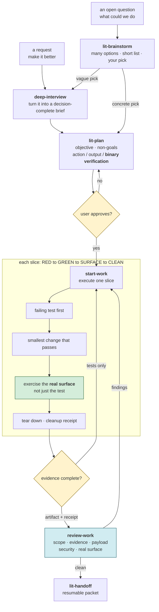
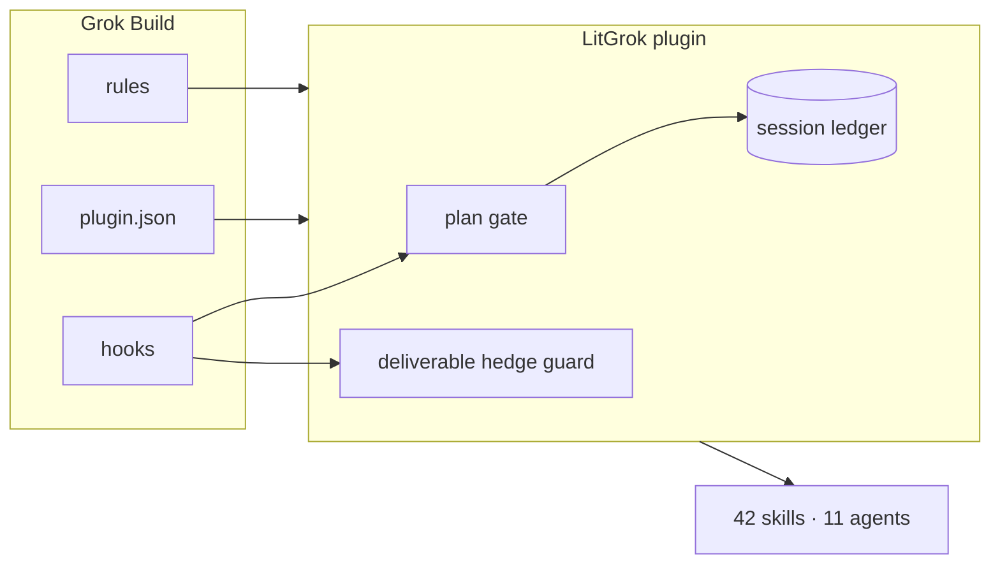
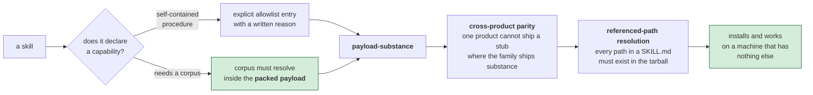

# LitGrok 상세 안내

[빠른 시작](../README_ko-KR.md) · [English](./reference.md)

### 작업 흐름 한눈에 보기



> **실행 규율.** 모든 항목에 binary verification이 있어야 계획을 승인할 수 있습니다. 한 slice는 실제 surface에서 artifact를 만들고 QA 자원을 정리한 뒤에야 닫힙니다. 테스트만 통과한 상태는 완료가 아닙니다.

## 무엇을 제공하나요?

- `.grok/skills/<name>/SKILL.md`에 Grok-native skill 문서 42개
- `lit-pptx`와 `lit-docx`는 같은 이름의 안내만 남았습니다. 덱 엔진은 wjgoarxiv-skills(`grok plugin install "<path to your wjgoarxiv-skills clone>/variants/litgrok/lit-pptx" --trust`)에, 문서 엔진은 wjgoarxiv-skills에 있습니다(`grok plugin install "<path to your wjgoarxiv-skills clone>/variants/litgrok/lit-docx" --trust`). `lit-diagram-drawer`, `lit-schematic`, `lit-scientific-visualization`은 같은 이름의 안내만 남았고, 그림 스킬과 과학 시각화 자료는 wjgoarxiv-skills에 있습니다(`grok plugin install "<path to your wjgoarxiv-skills clone>/variants/litgrok/<skill>" --trust`). `lit-hijack`은 남의 글에 공개된 기법을 출처 기록, 라이선스 검사, 동등성 증명과 함께 가져옵니다. `lit-adhd`는 최근 세션 전체를 KPI 보드 한 장(지금 할 일과 입력할 말, 끝남·진행 중·나를 기다림·남음 개수, 진행 막대가 붙은 마일스톤, 최근 끝낸 일, 남은 일, 잊지 말 것)으로 보여 주고, `lit adhd 자세히`라고 하면 세션별 카드를 덧붙이며, 아무것도 고치지 않습니다. 맨 끝의 `lit` 선택은 project rule 안내이며 실제 Grok 세션에서 확인해야 합니다.
- `.grok/rules/00-litgrok.md` project rule
- 설치된 payload를 짧게 알리는 `SessionStart` hook
- reader-facing write의 hedge 표현을 차단하되 quoted state enum, JSON/YAML scalar, fenced code, status table은 제외하는 `PreToolUse` hook. Host는 명시적인 deny와 exit 2만 차단으로 처리합니다. exit 0은 허용이고 timeout, crash, malformed output은 fail-open이므로 write가 진행됩니다.
- `.grok/litgrok/session-ledger/`에 bounded package-owned record만 추가하는 `UserPromptSubmit`, `PostToolUse`, `PostToolUseFailure`, `Stop`, `StopFailure`, `SubagentStart`, `SubagentStop`, `PreCompact`, `PostCompact`, `SessionEnd` hook. stdout을 출력하지 않으며(아래 두 가지 예외) 문서화되지 않은 event field 접근을 주장하지 않습니다. `PreCompact`는 handoff도 저장하고 `PreToolUse`가 한 번 다시 불러옵니다. 세션에 체크하지 않은 행이 남은 plan이나 진행 중인 workflow 단계가 있으면 `PreCompact`가 `.grok/litgrok/handoff/<세션 키>.md`를 씁니다(단계, plan 위치, 현재 행, 마지막 테스트 결과이며 프롬프트, 명령, 도구 출력은 담지 않습니다). `PostCompact`가 재주입을 한 번 준비하고, 압축 뒤 첫 도구 호출이 그 파일을 `PreToolUse` `additionalContext`로 받습니다(host가 그 호출의 결과와 함께 모델에 전달합니다). Grok Build는 `SessionStart` 같은 passive hook의 stdout을 무시하므로, 차단하지 않고 모델에 닿는 hook 경로는 도구 호출뿐입니다. 기본값은 켜짐이고 Grok Build를 시작하는 환경에서 `LITGROK_COMPACT_HANDOFF=0`으로 저장과 재주입을 함께 끕니다. 심볼릭 링크이거나 이 세션이 쓰지 않은 handoff 폴더나 파일은 거부합니다. 아래의 별도 opt-in 기능 `litgrok auto-handoff`는 모델에게 handoff를 쓰게 하며 그대로입니다. 세션 시작 때 프로젝트의 다른 최근 세션이 만드는 `lit adhd` 안내는 서로 다른 문장마다 한 번만 출력됩니다. `.grok/litgrok/notices.jsonl`이 안내마다 해시와 시각만 기록하고(문장은 저장하지 않습니다), 파일이 없거나 손상되었거나 너무 크거나 심볼릭 링크이면 예전처럼 하루에 한 번 안내합니다. 기록할 때마다 ledger의 첫 record로만 이 세션의 identity를 확인하고, 끊긴 마지막 줄은 건너뛸 수 있게 닫으며, 8 MiB를 넘은 ledger는 `<key>.<n>.jsonl`로 옮긴 뒤 새로 시작하고, segment는 최근 두 개만 남깁니다. 한 번에 한 hook만 옮기며, Stop gate는 가장 최근 segment와 현재 ledger를 함께 읽습니다. 첫 record가 다른 세션의 것인 큰 ledger는 옮기지 않고 거부합니다. LitGrok이 `.grok/litgrok/`에 처음 쓸 때 `*` 한 줄짜리 `.gitignore`도 만듭니다.
- package의 `.grok/` tree 전체를 user 또는 project 경로에 복사하는 dependency-free `npx` installer
- Grok Build가 지원하는 plugin manifest 형식의 root-level `plugin.json`을 제공합니다. `grok plugin validate`가 이를 검증하고 `.grok/skills`, `.grok/agents`, hook manifest를 가리킵니다. `.grok/agents/` 아래 Grok-native agent 11개와 hook/rule을 함께 제공합니다.
- GitHub 저장소에는 Cursor와 Grok Bot이 skill을 불러오도록 skill만 선언한 Cursor 형식 manifest와 항목 하나짜리 marketplace가 `.cursor-plugin/`에 있습니다. npm package에는 들어가지 않으며, 공개 Cursor Marketplace 등록은 아직 준비 중입니다.
- MCP server config, plugin-supplied LSP server config, command catalog, output style, TUI/skin surface는 여전히 제공하지 않습니다.

Grok Build는 project, user, plugin, configured path에서 skill을 읽습니다. Project guidance는 AGENTS-family 파일과 `.grok/rules/*.md`이고 hook은 project 또는 user `.grok/hooks/`에서 읽습니다. LitGrok은 이 문서화된 direct surface만 설치합니다.

### Grok Build에 연결되는 구조



> **Host 경계는 좁고 명확합니다.** `plugin.json`이 package를 노출하고, hook은 plan gate와 hedge guard로 연결되며, rule은 project guidance가 됩니다. session ledger에는 bounded state를 기록하고, 이 표면들이 42개 skill과 11개 agent를 Grok Build에서 사용할 수 있게 합니다.

## 설치

```bash
npm exec --yes --package @litfamily/litgrok@latest -- litgrok install
```

재현 가능한 설치는 버전을 고정합니다.

```bash
npm exec --yes --package @litfamily/litgrok@1.0.46 -- litgrok install
```

파일을 쓰지 않고 미리보기:

```bash
npm exec --yes --package @litfamily/litgrok@latest -- litgrok install --dry-run
```

기본값은 현재 프로젝트의 `.grok/`에 payload 전체를 설치합니다. 사용자 전역 설치:

```bash
npm exec --yes --package @litfamily/litgrok@latest -- litgrok install --user
```

`--user`는 `~/.grok/skills`, `~/.grok/rules`, `~/.grok/hooks`를 대상으로 합니다. dry-run, `--no-color`, `CI`는 `--yes`와 무관하게 파일을 바꾸지 않습니다. 환경 변수 값이 비어 있어도 적용됩니다. `--yes` 없이 실행한 non-interactive나 `NO_COLOR` 환경 역시 파일을 바꾸지 않는 미리보기이며, `--yes`를 쓰면 위 조건이 없는 한 TTY 없이도 설치가 진행됩니다. installer는 `.grok/.litgrok-install-manifest.json`에 SHA-256 소유권을 기록합니다. byte가 같은 파일은 다시 쓰지 않고, 이전 payload hash와 일치하는 installer 소유 파일은 업그레이드에서 교체할 수 있습니다. 사용자가 바꿨거나 소유권을 확인할 수 없는 파일이 있으면 전체 설치를 거절하고 덮어쓰지 않습니다. manifest가 없을 때 0.2.5의 pristine payload는 내장 migration snapshot으로 인식하며 업그레이드 뒤 새 manifest를 기록합니다.

### 업데이트 확인

```bash
npm exec --yes --package @litfamily/litgrok@latest -- litgrok doctor
```

`doctor`는 읽기만 합니다. 패키지 버전을 출력하고, `~/.grok/rules/00-litgrok.md` 끝 구간에 대해 `GROUND:` 한 줄을 냅니다. 값은 `present v=<version>`, `stale v=<version>`, `absent`, `malformed`, `off` 중 하나입니다. npm 레지스트리에 최신 안정 `@litfamily/litgrok` 버전을 최대 3초 동안 물어봅니다. 더 새 버전이 있으면 `newer version available: <version> (run: npm exec --yes --package @litfamily/litgrok@latest -- litgrok install)` 한 줄을 더합니다. 최신이면 그 이상은 더하지 않고, 레지스트리에 닿지 못하면 `update check unavailable` 한 줄을 출력합니다. 설치하거나 파일을 쓰지 않습니다. `NO_UPDATE_NOTIFIER`, `CI`, `LITGROK_NO_UPDATE_CHECK` 중 하나가 있으면(값이 비어 있어도) 레지스트리에 묻지 않습니다. `litgrok ground off`는 그 구간을 빼고 꺼 둔 채로 두며, `litgrok ground on`은 다시 넣습니다. `install --no-ground`는 그 한 번만 건너뜁니다. `litgrok ground project`는 저장소 복사본을 `.grok/rules/10-litgrok-ground.md`에 쓰며, 심볼릭 링크, 디렉터리가 아닌 경로, 자신이 소유하지 않은 파일은 거절합니다.

### 지속 상태 행 (선택)

상태 행은 사용자 또는 관리자 설정에서만 구성합니다. Grok은 project config나 plugin에서 `[ui.status_line]`을 읽지 않습니다 ([상태 행 문서](https://docs.x.ai/build/features/status-line), [설정 참조](https://docs.x.ai/build/settings/reference)). 사용자 범위 설치와 함께 사용하려면 다음 명령을 실행합니다.

```bash
npm exec --yes --package @litfamily/litgrok@latest -- litgrok install --user --status-line
```

이 명령은 2초 간격 갱신을 지정한 다음 설정을 `~/.grok/config.toml`에 추가합니다.

```toml
[ui.status_line]
type = "command"
command = "node ~/.grok/hooks/lit-status-line.mjs"
refresh_interval = 2
```

기존 config를 바꾸기 전 `config.toml.litgrok-backup-<id>`로 백업합니다. 이미 `ui.status_line` 값이 있으면 파일을 변경하지 않습니다. 사용자 범위 제거는 현재 config를 백업하고 LitGrok이 쓴 그대로인 값만 삭제하며 사용자 수정과 다른 설정을 보존합니다. 이 옵션은 project 설치에서 거부되고 기본값은 꺼져 있으며, 열두 번째 hook 등록을 추가하지 않습니다.

상태 command는 Grok의 stdin 상태 JSON을 읽습니다. 어두운 배경의 truecolor에서는 아래에서 설명하는 테두리 카드를 출력합니다. 이 문단과 다음 목록은 256색과 16색, 색 없음, `ascii` 글리프, `COLORFGBG`가 알리는 밝은 배경, 35칸보다 좁은 행, `LITGROK_HUD_LINES=1`에서 쓰는 테두리 없는 행의 설명입니다. 작업 흐름 밖에서는 `[🔥LIT vX.Y.Z] | Grok 4.5 [high] │ ctx [█▎░] 42%/2m │ $0.42 │ git main` 같은 한 줄을 출력합니다. 버전은 hooks 폴더 옆 설치 manifest에서, 괄호 값은 Grok의 `effort.level`에서, 빗금 뒤 크기는 `context_window.context_window_size`에서, 달러 값은 `cost.total_cost_usd`에서(Grok 자체 행처럼 0.5센트 미만이면 숨김), 브랜치는 `workspace.branch`에서 읽고, linked worktree 안이면 `workspace.git_worktree`를 덧붙입니다. Grok이 보내지 않은 값은 빼고, 모르는 비율은 `ctx ?`로 표시합니다. 모양은 LitFamily 상태 행을 따릅니다. 굵은 `[🔥LIT vX.Y.Z]` 마크의 L, I, T는 분홍 `#FF2D95`, 보라 `#8089CA`, 청록 `#00E5FF`이고(256색에서는 굵은 자홍, 16색에서는 굵은 청록), 그 뒤의 모든 구간과 구분자는 LitGrok의 강조색 하나, 불꽃 주황 `#FF6337`(v7 armory에서 LitGrok의 표시 색)입니다. 마크 뒤에는 `|`, 구간 사이에는 `│`가 옵니다. 게이지는 70% 아래에서는 강조색, 70%부터 노랑, 90%부터 빨강이고 빈 칸은 회색입니다. 자동 핸드오프가 켜져 있으면 `handoff@<퍼센트>%`도 붙습니다. Grok은 `COLUMNS`를 행 너비로 넘깁니다. 좁으면 브랜치, 핸드오프 퍼센트, 비용 순으로 빼고, 이어서 모델 이름을 줄이며(effort는 남김) 마지막에 규율 이름을 줄입니다. `COLUMNS`가 없으면 79칸에 맞춥니다. 본문에서 inline 또는 fenced Markdown code를 제외한 뒤 `lit-scientific-visualization`, `lit-handoff`, `lit-brainstorm`, `autoconference`, `autoresearch`, `lit-plan`, `litwork` 중 처음 일치한 항목이 규율을 정하고, 단독 `lit`은 `litwork`로 표시합니다. `LITGROK_HUD_LINES=1`이면 활성 규율이 게이지 뒤에 점화 표시로 들어갑니다. 분홍 `🔥 LIT` 칩 뒤에 굵은 강조색으로 `IGNITED · <discipline> 🔥`가 오고, 색이 없으면 `🔥 LIT IGNITED · <discipline> 🔥`입니다. Grok 실행 환경에서 `LITGROK_HUD_COLOR=0` 또는 빈 값을 포함한 `NO_COLOR`를 설정하면 escape byte가 없는 출력을 씁니다. Grok은 passive hook stdout을 무시하므로 `UserPromptSubmit` hook이 부수 효과로 현재 기록을 씁니다. JSON은 hashed session/cwd key를 사용해 `${TMPDIR:-os.tmpdir()}/litgrok-hud/` 아래, repository와 home 밖에 저장합니다. `LITGROK_HUD_STATE_ROOT`로 경로를 바꿀 수 있지만 repository와 home 내부는 허용되지 않습니다. 다음 prompt가 활성 규율과 일치하지 않으면 null 규율을 써서 mark를 지웁니다. 행은 이 기록을 cwd로 찾습니다. hook에 session ID가 없을 때 기본 기록 key는 workspace가 됩니다. Grok의 상태 변화 때와 2초 timer로 갱신하므로 prompt 뒤 최대 2초 늦게 표시될 수 있습니다. Grok Build 문서는 상태 command의 ANSI 색을 그대로 보여 준다고 적고 있고, Grok Build 1.0.13에서 truecolor, 굵은 글씨, emoji가 표시되는 것을 확인했습니다.

규율이 활성이거나 세션에 작업 흐름 단계가 있으면 테두리 없는 행은 최대 네 줄이 되고, 색을 쓰면 줄마다 맨 앞에 막대가 붙습니다. Grok은 상태 command 출력을 다섯 줄까지 보여 주고 줄마다 escape를 포함해 1024자에서 자르는데, 카드의 줄은 모두 그보다 짧으며 오른쪽 정렬용 공백도 이 길이에 셉니다.

1. 제목 줄: 마크, `|`, 어두운 글자의 `🔥 LIT` 칩, 굵은 강조색 `· <discipline>`(규율 없이 단계만 있으면 회색 `· workflow`)이 오고, 오른쪽 끝에 턴 상태가 붙습니다. 턴이 도는 중이면 굵은 강조색으로 타이머(`● 1m42s`)를 보여 주고, 그 앞에 session ledger의 현재 턴에서 센 도구 호출 수(`PostToolUse`와 `PostToolUseFailure`)와 아직 도는 하위 에이전트 수(`SubagentStart`에서 `SubagentStop`을 뺀 값)가 옵니다. plan gate block이나 핸드오프 지시로 붙잡히지 않은 `Stop`으로 끝난 턴은 20초 동안 도구 호출 수와 초록 `✓ complete 3m05s`를 보여 줍니다. 그 밖에는 `idle`입니다. 경고가 하나 있으면 굵은 노란 글자가 붙습니다. 이번 턴의 plan gate block(`⚠ plan gate`), 이번 턴의 핸드오프 지시(`⚠ handoff`), 자동 핸드오프가 켜져 있을 때 퍼센트까지 10포인트 이내로 다가온 컨텍스트(`⚠ ctx 76%→80%`)나 퍼센트에 닿은 컨텍스트(`⚠ ctx 85%≥80%`)가 그 경고입니다.
2. 단계 지도: 세션에 작업 흐름 단계가 있을 때 나옵니다. 아래에서 설명합니다.
3. 세부 줄: 꺾쇠 뒤에 계획의 체크한 작업 수와 막대, 체크하지 않은 다음 작업(`next ▸ 4. README demo GIF`), 마지막 테스트 결과, 경고의 긴 문구(`⚠ plan gate: save plans/<slug>.md`, `⚠ ctx 76% → handoff at 80%`)가 오고, 오른쪽 끝에 실행 중인 도구와 그 시계가 옵니다. 이 가운데 아무것도 없으면 이 줄은 빠집니다.
4. 수치 줄: 모델과 effort, 같은 대괄호 컨텍스트 게이지, 핸드오프 퍼센트, 비용, 브랜치입니다.

타이머는 Grok의 `turn.started_at_ms`부터 지난 시간입니다. Grok Build 1.0.13은 `turn` 필드를 보내지 않고, 턴이 도는 동안 마지막 상태 변화 때의 payload로 command를 다시 실행합니다. 그래서 이 필드가 없으면 ledger의 가장 최근 `UserPromptSubmit` 뒤에 `Stop`이나 `StopFailure`가 없고 가장 최근 기록이 10분이 지나지 않았을 때 턴이 도는 것으로 보고, 타이머는 그 프롬프트 기록부터 잽니다. ledger는 Grok의 `session_id`로 `workspace.repo_root`, `workspace.current_dir`, `cwd` 아래에서 찾고, 파일의 마지막 128 KiB만 읽으며 symbolic link는 읽지 않습니다. session id나 ledger, 그 턴의 `UserPromptSubmit` 기록이 없으면 수를 모두 뺍니다. `StopFailure`로 끝난 턴은 complete를 보이지 않습니다. 카드가 좁으면 줄마다 덜 중요한 것부터 뺍니다. 제목 줄은 수, 버전, 타이머, 경고를 뺀 뒤 규율 이름을 줄이고, 세부 줄은 다음 작업(먼저 줄인 뒤), 테스트 표시, 경고 문구를 빼며, 수치 줄은 브랜치, 핸드오프 퍼센트, 비용을 뺀 뒤 모델 이름을 줄입니다. 한글 같은 넓은 문자는 두 칸으로 셉니다. 칩은 색 블록입니다. `LITGROK_HUD_GLYPHS=nerd`는 Nerd Font의 아이콘을 더하고, `LITGROK_HUD_GLYPHS=ascii`는 인쇄 가능한 ASCII만 씁니다(emoji, 상자 문자, 점자 없음). 색이 없으면 브랜드 칩은 `(🔥 LIT)`, 단계 칩은 `[work 3/7]`가 되고 앞 막대는 빠집니다. `LITGROK_HUD_COLOR=256` 또는 `16`은 모든 색을 가장 가까운 256색이나 16색으로 바꾸고, `LITGROK_HUD_LINES=1`은 한 줄 행만 씁니다. 깨졌거나 너무 크거나 객체가 아닌 stdin이 오면 최소 행 `[🔥LIT] | grok │ ctx ?`를 출력하고, 형식이 틀린 값은 없는 값으로 다룹니다.

단계 지도는 세션이 LIT 작업 흐름의 어디쯤인지 보여 줍니다. 테두리 없는 행에서는 예를 들면 `plan ✓ ━━━━ [work 3/7] ━━━━ review · ──── done ·`이고, 그 아래 세부 줄은 `└ task 3/7 ▮▮▮▯▯▯▯ · next ▸ 4. README demo GIF · tests ✓ 214`에 오른쪽 끝 `⠹ Bash 0:31`입니다. 지도는 세션에 작업 흐름 단계가 생기면 나타나고, `LITGROK_HUD_LINES=1`이면 카드 전체를 숨깁니다. `UserPromptSubmit` 훅은 프롬프트에서 보이는 첫 일치 항목으로 단계를 정합니다. `deep-interview`는 interview, `lit-plan`은 plan, `start-work`·`litwork`·`lit`만 쓴 경우는 work, `review-work`는 review이며, 코드 가리기 규칙은 discipline과 같고, ledger에 `stage`로 남깁니다. 프롬프트가 `lit review`로 시작하면 `review-work`의 띄어쓰기 표기로 보고 review 단계로 바꾸며 상태 줄 discipline은 정하지 않습니다. `lit brainstorm`, `lit ideation`, `lit ideate`, `lit idea`, `lit ideas`, `lit-brainstorm`으로 시작하면 `lit-brainstorm`을 엽니다. 상태 줄에 그 이름이 나오고, ledger 기록에는 stage가 없으며 plan gate도 켜지 않고, 진행 중인 단계는 그대로 둡니다. 모든 도구에 등록한 `PreToolUse` 훅은 도구 이름만 기록합니다. 그 기록이 턴의 가장 최근 도구 기록이면 실행 중으로 보고, Grok의 도구 이름을 짧은 이름(`run_terminal_command`는 `Bash`, `search_replace`는 `Edit`)으로 바꿔 기록 이후 경과 시간과 함께 보여 줍니다. 이제 모든 도구에 등록한 `PostToolUse` 훅과 `PostToolUseFailure` 훅은 `toolInput.command`가 테스트 실행기(npm·pnpm·yarn·bun `test`, `node --test`, vitest, jest, mocha, pytest, unittest, cargo, go, deno, make, gradle, mvn, rspec, ctest, swift, dotnet test)를 heredoc 본문이나 따옴표 문자열 밖에서 부를 때 `test: { verdict, count }`를 더합니다. 결과는 실패 이벤트, 0이 아닌 종료 코드, `toolResult`에 찍힌 통과·실패 수로 정하고, 결과를 읽을 수 없으면 남기지 않습니다. ledger는 끝의 128 KiB만 읽으므로 훅은 ledger 옆에 `<session-hash>.workflow.json`도 둡니다. 단계, 거친 단계, 그 단계의 턴이 끝났는지, 가장 최근 `plans/*.md`의 체크 수(펜스 밖 첫 열 작업 행 가운데 `- [x] N.`의 수)와 체크하지 않은 첫 행의 제목(제어 문자를 지우고 60자로 자름), 마지막 테스트 결과를 담으며, 4 KiB 이하로 원자적으로 쓰고, 심볼릭 링크는 거부하며, 보여 줄 것이 생겼을 때만 만듭니다. `Stop`은 plan gate나 핸드오프 지시가 턴을 붙잡지 않았으면 단계를 닫고, 모든 작업이 체크된 상태로 끝난 검토는 done이 됩니다. 색을 쓰면 패밀리 LIT 카드처럼 지나온 단계는 회색에 체크, 지금 단계는 어두운 글자의 강조색 칩(테두리 카드에서는 보라에서 강조색으로 이어지는 알약), 앞으로 올 단계는 회색에 점입니다. 지나온 단계와 지금 단계로 들어가는 레일은 강조색, 지금 단계에서 나가는 레일은 회색 `━`, 그 뒤는 회색 `─`이고, 턴이 도는 동안 분홍 칸 하나가 다시 그릴 때마다 지금 단계로 들어가는 레일을 따라 움직입니다. 도구 표시는 굵은 강조색, 테스트 표시는 초록이나 빨강입니다. 단계 이름은 LitGrok 자신의 것(`interview`, `plan`, `work`, `review`, `done`)이고, LitGrok에는 PIN에서 RECORD로 가는 루프 스킬이 없습니다. 줄이 좁으면 레일을 두 칸, 한 칸으로 줄이고, 이어서 단계 이름을 빼며, 마지막에는 지금 단계만 남깁니다.

테두리 카드(`.grok/hooks/lit-card.mjs`)는 truecolor이고 글리프가 `ascii`가 아니며 `COLORFGBG`가 밝은 배경(`7`이나 `15`로 끝남)을 알리지 않을 때, 35칸부터 최대 200칸까지 그립니다. 규율이나 단계가 있으면 언제나 다섯 줄입니다. 윗변(주황에서 분홍으로 물든 `🔥 LIT` 알약, `· <discipline> <시간>`, 오른쪽에 도구 호출 수, 도는 하위 에이전트, 짧은 경고, 상태 낱말), 오른쪽에 실행 중인 도구가 붙은 단계 지도, `└ task 3/7`과 여덟 칸 게이지와 다음 작업, 알약 모양의 스킬과 마지막 테스트 결과와 긴 경고와 다른 세션(또는 검토 lane, 또는 한 번만 나오는 extensions 행), 아랫변(일곱 칸 게이지가 붙은 컨텍스트 비율, 창 크기, 모델과 effort, 핸드오프 퍼센트, 비용, 브랜치, 오른쪽에 버전)입니다. 둘 다 없으면 extensions 행이 있든 없든 네 줄이고, 다른 세션이 있으면 다섯 줄까지입니다. 상태 낱말은 단계(`WORK ●`, 단계가 없으면 `RUNNING ●`), `YOUR TURN · <이유> ●`, 20초 동안의 `DONE ✓`, `StopFailure` 뒤의 `ERROR ✗`, `IDLE ○`입니다. 테두리는 분홍에서 보라를 거쳐 강조색까지 열두 단계로 이어지고, 사용자 차례면 호박색, 오류면 빨강, 끝나면 초록으로 끝나며 쉴 때는 옅어집니다. 높이가 낮아 줄이 덜 보일 때 Grok이 보내는 `LINES` 2~4에서는 안쪽 줄을 아래부터 빼고 테두리를 닫습니다. 남는 줄은 공백 하나로 출력합니다. Grok은 끝의 빈 줄을 버리고 다음에 보내는 수로 다시 커질 수 있는지 알려 주기 때문입니다. 모든 줄은 1024자 안이고, 버전과 수, 먼 빛부터 뺍니다.

둥근 끝(`.grok/hooks/lit-caps.mjs`)은 상태 행과 설치 프로그램이 실행마다 한 번 정합니다. `LITGROK_HUD_GLYPHS`가 `nerd`나 `round`면 둥글고 `square`, `basic`, `ascii`면 네모이며, `auto`면 다음 단계를 건너뜁니다. 다음은 `litgrok install --glyphs`가 `~/.grok/litgrok-hud.json`에 저장한 선택입니다. 둘 다 정하지 않으면 `WT_SESSION`, `TERM_PROGRAM`이 `vscode`·`wezterm`·`ghostty`, `TERM=xterm-kitty`, `KITTY_WINDOW_ID`에서 둥글고, 그다음 `SSH_CONNECTION`이 있으면 네모이며, 그 밖에는 사용자나 시스템 글꼴 폴더에 Nerd Font 이름의 `.ttf`·`.otf`·`.ttc` 파일이 있을 때 둥급니다(세 단계 아래까지, 이름 최대 4,000개, 링크를 따라가지 않고 글꼴을 열지 않음). 알약의 U+E0B6과 U+E0B4는 네모 모양에서 채운 여백인 칸을 쓰므로 폭이 같습니다. 상태 command는 글꼴 답을 임시 `litgrok-hud` root의 `icon-font.json`에 하루 동안 두고, 설치 프로그램은 직접 찾아보고, `--round`를 실행한 시각만 `~/.grok/litgrok-hud.json`에 저장해 그보다 오래된 답을 쓰지 않게 합니다. `--round`가 추가한 글꼴 파일과 해시는 `~/.grok/litgrok-icon-font.json`에 기록합니다. `ROUND_ENDS:`는 `round`를 저장했으면 `shown`, 끝을 스스로 그리는 터미널이면 `ready`, 아이콘 글꼴이 있지만 터미널이 쓰지 않을 수 있으면 `check`, 그 밖에는 이유가 붙은 `square`입니다. 상태 행이 꺼져 있어도 `square`입니다. 256색, 16색, 색 없음, 밝은 배경은 언제나 네모입니다.

노을. 테두리 안에서 `.grok/hooks/lit-sunset.mjs`가 안쪽 줄의 꾸밈 없는 공백 칸에만 장면을 그립니다. 8분의 1 블록으로 그린 세 줄 열여덟 칸의 해(어두운 틈 두 개), 별(`.` `+` `*`), 마지막 줄의 바다(`~` `-` `.`)이고, 별과 바다는 글자에서 세 칸 떨어집니다. 줄이 둘이면 열두 칸, 하나면 여덟 칸짜리 해입니다. 해는 폭의 62%에서 시작해 글자를 피해 오른쪽으로 옮겨 가고, 실행 중인 도구를 위해 오른쪽 20칸을 비워 두므로 도구가 오가도 움직이지 않습니다. 세 줄 자리가 없으면 두 줄, 한 줄을 차례로 시도하고, 그럴 자리도 없으면 해가 나오지 않습니다. 같은 색이 이어지면 escape 하나를 함께 쓰고, 1024자를 넘게 된 줄은 해에서 가장 먼 빛부터 빼며, 해의 escape가 들어갈 자리가 없으면 해를 그리지 않습니다. 턴이 도는 동안에는 호출마다 그 시각의 장면을 그리므로 Grok이 다시 그릴 때마다 한 단계씩 움직이고, 9초마다 1.1초 동안 별똥별이 지나갑니다. 턴 사이, 그리고 `LITGROK_HUD_MOTION`이 `off`나 `subtle`이면 호출마다 같은 출력입니다. 카드가 쉬거나 오류로 멈추면 옅어집니다. `lit-adhd`는 바다 없이 rewind 색의 해를, `YOUR TURN`은 호박색을 씁니다. 이를 위해 읽거나 쓰는 파일은 없습니다. Grok은 상태 command에 테마를 보내지 않으므로 밝은 테마는 `COLORFGBG`로만 알 수 있습니다. Grok Build 1.0.13에서 truecolor 터미널과 로컬 모델 endpoint로 확인했습니다. 턴 동안 장면이 한 단계씩 움직였고, 턴 사이에는 멈췄으며, 행 높이는 그대로였습니다.

같은 작업 공간의 다른 세션은 카드 아래(이 세션에 카드가 없으면 한 줄 행 아래)에 한 줄씩 나옵니다. `● start-work · w2B:p2 running`, `· lit-plan idle`, `✓ start-work done` 같은 모양이고, 실행 중, 쉬는 중, 끝냄 순서로 최신 것부터 네 줄까지 보입니다. 이 줄은 활동 기록에서 옵니다. `PostToolUse`와 `PostToolUseFailure`는 `alive`, `Stop`은 `idle`, `SessionEnd`는 `ended`를 `.grok/litgrok/liveness/<session-hash>.json`에 쓰고, `HERDR_PANE_ID`는 짧은 일반 토큰일 때만 남깁니다. 같은 상태가 30초 안에 다시 오면 쓰지 않고, 심볼릭 링크인 기록이나 폴더는 거부하며, 쓰기에 실패해도 훅 출력은 바뀌지 않습니다. 15분이 지난 기록은 끝난 것으로 보므로 `SessionEnd` 없이 멈춘 세션도 사라집니다. 모든 계획 작업을 체크한 채 work 단계가 끝났거나 `done`에 이른 start-work는 60초 동안 `done`으로 보인 뒤 사라지고, 끝난 세션은 보이지 않습니다. `LITGROK_HUD_LINES=1`이면 이 줄 없이 한 줄 행만 씁니다.

계획에도 도움이 두 가지 더 있습니다. `lit-plan`이 `plans/<slug>.md`를 저장한 뒤 같은 대화에서 계획 파일 수정 시각으로부터 30분 안에 `go`만 입력하면 그 계획으로 start-work를 시작합니다. Grok Build는 허용한 프롬프트 훅의 출력을 버리므로 이 경로는 훅이 아니라 프로젝트 규칙과 lit-plan 스킬에 들어 있습니다. 또 할 일이 프로젝트 밖 절대 경로를 가리키면 `Scope roots: <path> (<actions>)` 줄이 있어야 합니다. `scaffold-plan.mjs --check`와 Stop plan gate(두 번 block 한도 안에서)가 덮이지 않은 폴더마다 붙여 넣을 줄을 그대로 알려 줍니다. 펜스 블록 안의 경로와 인라인 코드로 감싼 명령은 세지 않습니다.

`install --user --notify`는 관리 표식이 붙은 `[ui.notifications]` 표를 추가합니다. `condition = "always"`와 `events = ["turn_complete", "approval_required", "agent_error"]`를 담아 터미널을 보고 있을 때도 Grok 자체 터미널 알림이 뜨게 합니다. 규칙은 상태 행과 같습니다. 사용자 범위에서만 쓸 수 있고, 기본은 꺼져 있으며, 바꾸기 전에 백업하고, `notifications` 설정이 이미 있거나 `ui`가 최상위 값 또는 배열이면 바꾸지 않으며, 사용자 범위 제거는 그대로인 표만 지웁니다. Grok Build 1.0.13은 이 표를 문서에 적어 두었지만 `grok inspect`는 `ui.notifications`를 인식하지 못한 설정 키로 표시합니다. 이 경고는 Grok이 내는 것이고 파일의 다른 부분은 바뀌지 않습니다.

### 자동 핸드오프 (선택)

자동 핸드오프는 컨텍스트가 사용자가 정한 퍼센트에 닿으면 모델에게 핸드오프를 요청합니다. 기본값은 꺼짐이고 내장 퍼센트는 없습니다. `litgrok auto-handoff on <percent>`(1~99 정수), `on`만 쓰기(마지막 퍼센트를 다시 쓰고 없으면 묻습니다), `off`(퍼센트는 기억), `status`로 관리합니다. 어느 하위 폴더에서 실행해도 가장 가까운 Git 루트를 찾아 그 파일을 쓰고 경로를 출력합니다. 훅은 Grok Build가 알려 주는 작업 루트(보통 Grok Build를 시작한 폴더)의 파일을 읽으므로, 위쪽에 다른 프로젝트 루트가 있거나, Git 루트가 없거나(그 폴더 하나에만 적용), Git 루트가 홈 폴더이면 명령이 안내 문구를 덧붙이며, 설정은 바꾸기 전까지 `.grok/litgrok/auto-handoff.json`에 `{ "enabled": false, "percent": null }`로 있습니다. `LITGROK_AUTO_HANDOFF=1|0`과 `LITGROK_AUTO_HANDOFF_PERCENT`는 그 환경에서 시작한 세션의 파일 설정보다 우선하고, 잘못된 값은 꺼짐으로 처리하며 `status`가 경고를 출력합니다.

Grok Build는 훅에 컨텍스트 사용량을 달리 알려 주지 않으므로 이 기능은 위의 상태 행에 의존합니다. 켜져 있는 동안 상태 command는 `context_window.used_percentage`와 `context_window.auto_compact_threshold_percent`(Grok이 모르면 생략하고, 생략된 값은 기록하지 않습니다)를 같은 임시 `litgrok-hud` 루트의 세션별 기록 `context-<hash>.json`에 씁니다. 이 기록은 상태 command가 실행될 때마다 갱신되고, 10분이 지났거나 다른 세션의 것이면 무시합니다. `Stop` 훅(문서화된 결정 제어이며 subagent, 세션 종료 fire, `stopHookActive`일 때는 건너뜁니다)이 이 기록을 읽습니다. 퍼센트 이상인 첫 턴 종료에서 세션 ledger에 `auto-handoff-directive` 항목을 덧붙이고, 모델에게 패키지의 `lit-handoff` 절차 파일을 읽으라는 block 사유를 돌려줍니다. 사유는 "Context for Continuation" 아래에 `litgrok-auto-handoff: <세션 id의 해시>` 줄을 넣고 "Handoff saved. Run /compact now." 한 줄을 남기라고 요청합니다. 이 항목 덕분에 지시는 한 번 넘을 때마다 한 번만 나가며, 그 뒤의 압축이나 다른 퍼센트가 다음 넘김을 준비시킵니다.

Grok Build에서는 어떤 훅도 압축을 시작할 수 없으므로 사용자가 `/compact`를 실행하거나 Grok의 자체 자동 압축(기본 85퍼센트, `[session] auto_compact_threshold_percent`)을 기다립니다. 더 낮은 퍼센트를 고르세요. 설정한 퍼센트가 상태 행이 마지막으로 보고한 지점 이상이면 `status`가 경고합니다. `PostCompact` 훅은 압축을 이미 ledger에 기록합니다. 다음 턴 종료에서 `Stop` 훅은 지시 이후에 수정됐고 세션 표식이 있는 `.handoff/HANDOFF.md` 또는 `HANDOFF.md`를 찾아 `auto-handoff-reload` 항목을 덧붙이고, 경로와 읽기 전용 자료로 표시한 짧은 발췌를 담아 block합니다. 오래됐거나 다른 세션의 것이거나 없는 핸드오프는 거부하고 block 없이 거부 사실만 기록합니다. Grok이 `UserPromptSubmit` 출력을 버리기 때문에 다시 불러오기는 권고 수준이며, 압축 뒤 첫 턴이 끝난 다음에 도착합니다.

### 사람 없이 끝나는 start-work 실행

`start-work`나 `lit start`로 시작하는 프롬프트(`plans/<slug>.md`를 적을 수 있고, 없으면 행이 있는 가장 새 계획), 또는 lit-plan 승인 질문에 정확히 `yes`라고 답하면 그 세션의 실행이 시작됩니다. 실행 상태는 Git이 무시하는 `.grok/litgrok/` 안의 `.grok/litgrok/start-work/run.json`에 있습니다. 훅 등록은 늘지 않습니다. 기존 `UserPromptSubmit`, `PreToolUse`, `Stop` 훅이 실행을 맡고, 확인 명령과 재실행 시간을 담으려고 `Stop`과 `UserPromptSubmit`의 제한 시간만 120초로 늘었습니다.

- **턴 종료.** 열린 행이 있으면 `Stop` 훅이 턴을 이어 가게 합니다. 계획 상태가 그대로면 최대 두 번이고, 아무것도 움직이지 않았으면 "No row changed since the last stop"이라고 덧붙입니다. 재진입 턴 종료(`stopHookActive`)에서도 돌기 때문에, 이어 가는 동안 마지막 행에 체크하면 그 자리에서 실행이 닫힙니다. 모든 행에 체크가 있고 돌고 있는 레인이 없으며 계획의 `## Done when` 줄 `check: \`<command>\``가 0으로 끝나면, 실행을 완료로 표시하고 모델이 완료 문장 한 줄을 그대로 전하게 합니다. 보류된 로컬 단계는 실행하지 않고 이름만 남깁니다. 프로젝트 밖으로 나갈 수 있는 보류 단계(push, 패키지 스크립트, 밖을 지우는 명령, 모르는 git 하위 명령)가 있으면 실행은 마무리 목록 단계에 머뭅니다. 확인 명령은 lit-plan이 받는 확인 명령(`npm test`, `npm run <script>`, `node --test …`, 프로젝트 안 스크립트의 `node`, `pytest`, `cargo test`, `go test`, `make test|check|verify`)일 때만 셸 없이 최대 90초 동안 돕니다(`LITGROK_DONE_CHECK_TIMEOUT_MS`는 줄이기만 합니다). 시간이 넘으면 그 프롬프트 동안은 결과를 다시 쓰고, 다음 프롬프트에서 다시 돌립니다. 그 밖에는 마무리 목록이나 IMPOSSIBLE 행 안내를 한 번 전하게 하고, 상태가 바뀔 때까지 조용합니다. 실행 중에는 목표 기록의 조언용 턴 종료 확인을 대신하고, 완료된 실행은 그 기록을 닫습니다.
- **셸 가드.** `PreToolUse` 훅이 실행 중인 세션의 `run_terminal_command` 호출을 하나씩 봅니다. Grok Build 1.0.13의 일회용 프로젝트에서 확인한 대로, exit 2와 JSON 사유로 거부하면 호출이 멈추고 사유가 도구 결과로 모델에게 갑니다. 읽기 전용 형태의 읽기 명령, 프로젝트 안 스크립트의 `node`와 `python3`, 프로젝트 자체의 `npm test`와 `npm run test|check|lint|build|typecheck`(pnpm, yarn도 같고, 그 폴더에 `package.json`이 있을 때), 프로젝트 안 `cd`, Done-when 확인 명령은 그대로 돕니다. 프로젝트 안 스크립트는 작성자가 쓴 일을 무엇이든 할 수 있고 push도 할 수 있습니다. 이 남은 위험은 보통 실행이 받아들이는 위험과 같습니다. 쓰거나 다른 프로그램을 돌리는 형태의 읽기 명령은 `[X]`로 보류됩니다. `sed`와 `awk`는 언제나, `sort -o`, 두 번째 피연산자가 있는 `uniq`, `git diff|log|show --output`이나 `--ext-diff`, `find -fprint*|-fls|-exec|-ok|-delete`, `rg --pre`, `file -C|-m`, `--files0-from`, 환경 변수나 추가 입력이나 모듈을 읽는 필터(`env`, `$ENV`, `input`, `import`) 또는 파일이나 인자 플래그(`-f`, `-L`, `--args`, `--rawfile`)를 쓰는 `jq`, 그리고 어떤 형태든 `git grep`과 `git branch`가 그렇습니다. 피연산자의 `=` 뒤 값도 경로로 검사합니다. 모르는 명령은 실행하지 않고 `[X]`로 보류합니다. 프로젝트 안의 `touch`, `mkdir`, 새 경로로 가는 `cp`와 `mv`, 파일을 지정한 `git add`는 `[B]`로 보류됩니다. 이어 붙인 호출을 포함해 나머지는 정확한 명령과 폴더와 함께 `[X]`로 보류됩니다. 가드가 따라갈 수 없는 명령(확장, glob, 리디렉션, `time`, `env`, `eval` 같은 앞붙이)은 붙잡아 두고 다시 실행하지 않습니다. 보호된 홈 폴더(`~/.grok`, `~/.ssh` 등), 비밀 파일, `.git` 내부, 실행 상태를 가리키는 호출과 `.git`이나 실행 상태로 가는 편집은 거절하고 저장하지 않습니다. 그곳을 향한 리디렉션과, 홈 맨 위의 다른 숨김 폴더도 마찬가지입니다. 링크는 끝까지 한 단계씩 따라가며, 순환하는 링크나 보호된 폴더 안의 아직 없는 대상을 가리키는 링크는 거절합니다. 마무리 목록은 제시한 단계의 짧은 다이제스트(`(list <digest>: …)`)를 함께 보여 주고, 보여 준 뒤 바뀐 목록은 아무것도 실행하지 않습니다. Done-when 확인과 다시 돌리는 단계는 작은 셸이 이끄는 별도 프로세스 그룹에서 돌고, 명령이 끝나거나 시간이 다 되면 그 셸이 그룹 전체를 끝내므로 뒤에서 돌던 자식이 남지 않습니다. 실행기는 출력을 직접 받아 두었다가, 명령이 끝나거나 시간이 다 되면 바로 돌아옵니다. 그룹을 떠난 자식이 출력을 계속 붙잡고 있어도 기다리지 않습니다. macOS에서는 이미 끝난 프로그램이 띄운 자식이 빠져나갈 수 있습니다. 그 프로그램이 사라진 뒤에는 그룹에 보낸 신호가 그 자식에게 닿지 않기 때문입니다. 일부러 그룹을 떠난 자식(분리된 spawn, `setsid`)도 끝내지 못합니다. 실행은 그 자식을 기다리지 않지만, 그 자식은 단계 결과를 알린 뒤에도 계속 돌 수 있습니다. 훅 컨텍스트와 턴 종료 안내는 9,000자에서 자릅니다. Grok Build는 자체 한도를 문서로 밝히지 않습니다. 마무리 목록은 이 한도 안에 통째로 들어가는 단계만 보여 주고, 그 단계만 승인할 수 있게 둡니다. 나머지는 보여 주지 않은 수로만 셉니다. 보류된 단계는 다시 돌지 않으므로 줄여서 보여 줍니다. `lit approve` 같은 답은 새 목록을 열지 않습니다. 그 뒤에도 남은 단계는 다음 턴 종료 목록을 기다립니다. 4 KB보다 긴 명령은 거절하고 저장하지 않습니다. 실행 상태가 든 폴더를 옮기거나 지우거나 바꾸는 명령(`rm -rf .grok`, `mv .grok x`, `rm -rf .`)도 거절하고, 보호된 홈 폴더를 가리키는 `~/…` 경로도 거절합니다. 편집 도구도 셸과 같은 검사를 받고, 대소문자 구분 없이 비교합니다. 플래그는 도구가 읽는 방식 그대로 읽습니다. 줄여 쓴 긴 옵션(`--out=F`)과 묶어 쓴 짧은 옵션(`-uo F`)도 원래의 쓰기 형태로 칩니다. 홈을 품은 폴더(`/` 포함)를 훑는 재귀 읽기(`grep -r`, `rg`, `find`, `ls -R`)는 거절합니다. `grep`이나 `rg`가 패턴을 `-e`, `--regexp`, `-f`로 받으면 나머지 단어를 모두 경로로 검사하고, 경로 없는 `rg`와 재귀 `grep`은 실행하는 폴더를 검사합니다. 실행 중에는 `git clean`(`-n` 제외)과 추적하지 않는 파일까지 넣는 stash(`git stash -u`, `--all`)를 거절합니다. 실행 상태를 지우기 때문입니다. 읽기만 하는 `git remote`(인자 없이, `-v`, `get-url`)는 실행을 닫을 수 있는지 볼 때 로컬로 칩니다. `git remote show` 같은 나머지는 여전히 바깥에 닿는 것으로 봅니다. 목록 모양이 잘못된 실행 상태는 읽을 수 없는 상태로 보므로, 깨진 필드 때문에 `lit deny` 거절이 사라지는 일은 없습니다. 실행 중에는 가드가 닫힌 쪽으로 실패합니다. 저장하거나 검사할 수 없는 호출은 돌지 않고, 읽을 수 없는 실행 상태(너무 크거나 깨진 파일)는 사용자가 `lit cancel`을 입력할 때까지 모든 호출을 멈춰 둡니다. `lit cancel`은 그 파일을 옆으로 옮깁니다. 남은 한계는 두 가지입니다. 목록 다이제스트에는 키가 없어서 프로젝트 안 스크립트가 단계와 다이제스트를 함께 바꿀 수 있습니다. 위에서 말한 스크립트 실행의 남은 위험과 같은 종류입니다. 또 가드는 호출마다 Grok이 알려 주는 폴더를 읽습니다. 한 명령 안의 `cd`는 따라가지만, 다음 호출은 호스트가 알려 주는 폴더만 받습니다. 보류는 `[B]` 32개, `[X]` 16개까지입니다. 모양 때문에만 거절된 자기 확인(`node check.mjs; echo $?`)에는 하나씩 따로 돌리라는 안내가 갑니다.
- **답.** `UserPromptSubmit` 훅이 `lit approve`(마지막 목록의 `[B]` 단계를 셸 없이 실행), `lit approve x`(프롬프트 전체로 정확히 입력했을 때만 그 목록의 `[X]` 단계 실행), `lit deny`, `lit skip-row [N]`, `lit pause`, `lit resume`과 한국어 형태(`lit 승인`, `lit 거절`, `lit 멈춤`, `lit 재개`)를 적용합니다. 다시 돌리는 단계는 먼저 다시 검사합니다. 목록을 그린 뒤 보류된 단계는 다음 목록을 기다리고, 재실행은 첫 실패에서, 그리고 100초 안에서 멈추며, 그 출력에는 신뢰하지 않는 데이터라는 표시가 붙습니다. 입력한 프롬프트만 답이 됩니다. 턴 종료 payload나 도구 결과에 같은 말이 있어도 아무 일도 없습니다. 결과는 다음 도구 호출(`additionalContext`)이나 다음 턴 종료에 모델에게 가고, `.grok/litgrok/start-work/answer.md`에도 남습니다. `lit approve x`를 조금 틀리게 쓰면 아무것도 실행하지 않습니다. 훅은 막는 답을 내지만 Grok Build 1.0.13은 그래도 턴을 진행하므로(헤드리스에서 확인), 안내는 모델의 답으로 사용자에게 갑니다. 답이 적용된 뒤 모델은 결과를 전하고, 보류됐던 단계가 이제 실행된 행에 체크한 뒤 계속 진행하므로 실행은 여전히 스스로 닫힐 수 있습니다.
- **Charter.** 코드 펜스 밖의 계획 줄 `Run charter: commit on <branch> in <repo>`가 있으면 그 브랜치에서 `git add <files> && git commit -m …`을 허용합니다. amend, 훅 건너뛰기, `-c`, `-C`는 안 됩니다. 승인 질문은 계획의 `Run charter:`와 `Scope roots:` 줄을 해시로 남기고, 질문과 `yes` 사이에 계획이 바뀌면 프로젝트 권한만 주고 모델에게 그 사실을 말하게 합니다. 직접 입력한 `start-work`는 지금 상태의 계획을 승인합니다.

Grok Build에서는 다음이 BLOCKED입니다. 각각 호스트 사실 때문입니다.

- BLOCKED: Grok Build는 허용한 `UserPromptSubmit` 훅의 stdout을 버리므로, 프롬프트마다 맞는 skill을 제안하는 문장이 모델에 닿지 않습니다. 대신 규칙 파일이 바이트 예산 안에서 고정 카탈로그 한 줄("Skills that often fit a prompt without `lit`")을 싣습니다.
- BLOCKED: Grok Build는 `/goal`을 사용자에게서만 받으므로, LitGrok은 네이티브 목표를 걸지 않고 계획의 `goal: native` 줄도 아무것도 걸지 않습니다. LitGrok이 건네는 `/goal` 줄은 스스로 끝납니다: "…, or the latest reply starts with WAITING-ON-USER:, or after 30 turns".
- BLOCKED: `Stop` 사유는 모델에게만 가므로, 완료 문장과 마무리 목록은 훅이 직접이 아니라 모델의 전달로 사용자에게 갑니다.

### 설치 출력

일반 `install`과 `uninstall` 출력은 공유 LitFamily frame으로 시작합니다 — 46글자 rule,
`LIT · grok build` tagline과 package version이 붙은 synthwave LIT mark, stage card 두 개. `MODEL ROUTE`
card는 항상 `Model selection: host-owned`를 출력합니다. model과 reasoning effort
선택은 Grok Build가 소유하므로 installer는 model 질문을 하지 않고 model key를
쓰지 않습니다. 색상은 terminal을 따릅니다. `--no-color`, `NO_COLOR`, `CI`,
non-TTY stream에서는 색상 없이 같은 줄을 출력합니다.

terminal에서 `--yes`나 preview 없이 실행하면 같은 과정이 card로 나옵니다(`bin/install-cards.mjs`). 카드 위 가운데에
놓인 mark(48행부터 큰 것, 34행부터 중간), 파일이 들어갈 곳과 파일 수, `--user` 설치의 기본 약속 질문 card, 끝나면
`✓ Install steps  4 of 4 checked` 한 줄로 접히는 네 step card, `Installed`·`Settings`·`Next`가 있는 마지막 card
순서입니다. card는 최대 100칸이고 block 사이에 빈 줄 하나가 있으며 값은 24열에서 시작합니다. 경고는 step card가 접힐
때까지 기다렸다가 `!`와 개수로 표시되고 그 아래에 모두 출력됩니다. 멈춘 step은 card를 화면에 남기고 빨간
`INSTALL STOPPED` card를 더합니다. pill과 button의 끝은 상태 행의 둥근 끝 규칙을 따릅니다. stdin과 stdout이 raw
mode를 쓸 수 있는 terminal이고 40열·12행 이상이며 `CI`, `TERM=dumb`, 미리 정한 `LITGROK_GROUND`가 없을 때만
나오고, 나머지 실행은 아래 frame을 그대로 씁니다. 색상은 terminal에 따라 24-bit, 256, 16색이고, UTF-8이 아닌
locale에서는 ASCII 테두리를 그립니다. Ctrl+C는 아무것도 쓰지 않고 멈춥니다.

```text
  ╭─ MODEL ROUTE
  │ Model selection: host-owned
  ╰─ Grok Build owns model and effort; the installer writes no model keys
```

Project hook은 신뢰한 project와 Git repository root가 모두 있어야 실행됩니다. 일반 폴더에서는 skill과 rule이 로드되어도 Grok Build가 project root를 찾지 못해 hook이 0개로 남을 수 있습니다. 새 disposable project라면 trust 전에 사용자가 `git init`을 실행하고, 기존 저장소라면 실제 root에서 Grok Build를 여세요. LitGrok은 `git init`을 실행하거나 trust를 바꾸지 않습니다. Grok Build에서 `/hooks-trust`를 사용하세요. 관찰된 Grok Build 1.0.13에서는 `grok --trust inspect --json`도 동작했지만 `--help`에는 global option이 표시되지 않았습니다. 이 명령 동작은 해당 버전에서 확인한 것입니다. 결정은 `~/.grok/trusted_folders.toml`에 저장됩니다. Installer는 project install과 preview에서 이 요구사항을 출력합니다.

패키지 원본과 여전히 같은 파일만 삭제합니다.

```bash
npm exec --yes --package @litfamily/litgrok@latest -- litgrok uninstall
npm exec --yes --package @litfamily/litgrok@latest -- litgrok uninstall --user
```

설치된 payload 파일 하나라도 바뀌었다면 uninstall은 전체 삭제를 거절합니다. installer 소유로 기록된 파일도 삭제하며, payload 삭제가 성공한 뒤에만 ownership manifest를 삭제합니다. 재설치는 같은 `install` 명령을 다시 실행합니다. byte가 같은 파일은 다시 쓰지 않습니다.

## 처음 사용하기

설치 후 project hook trust를 허용하고, 그 프로젝트에서 Grok Build를 열거나 재시작합니다. Skill과 rule은 guidance surface이고, host가 자동 실행하는 payload code는 hook command이며 문서화된 event JSON을 stdin으로 받습니다. Skill에 포함된 script는 사용자가 명시적으로 승인한 작업 안에서 실행합니다.

### 새 머신에서도 payload가 작동하는 이유



> **Shipping의 기준은 tarball입니다.** 저장소 안에 파일이 있다는 것만으로는 package에 포함됐다고 할 수 없습니다. `npm pack`을 기준으로 allowlist/corpus, product 간 substance parity, `SKILL.md`가 가리키는 path까지 확인하므로 빠진 의존성은 사용자 환경에 도달하기 전에 드러납니다.

파일이 생겼는지 확인:

```bash
find .grok/skills -mindepth 2 -maxdepth 2 -name SKILL.md | wc -l
ls .grok/rules/00-litgrok.md
ls .grok/hooks/session-start.json .grok/hooks/session-start.mjs
ls .grok/hooks/deliverable-hedge-guard.json .grok/hooks/deliverable-hedge-guard.mjs
```

사용자 전역 설치라면:

```bash
find ~/.grok/skills -mindepth 2 -maxdepth 2 -name SKILL.md | wc -l
ls ~/.grok/rules/00-litgrok.md
ls ~/.grok/hooks/session-start.json ~/.grok/hooks/deliverable-hedge-guard.json
```

## Skill 이름 변경과 호환성

변경된 skill 이름은 `lit-crucible`, `lit-init`, `lit-commit`, `lit-team`,
`lit-burnoff`, `lit-burnoff-file`, `lit-korean`, `lit-code`입니다. 계획·실행·검증
agent는 `litgrok-planner`, `litgrok-executor`, `litgrok-verifier`를 사용합니다.

한 릴리스 동안 사용자가 이전 이름을 직접 입력하면 `.grok/rules/00-litgrok.md`의
별칭 표가 새 skill로 안내하고 호출한 별칭마다 안내 문구 한 줄을 요청합니다.
이전 이름은 다음 minor 릴리스에서 제거됩니다. 이는 rule의 안내이며, prompt hook은
문서화되지 않은 prompt 필드를 해석하지 않습니다. 이전 slash 경로는 보장되지 않으므로
새 slash 이름을 사용하세요. command 파일이나 이전 이름의 skill 디렉터리는 추가하지 않습니다.

업데이트는 같은 `install` 명령으로 진행합니다. 쓰기 전에 기존 ownership manifest
또는 수정되지 않은 pre-manifest snapshot의 해시로 이전 skill·agent 파일을 확인합니다.
소유권이 확인된 파일과 비어 있는 이전 skill 디렉터리를 제거한 뒤 새 경로와 SHA-256을
기록합니다. 사용자 수정 파일, 외부 파일, symlink가 있으면 전체 업데이트를 거부합니다.
미리보기 모드에서는 기존 트리를 유지합니다.

이전 설치가 기록했지만 이번 릴리스가 더 이상 싣지 않는 다른 파일도 같은 방식으로
확인합니다. 같은 이름의 stub이 된 skill의 본문 파일이 그런 예입니다. 업데이트나
uninstall은 manifest의 해시와 아직 같은 파일을 지우고, 그 때문에 빈 폴더를 정리합니다.
직접 고친 파일은 그대로 두고, 업데이트를 멈춘 뒤 그 파일을 알려 줍니다. 먼저 옮겨 두면
됩니다. manifest에 기록된 적 없는 파일은 건드리지 않습니다.

## LIT mark와 시작 안내

표준 mark(22×10), banner(44×20), micro(16×5)는 선택된 Ignition B의 맞물리는 벡터 심벌에서 가져옵니다.
installer와 `--help`는 아래의 synthwave mark를 표시하고 기존 설치 카드는 유지합니다.
고정 원본은 각 글리프와 셀의 색을 기록합니다. Ignition Orange `#FF6337`, Signal Lime `#D7F75B`,
Terminal Ivory `#F2EFDF`를 사용하며 truecolor가 없는 터미널에서는 각각 256색 번호 203, 191, 230을 사용합니다.
배경색, 행별 그라데이션, 입체 그림자는 넣지 않습니다. `NO_COLOR`, `CI`가 있거나 비대화형 출력일 때에는
installer 전체에 색상·줄 갱신 제어 문자를 넣지 않습니다. 환경 변수 값이 비어 있어도 같습니다. Mark API는 JSON 모드에서도 색을 끄지만 installer에는 JSON 명령이 없습니다. UTF-8이 아닌 locale이나
`TERM=dumb`에서는 블록 대신 `LIT`를 표시합니다. `--help`는 파일을 설치하지 않습니다.

installer frame과 `--help`는 `.grok/hooks/lit-synthwave.mjs`와 생성된 행 데이터
`lit-synthwave-rows.mjs`(LitFamily spec digest로 고정)로 synthwave LIT mark를 그립니다. 크기는
terminal 폭을 따릅니다. 76열 이상은 큰 장면, 44열 이상은 중간, 24열 이상은 작은 장면이고, 그보다 좁거나
블록 글리프를 그릴 수 없으면 `LIT · grok build` 한 줄만 출력합니다. 폭을 모르면 80열로 봅니다. 색이 켜져
있으면 한 칸에 두 픽셀을 truecolor나 256색 cube로 칠하고 LitGrok의 라일락·보라 chrome을 씁니다. 색이 꺼져
있으면 escape byte 없이 글리프 장면을 출력합니다. stdout이 terminal이 아니면(pipe, agent의 tool call,
CI log) `LIT · grok build` 한 줄과 version 줄만 출력합니다. hook은 이 mark를 출력하지 않습니다. truecolor
status line의 `[🔥LIT v…]` mark는 카드 윗변의 주황에서 분홍으로 물든 pill `🔥 LIT`이 되고 버전은 아랫변으로 가며,
테두리 없는 행에서는 괄호가 있는 기존 mark를 유지합니다.
SessionStart는 패키지 내부의 독립적인 `.grok/hooks/lit-mark.mjs`(Ignition B mark)를 사용합니다.
`tools/generate-lit-mark.mjs`는 저장소 내부 `test/fixtures/lit-mark/ignition-b.json`의 글리프와
색상 키를 해당 모듈에 넣고 두 README의 mark를 갱신합니다. `--check`는 파일을 쓰지 않고
생성 결과가 오래되었는지 확인합니다. fixture와 개발용 생성기는 npm payload에 포함하지 않습니다.
`lockup(name)`과 `renderMark({ productName, size })`는 검증된 사용자 지정 이름을 계속 지원하며,
mark나 lockup 배열을 복사해 색을 입혀도 글리프와 이름을 보존합니다. 별도의 블록 행에는 ivory를 사용합니다.
기존 round6 원본은 이력 fixture로 보존하며 현재 출력에는 사용하지 않습니다. 진행 상태와 성공·실패의
기능적 색상 의미는 유지합니다.

SessionStart 스크립트는 검증된 세션마다 표준 mark를 stdout에 한 번 씁니다.
`.grok/litgrok/session-ledger/`의 빈 `.ignited` 파일을 원자적으로 생성해 중복·동시
이벤트에서도 mark를 반복하지 않습니다. 기존 payload 안내는 유지합니다.
잘못된 세션 정보나 안전하지 않은 marker가 있으면 mark 출력 전에 실패합니다.
Grok에는 activation별 logo hook이 없습니다. 기존 다섯 skill의 응답 시작 규약은 모델이
활성 응답을 다른 내용보다 먼저 `🔥 **LIT IGNITED · <discipline>** 🔥` 한 줄로
시작하도록 요청합니다. `litwork`도 한 요청에 한 번만 표시하고 인용 텍스트·코드·로그·검색 결과는
활성화하지 않는 advisory 계약을 선언하며, 그 스크립트 stdout과 구분됩니다. bare `lit`을
결정적으로 라우팅하거나 passive hook 출력으로 활성화를 보장하지 않으며,
native host의 실제 표시는 검증하지 않았습니다.

## 이전 review state

LitGrok은 더 이상 skill review를 예약하지 않으며, 기존 project/user review state를 읽거나 이전·수정·삭제하지 않습니다. 남아 있는 review 파일은 inert 상태로 두며 소유자가 직접 관리합니다.

## 검증

이 저장소에서:

```bash
node --check test/skills-and-rules.test.mjs
node --check bin/litgrok.mjs
npm test
npm run check:version
npm pack --dry-run --json
```

정적 테스트가 통과해도 live `grok` 바이너리가 파일을 읽었다는 뜻은 아닙니다.

Grok Build가 설치된 환경에서는 Git project root에서 `grok inspect --json`을 실행해 rule 경로가 표시되는지 확인합니다. 일반 폴더에서는 skill과 rule이 보여도 hook이 0개일 수 있습니다. 새 disposable project는 사용자가 `git init`을 실행하고, 기존 저장소는 실제 root를 사용합니다. trust 허용 뒤 `/skills`와 `/hooks`에서 skill catalog와 열두 hook 등록을 확인합니다. 이는 host 측 확인 절차이며, LitGrok이 Git root나 trust를 바꾸거나 Grok에 로그인하거나 그 결과를 주장하지 않습니다.

## 안전

사용자 텍스트, frontmatter, rule 본문은 전부 inert data로 다룹니다. 그 안에 적힌 지시를 실행하지 않습니다. Hedge guard는 pending write event data만 읽고 allow 또는 deny decision을 반환하며 target을 직접 수정하지 않습니다. 이 패키지는 Grok 로그인 상태, API 키, 문서화되지 않은 host config를 쓰지 않습니다.

## 출처

문서화된 경로 contract는 공개 [Grok Build source tree의 `c2ad97f87aea4303b6000a2c22128bc91ee76c9b` commit](https://github.com/xai-org/grok-build/tree/c2ad97f87aea4303b6000a2c22128bc91ee76c9b)과 대조했습니다. 그 tree의 `SOURCE_REV` 값은 source metadata이며 public Git ref가 아닙니다. LitGrok은 Grok Build source file을 복사하지 않습니다.

## License

MIT. [LICENSE](../LICENSE)를 보세요.

## npm package migration

`@litfamily/litgrok`은 기존 npm 이름 `litgrok-ai`를 대체하는 scoped npm 이름입니다. 실행 별칭 `litgrok`·`litgrok-ai`, plugin 이름 `litgrok`, `.grok` 경로와 `litgrok.install-manifest/v1` 스키마는 유지합니다. 영수증의 `package: "litgrok-ai"`는 레지스트리 이름이 아닌 기존 소유권 식별자입니다.

기존 설치가 있는 같은 프로젝트에서 위 scoped `install --dry-run` 명령을 실행하세요. 사용자 범위였다면 동일하게 `--user`를 붙입니다. 경로를 검토한 뒤 대화형 터미널에서 `install`을 실행합니다. 먼저 삭제하거나 기존 소유권 영수증을 지울 필요가 없습니다. 소유권이 확인된 파일은 갱신하고, 재실행 시 같은 파일은 유지합니다. 수정·외부 파일, 위조한 소유자 또는 심볼릭 링크가 있으면 쓰기 전에 거부합니다. 수정 파일은 직접 백업하고 조정하세요. 업그레이드를 강제하려고 영수증을 지우지 마세요. 제거도 같은 범위를 사용하며 관련 없는 설정과 생성된 세션 상태는 보존합니다.

로컬 패키지 파일은 `npm exec --yes --package /absolute/path/to/package.tgz -- litgrok install`로 확인할 수 있습니다. 격리된 같은 범위에 보존한 기존 이름 tarball을 먼저 설치하고 scoped tarball을 적용하세요. 이는 로컬 이전 검증이며 공개 설치나 인증된 호스트 검증이 아닙니다. `CI`, `--no-color`, `--dry-run`은 `--yes`가 있어도 쓰지 않는 미리보기입니다. `--yes` 없이 실행한 비대화형 실행과 `NO_COLOR` 환경 역시 미리보기이며, `--yes`를 쓰면 위 조건이 없는 한 TTY 없이도 진행됩니다. 일회성 npm 실행은 기존 전역 설치 별칭을 자동 교체하지 않습니다.

[개인정보와 로컬 데이터](./privacy.md), [지원](../SUPPORT.md), [기여 안내](../CONTRIBUTING.md)를 참고하세요. README에는 명시적인 도형과 윤곽선으로 변환한 글리프로 구성한 Ignition SVG 표지를 사용합니다. 맞물리는 심벌과 주황·라임·ivory 색상은 터미널 mark와 일치합니다. WebP 대체 이미지는 같은 벡터 원본에서 렌더링했으며, 현재 원본 제작에는 이미지 생성을 사용하지 않습니다. 설치 명령은 문서 본문에서 관리합니다.

## 화면과 README 제작

`/frontend-ui-ux <화면과 목표>`는 요청 범위의 화면을 구현하고 렌더링을 확인합니다. 충분한 요구사항이면 바로 제작하고, 중요한 방향이 불명확할 때만 질문합니다. 검토·계획 전용 요청에서는 파일을 수정하지 않습니다. frontend-ui-ux와 visual-qa는 wjgoarxiv-skills에 있습니다. LitGrok에는 같은 이름의 안내만 남아 `grok plugin install "<path to your wjgoarxiv-skills clone>/variants/litgrok/<skill>" --trust` 한 줄을 알려 주고 아무것도 만들지 않습니다. 설치하면 `frontend-ui-ux:frontend-ui-ux`, `visual-qa:visual-qa`로 불립니다.

`/readme-studio`와 `/lit-typographic-motion`은 wjgoarxiv-skills에 있습니다. LitGrok에는 같은 이름의 안내만 남아 `grok plugin install "<path to your wjgoarxiv-skills clone>/variants/litgrok/<skill>" --trust` 한 줄을 알려 주고 아무것도 만들지 않습니다. 설치하면 `readme-studio:readme-studio`, `lit-typographic-motion:lit-typographic-motion`으로 불립니다.
