# LitGrok 스킬 한눈에 보기

[README](../README_ko-KR.md) · [English](./skills.md) · [안내서](./guide_ko-KR.md) · [상세 안내](./reference_ko-KR.md)

스킬 42개를 한 줄씩 정리했습니다. 경로는 각 스킬 문서에 적힌 것이고, 지금 Grok Build 세션이 실제로 불러온 목록은 `/skills`에서 보입니다. 이름이 바뀐 스킬은 한 릴리스 동안 이전 이름을 별칭으로 유지합니다([이름 변경과 호환성](./reference_ko-KR.md#skill-이름-변경과-호환성)). 예전 슬래시 경로는 동작하지 않을 수도 있습니다.

<table>
<tr><th>이렇게 됩니다</th><th>스킬</th><th>얻는 것</th></tr>
<tr>
<td>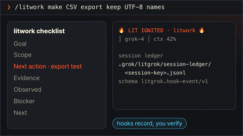</td>
<td><code>litwork</code> <code>/litwork &lt;goal&gt;</code></td>
<td>작업을 범위가 정해진 체크리스트로 바꿉니다. LitGrok 훅이 단계마다 로컬 기록을 남깁니다.</td>
</tr>
<tr>
<td>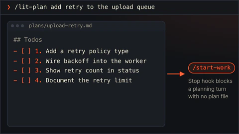</td>
<td><code>lit-plan</code> <code>/lit-plan &lt;objective&gt;</code></td>
<td><code>/start-work</code>가 실행할 번호 붙은 작업 목록을 파일로 만듭니다. 코드는 아직 건드리지 않습니다.</td>
</tr>
<tr>
<td>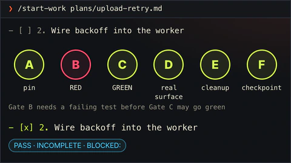</td>
<td><code>start-work</code> <code>/start-work &lt;plan path&gt;</code></td>
<td>계획을 한 줄씩 실행합니다. A부터 F까지 관문을 모두 통과해야 체크됩니다.</td>
</tr>
<tr>
<td>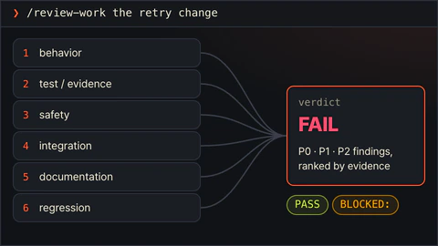</td>
<td><code>review-work</code> <code>/review-work &lt;target&gt;</code></td>
<td>작업 전에는 계획을, 작업 후에는 결과를 검토하며, 어느 쪽인지는 있는 자료로 고릅니다. 읽기 전용 갈래가 찾은 문제를 증거 순으로 정리합니다.</td>
</tr>
<tr>
<td>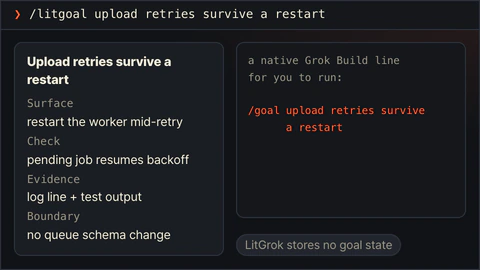</td>
<td><code>litgoal</code> <code>/litgoal &lt;request&gt;</code></td>
<td>확인 가능한 도착 지점 하나를 정해 직접 실행할 <code>/goal</code> 한 줄을 건네고, <code>litwork</code>와 <code>start-work</code>가 그곳을 향해 달립니다. LitGrok은 목표 상태를 저장하지 않습니다.</td>
</tr>
<tr>
<td>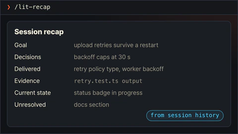</td>
<td><code>lit-recap</code> <code>/lit-recap</code></td>
<td>Grok Build 세션 기록을 바탕으로 증거가 붙은 짧은 요약을 만듭니다.</td>
</tr>
<tr>
<td>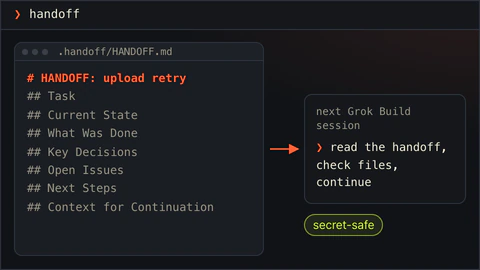</td>
<td><code>lit-handoff</code> <code>handoff</code> · <code>/lit-handoff</code></td>
<td><code>handoff</code>라고 치면 다음 세션이 읽을 인수인계 파일을 만듭니다. 비밀 값은 넣지 않습니다.</td>
</tr>
<tr>
<td></td>
<td><code>lit-hijack</code> <code>/lit-hijack &lt;urls or files&gt;</code></td>
<td>남의 글에 공개된 기법을 내 스킬로 가져옵니다. 출처를 기록하고 라이선스를 검사한 뒤 실제 화면에서 동등함을 증명합니다.</td>
</tr>
<tr>
<td>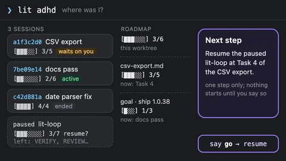</td>
<td><code>lit-adhd</code> <code>lit adhd</code> · <code>lit rewind</code></td>
<td>"어디까지 했지"에 답합니다. 세션별 카드, 로드맵 게이지, 추천 다음 단계 하나. 읽기 전용.</td>
</tr>
<tr>
<td>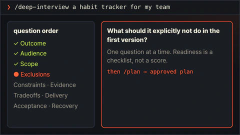</td>
<td><code>deep-interview</code> <code>/deep-interview &lt;request&gt;</code></td>
<td>정해진 순서로 한 번에 한 질문씩 물어, 계획을 세울 수 있을 만큼 요청을 분명히 합니다.</td>
</tr>
<tr>
<td>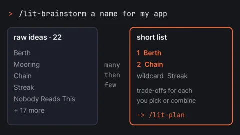</td>
<td><code>lit-brainstorm</code> <code>/lit-brainstorm &lt;topic&gt;</code></td>
<td>열린 질문을 여러 선택지로 펼친 뒤 묶고 점수를 매겨, 고를 수 있는 짧은 후보 목록으로 마무리합니다. 만들지는 않습니다.</td>
</tr>
<tr>
<td>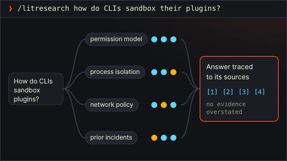</td>
<td><code>litresearch</code> <code>/litresearch &lt;question&gt;</code></td>
<td>범위를 정한 조사입니다. 모든 주장에 출처를 붙이고, 증거보다 크게 말하지 않습니다.</td>
</tr>
<tr>
<td>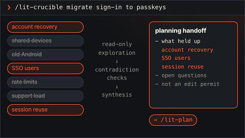</td>
<td><code>lit-crucible</code> <code>/lit-crucible &lt;approach&gt;</code></td>
<td>계획 전에 요구사항을 반박해 봅니다. 반박을 견딘 위험만 계획으로 넘어갑니다.</td>
</tr>
<tr>
<td>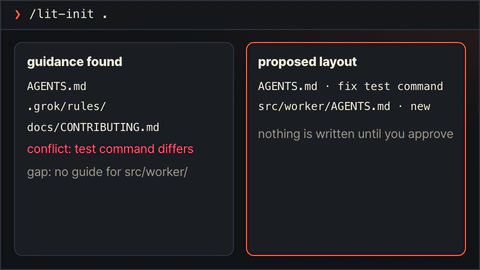</td>
<td><code>lit-init</code> <code>/lit-init &lt;path&gt;</code></td>
<td>있는 안내 문서를 찾아 충돌과 빈 곳을 알려주고 배치를 제안합니다. 승인 전에는 아무것도 쓰지 않습니다.</td>
</tr>
<tr>
<td>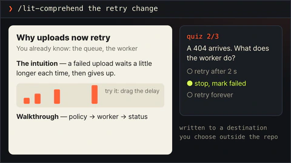</td>
<td><code>lit-comprehend</code> <code>/lit-comprehend &lt;scope&gt;</code></td>
<td>에이전트가 쓴 작업을 이해하도록 돕는 설명 페이지입니다. 직관, 흐름 설명, 짧은 퀴즈 순서입니다.</td>
</tr>
<tr>
<td>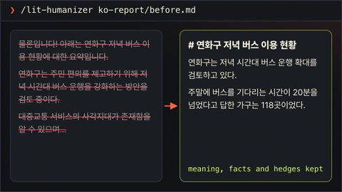</td>
<td><code>lit-humanizer</code> <code>/lit-humanizer &lt;draft or file&gt;</code></td>
<td>딱딱한 AI 문장을 한국어나 영어로 다시 씁니다. 사실과 단서는 남기고 군더더기는 뺍니다.</td>
</tr>
<tr>
<td>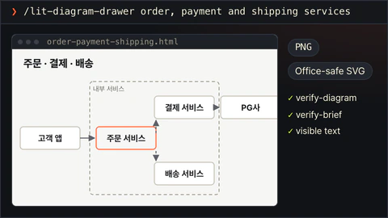</td>
<td><code>lit-diagram-drawer</code> <code>/lit-diagram-drawer &lt;brief&gt;</code></td>
<td>슬라이드와 문서에 넣을 다이어그램을 편집 가능한 형태로 그리고, 검사한 뒤 PNG와 SVG로 내보냅니다.</td>
</tr>
<tr>
<td>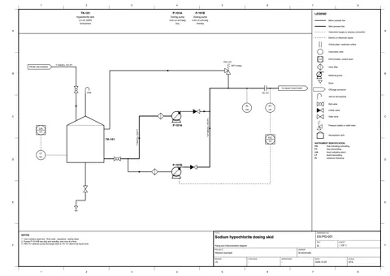</td>
<td><code>lit-schematic</code> <code>/lit-schematic &lt;equipment or apparatus brief&gt;</code></td>
<td>P&ID, 설비 배치도, 논문용 장치도, 아이소메트릭 단면도를 검사된 편집 가능 SVG와 PDF, 600 dpi PNG로 만듭니다.</td>
</tr>
<tr>
<td>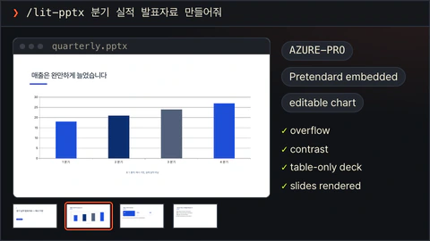</td>
<td><code>lit-pptx</code> <code>/lit-pptx &lt;presentation request&gt;</code></td>
<td>편집 가능한 PowerPoint 발표자료와 원고 Markdown을 만듭니다. 청중에 맞춰 여덟 가지 디자인 방향 가운데 하나를 고르고, 다른 두 방향도 함께 알려 줍니다. 파일에 품질 검사를 돌리며 LibreOffice가 있으면 슬라이드도 확인합니다.</td>
</tr>
<tr>
<td>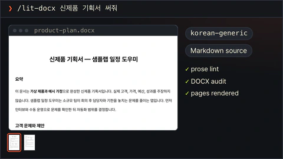</td>
<td><code>lit-docx</code> <code>/lit-docx &lt;document request&gt;</code></td>
<td>서식을 갖춘 Word 문서와 원고 Markdown을 만듭니다. 문서에 맞춰 절제된 여섯 가지 방향 가운데 하나를 고르거나, 지정한 학술지 서식을 씁니다. 문체 검사와 페이지 단위 검사를 돌리며 LibreOffice가 있으면 페이지도 확인합니다.</td>
</tr>
<tr>
<td>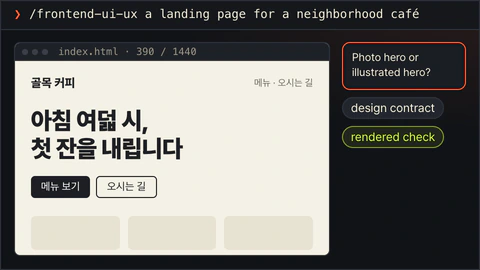</td>
<td><code>frontend-ui-ux</code> <code>/frontend-ui-ux &lt;surface and outcome&gt;</code></td>
<td>실제로 동작하는 화면을 만들고, 프로브로 일곱 가지 보기를 렌더링합니다. 네 가지 폭, 다크 모드, 모션 줄이기, 200% 확대입니다.</td>
</tr>
<tr>
<td>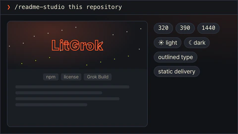</td>
<td><code>readme-studio</code> <code>/readme-studio &lt;repository and outcome&gt;</code></td>
<td>사실에 맞는 README와 커버, 윤곽선 글자, 로컬 모션을 만듭니다.</td>
</tr>
<tr>
<td>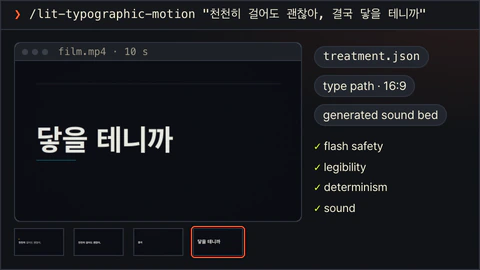</td>
<td><code>lit-typographic-motion</code> <code>/lit-typographic-motion &lt;request&gt;</code></td>
<td>트리트먼트로 짧은 영상을 완성합니다. LitGrok의 타입 엔진이나 무대 캡처로 렌더링하고, 품질 검사를 거칩니다. 커버 모드는 소리 없이 끊김 없이 도는 README 커버 루프를 만들고, 디코딩한 파일로 검사합니다.</td>
</tr>
<tr>
<td>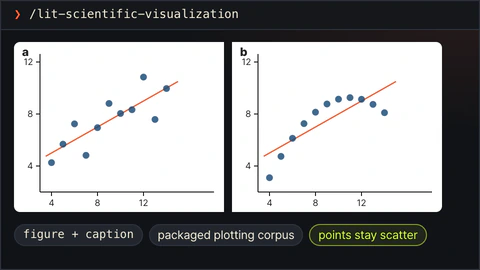</td>
<td><code>lit-scientific-visualization</code> <code>/lit-scientific-visualization</code></td>
<td>검증된 데이터로 논문용 그림과 캡션을 만듭니다. 그래프 종류는 데이터 성격에 맞춰 고릅니다.</td>
</tr>
<tr>
<td>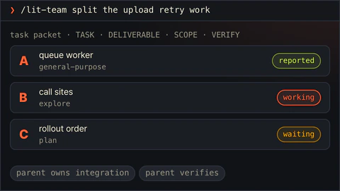</td>
<td><code>lit-team</code> <code>/lit-team</code></td>
<td>작업을 범위가 정해진 묶음으로 나눠 Grok Build 기본 서브에이전트에 맡깁니다. 통합과 검증은 부모가 맡습니다.</td>
</tr>
<tr>
<td>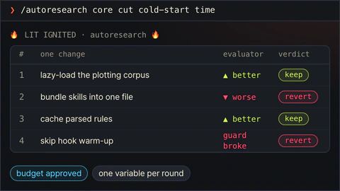</td>
<td><code>autoresearch</code> <code>/autoresearch &lt;mode&gt; &lt;objective&gt;</code></td>
<td>범위를 정한 연구 작업입니다. 서브에이전트가 조사하고, 증거 관문을 거쳐, 하나로 종합합니다.</td>
</tr>
<tr>
<td>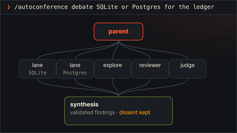</td>
<td><code>autoconference</code> <code>/autoconference &lt;mode&gt; &lt;topic&gt;</code></td>
<td>서브에이전트들이 증거를 두고 논의하고, 종합에는 반대 의견도 남깁니다.</td>
</tr>
<tr>
<td>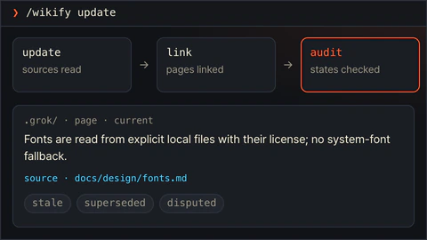</td>
<td><code>wikify</code> <code>/wikify &lt;mode&gt;</code></td>
<td>출처가 붙은 프로젝트 지식 지도를 <code>.grok/</code> 아래에 둡니다.</td>
</tr>
<tr>
<td>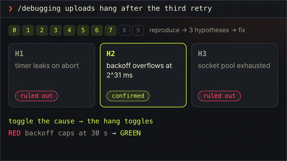</td>
<td><code>debugging</code> <code>/debugging &lt;symptom&gt;</code></td>
<td>버그를 재현하고, 가설을 세 개 이상 세워 확인한 뒤, 확인된 원인만 고칩니다.</td>
</tr>
<tr>
<td>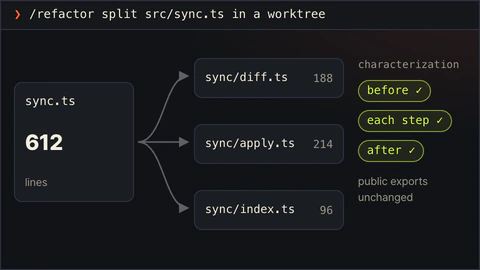</td>
<td><code>refactor</code> <code>/refactor &lt;target&gt;</code></td>
<td>분리된 작업 트리에서 코드 구조를 바꿉니다. 동작은 테스트로 고정합니다.</td>
</tr>
<tr>
<td>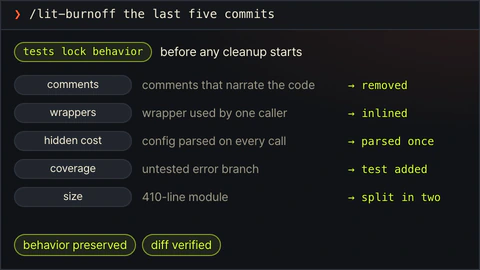</td>
<td><code>lit-burnoff</code> <code>/lit-burnoff &lt;scope&gt;</code></td>
<td>테스트로 동작을 먼저 묶어 두고, 변경분에 붙은 AI식 군더더기를 걷어냅니다.</td>
</tr>
<tr>
<td>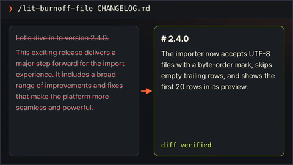</td>
<td><code>lit-burnoff-file</code> <code>/lit-burnoff-file &lt;path&gt;</code></td>
<td>파일 하나에서 생성된 문장 습관을 걷어내고 변경분을 확인합니다.</td>
</tr>
<tr>
<td>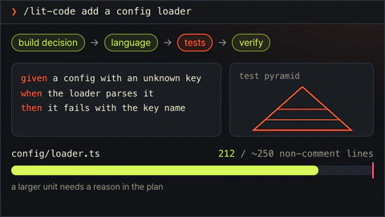</td>
<td><code>lit-code</code> <code>/lit-code &lt;task&gt;</code></td>
<td>엄격한 구현 규칙입니다. 테스트 먼저, 경계에서 타입 확인, 작은 파일.</td>
</tr>
<tr>
<td>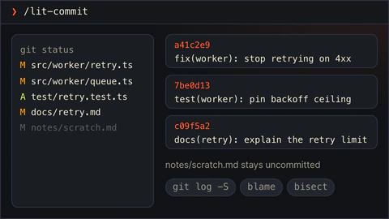</td>
<td><code>lit-commit</code> <code>/lit-commit &lt;operation&gt;</code></td>
<td>변경을 저장소 스타일에 맞는 작은 커밋으로 나눕니다. 관계없는 작업은 건드리지 않습니다.</td>
</tr>
<tr>
<td>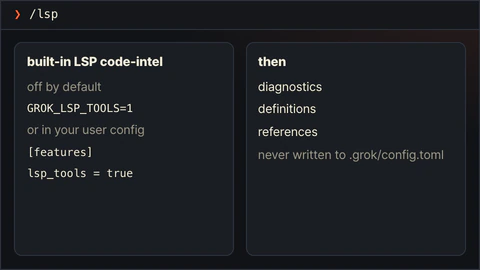</td>
<td><code>lsp</code> <code>/lsp</code></td>
<td>기본으로 꺼져 있는 Grok Build 내장 LSP 코드 분석 도구를 켜고 씁니다.</td>
</tr>
<tr>
<td>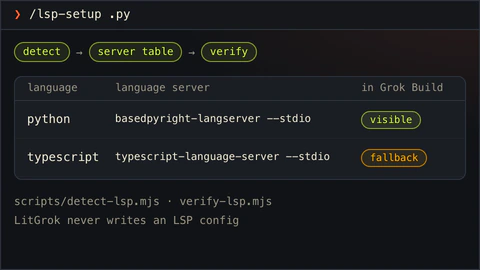</td>
<td><code>lsp-setup</code> <code>/lsp-setup &lt;path or extension&gt;</code></td>
<td>Grok Build가 볼 수 있는 언어 서버를 확인하고, 진단이 안 보일 때 대안을 알려줍니다.</td>
</tr>
<tr>
<td>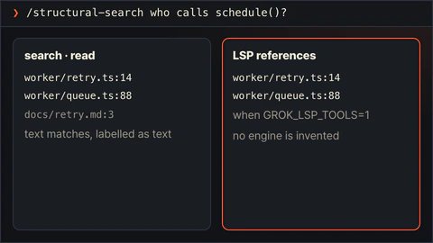</td>
<td><code>structural-search</code> <code>/structural-search &lt;pattern&gt;</code></td>
<td>검색, 읽기, 선택적 LSP 참조로 코드 구조를 추적합니다. 없는 엔진을 지어내지 않습니다.</td>
</tr>
<tr>
<td>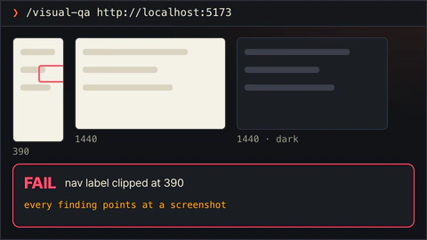</td>
<td><code>visual-qa</code> <code>/visual-qa &lt;target&gt;</code></td>
<td>렌더링된 화면을 스크린샷 근거로 검토합니다.</td>
</tr>
<tr>
<td>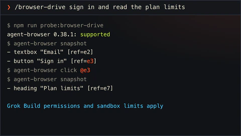</td>
<td><code>browser-drive</code> <code>/browser-drive &lt;url&gt;</code></td>
<td>브라우저 드라이버를 먼저 확인한 뒤 실제 페이지를 조작합니다. 드라이버가 없으면 그렇다고 말합니다.</td>
</tr>
<tr>
<td>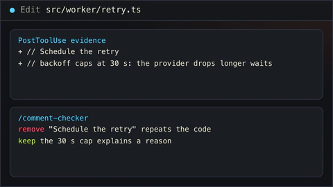</td>
<td><code>comment-checker</code> <code>/comment-checker &lt;path&gt;</code></td>
<td>수정으로 추가된 주석을 검토합니다. 이유를 설명하는 주석은 남기고, 코드를 되풀이하는 주석은 뺍니다.</td>
</tr>
<tr>
<td>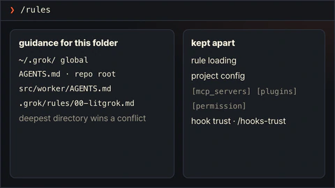</td>
<td><code>rules</code> <code>/rules</code></td>
<td>이 폴더에서 Grok Build가 어떤 안내를 어떤 순서로 읽는지, 훅을 신뢰하는지 설명합니다.</td>
</tr>
<tr>
<td>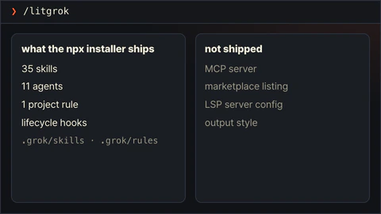</td>
<td><code>litgrok</code> <code>/litgrok</code></td>
<td>LitGrok 패키지가 무엇을 설치하고 무엇을 설치하지 않는지 설명합니다.</td>
</tr>
</table>
